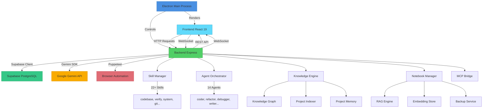
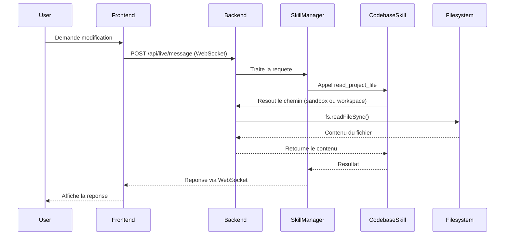

# Architecture Jarvis OS

## Sommaire

- [Vue d'ensemble](#-vue-densemble)
- [Diagramme d'architecture](#-diagramme-darchitecture)
- [Frontend](#-frontend)
- [Backend](#-backend)
- [Base de donnees](#-base-de-donnees)
- [Flux entre l'application et l'agent Leanna](#-flux-entre-lapplication-et-lagent-leanna)
- [Communication inter-processus](#-communication-inter-processus)

---

## Vue d'ensemble

Jarvis OS est une **application desktop monolithique** basee sur Electron, avec une architecture client-serveur interne :

- **Frontend** : Application React 19 rendue dans un navigateur Electron
- **Backend** : Serveur Express + WebSocket incluant Vite en middleware (dev)
- **Base de donnees** : Supabase (PostgreSQL) pour la persistance, fichiers JSON locaux pour la configuration
- **IA** : Integration avec Google Gemini via @google/genai pour toutes les capacites d'IA

Le point d'entree principal est `server.ts` qui :
1. Demarre le serveur Express avec tous les routeurs REST
2. Integre Vite en middleware pour le developpement
3. Initialise les WebSockets pour la communication temps reel
4. Charge tous les modules (agents, skills, knowledge, notebooks)
5. Demarre les services de fond (indexation, backup, watchers)

---

## Diagramme d'architecture



---

## Frontend

### Structure

```
src/
├── main.tsx                    # Point d'entree React
├── components/                # 80+ composants React
│   ├── ide/                    # Composants IDE
│   │   ├── FileExplorer.tsx    # Arbre des fichiers
│   │   ├── EditorTabs.tsx      # Onglets editeur Monaco
│   │   ├── ChatPanel.tsx       # Interface chat IA
│   │   └── ...
│   ├── notebooks/              # Module NotebookLM
│   │   ├── NotebookChat.tsx    # Chat avec sources
│   │   ├── SourcePanel.tsx     # Gestion des sources
│   │   ├── NotesPanel.tsx      # Notes et canvas
│   │   └── GeneratePanel.tsx   # Generation de contenu
│   ├── panels/                 # Panneaux lateraux
│   │   ├── AgentPanel.tsx      # Surveillance agents
│   │   ├── SandboxPanel.tsx    # Gestion sandbox
│   │   └── ...
│   └── ui/                    # Composants UI
├── context/                   # Contextes React
│   ├── LiveAPIContext.tsx     # WebSocket IA
│   ├── UserProfileContext.tsx # Preferences utilisateur
│   └── ThemeContext.tsx       # Theme et couleurs
├── hooks/                     # Custom hooks
│   ├── useLiveAPI.ts          # Communication WebSocket
│   ├── useFileSystem.ts       # Gestion fichiers
│   └── ...
├── services/                  # Clients API
│   ├── ideApi.ts              # Client pour /api/ide/*
│   └── supabase.ts           # Client Supabase
└── views/                     # Vues principales
    ├── IdeView.tsx           # Vue IDE complete
    ├── NotebooksView.tsx      # Vue Notebooks
    └── ...
```

### Flux de donnees

1. **Monaco Editor** : Gestion du code avec syntax highlighting, autocompletion
2. **React Router 7** : Navigation entre les differentes vues
3. **Custom Hooks** : Logique metier partagee (useLiveAPI, useFileSystem)
4. **Context API** : Etat global (theme, profile, WebSocket)
5. **Fetch Interceptor** : Injection automatique du token d'authentification

### Patterns observes

- **Component composition** : Composants petits et specialises
- **Custom hooks** : Logique réutilisable extraite des composants
- **TypeScript strict** : Typage fort sur toutes les props et returns
- **CSS-in-JS** : Styles inline avec Tailwind CSS 4
- **Lazy loading** : react.lazy pour les composants lourds (vues)
- **Error boundaries** : Gestion des erreurs au niveau des composants
- **Circuit breaker** : Protection contre les cascades d'erreurs backend

---

## Backend

### Structure

```
server/
├── server.ts                    # Point d'entree principal
├── server-bootstrap.ts          # Chargement env + validation
├── agents/                     # Systeme multi-agents
│   ├── AgentOrchestrator.ts    # Orchestration des agents
│   ├── AgentPersistence.ts    # Persistance Supabase
│   ├── AgentMessageBus.ts      # Communication inter-agents
│   └── AutonomousLoop.ts       # Boucle autonome
├── autonomy/                   # Autonomie
│   ├── Supervisor.ts           # Superviseur
│   └── SmartSkills.ts          # Skills intelligentes
├── knowledge/                  # Moteur de connaissances
│   ├── KnowledgeGraph.ts       # Graphe de connaissances
│   ├── ProjectIndexer.ts      # Indexation automatique
│   ├── SemanticSearch.ts       # Recherche semantique
│   └── FileWatcher.ts          # Surveillance fichiers
├── mcp/                        # Model Context Protocol
│   ├── McpBridge.ts            # Bridge MCP
│   └── McpClient.ts           # Client MCP
├── mission/                    # Missions autonomes
│   ├── Mission.ts              # Definition des missions
│   ├── Planner.ts             # Planificateur
│   └── Executor.ts            # Executeur
├── notebooks/                  # Notebooks RAG
│   ├── NotebookManager.ts     # Gestion notebooks
│   ├── RAGEngine.ts           # Recherche hybride
│   ├── GroundedChat.ts        # Chat avec citations
│   └── ProcessingQueue.ts      # Queue de traitement
├── prompts/                    # Instructions systeme
│   ├── systemInstruction.ts   # Prompt principal
│   └── promptConfig.ts        # Configuration
├── routes/                     # 30+ routeurs REST
│   ├── ide.ts                 # Operations fichiers
│   ├── notebooks/             # Routes notebooks
│   │   ├── chatRouter.ts      # Chat
│   │   ├── sourcesRouter.ts   # Sources
│   │   └── ...
│   ├── agents.ts             # Agents
│   ├── knowledge/             # Knowledge
│   │   ├── knowledgeRouter.ts
│   │   ├── memoryRouter.ts
│   │   └── understandingRouter.ts
│   └── ...
├── runtime/                    # Runtime V2
│   ├── AgentRuntime.ts        # Execution agents
│   ├── ToolRegistry.ts        # Registre outils
│   └── WorkflowEngine.ts     # Moteur workflows
├── skills/                     # 22+ skills IA
│   ├── SkillManager.ts        # Gestionnaire central
│   ├── codebase.ts           # Acces code
│   ├── verify.ts             # Verification
│   ├── system.ts             # Systeme
│   └── ...
└── utils/                      # Utilitaires
    ├── sandbox.ts            # Gestion sandbox
    ├── checkpoint.ts         # Checkpoints Git
    ├── crypto.ts             # Chiffrement AES-256-GCM
    └── logger.ts             # Journalisation
```

### Modules principaux

#### 1. Server Core (`server.ts`)
- Creation du serveur Express
- Integration Vite en middleware (dev)
- Configuration des WebSockets (/live, /sandbox-watch)
- Montage de tous les routeurs
- Gestion du graceful shutdown
- Rate limiting global

#### 2. Skill Manager (`server/skills/SkillManager.ts`)
- **Responsabilite** : Gestion centralisee de toutes les skills IA
- **22+ skills** : codebase, verify, system, git, github, automation, browser, knowledge, memory, agents, reasoning, richDocument, workflow, time, weather, guidelines, history, list, project, aiStudioDirectives, customSkills, documentKnowledge, documentLinker
- **Critical skills** : Chargees au demarrage (codebase, verify, system, etc.)
- **Lazy loading** : Chargement a la demande pour les skills moins utilisees
- **Tool relevance classifier** : Selection intelligente des skills basee sur le contexte

#### 3. Agent Orchestrator (`server/agents/AgentOrchestrator.ts`)
- **14 agents specialises** : coder, refactor, debugger, reviewer, tester, security, architect, writer, formatter, researcher, proofreader, translator, summarizer, planner
- **Delegation** : L'IA peut deleguer des taches a des agents specialises
- **Persistence** : Sauvegarde des etats dans Supabase
- **Event broadcasting** : Diffusion des evenements via WebSocket

#### 4. Knowledge Engine (`server/knowledge/`)
- **KnowledgeGraph** : Graphe des entites et relations dans le code
- **ProjectIndexer** : Indexation automatique du workspace
- **SemanticSearch** : Recherche basee sur les embeddings
- **ProjectMemory** : Memoire long terme du projet
- **DependencyGraph** : Graphe des dependances entre fichiers
- **ImpactAnalyzer** : Analyse d'impact avant modification

#### 5. Notebooks RAG (`server/notebooks/`)
- **NotebookManager** : CRUD notebooks, sources, notes
- **SourceIngester** : Extraction de texte (PDF, DOCX, HTML, images, etc.)
- **EmbeddingStore** : Vectorisation avec Gemini + stockage LRU
- **RAGEngine** : Recherche hybride (embeddings + TF-IDF + RRF)
- **GroundedChat** : Chat avec citations et re-ranking
- **ContentGenerator** : Generation de contenu (resumes, FAQ, guides)
- **BackupService** : Sauvegarde automatique incrementale
- **ProcessingQueue** : File d'attente async pour l'ingestion
- **ResponseCache** : Cache intelligent avec invalidation

### Patterns d'architecture Backend

#### 1. **Modular Router Pattern**
```typescript
// server/routes/ide.ts
const router = Router();
router.get('/tree', ...);
router.get('/file', ...);
router.post('/file', ...);
// ...
export default router;
```
- Chaque domaine a son propre routeur
- Montage dans server.ts avec prefixe /api
- Separation claire des responsabilites

#### 2. **Skill Pattern**
```typescript
// server/skills/base.ts
export abstract class Skill {
  abstract readonly name: string;
  abstract readonly description: string;
  abstract execute(args: any): Promise<any>;
  // ...
}
```
- Chaque skill etend la classe base
- Declaration des outils avec schema Zod
- Validation automatique des arguments

#### 3. **Agent Pattern**
```typescript
// server/agents/types.ts
export interface Agent {
  id: string;
  role: AgentRole;
  status: AgentStatus;
  currentTask?: AgentTask;
  // ...
}
```
- Agents specialises avec roles predefinis
- Communication via message bus
- Persistence des etats

#### 4. **Service Pattern**
- Services autonomes (BackupService, ProcessingQueue)
- Demarrage automatique au startup
- Gestion de leur propre etat
- Broadcast d'evenements via WebSocket

---

## Base de donnees

### Supabase PostgreSQL

Jarvis OS utilise **Supabase** comme base de donnees principale pour :

1. **Persistance des agents** (`agent_tasks`, `agent_orchestrations`, `agent_messages`)
2. **Memories long terme** (`memories`)
3. **Taches planifiees** (`scheduled_tasks`)
4. **Workflows** (`workflows`)
5. **Notebooks** (`notebooks`, `notebook_sources`, `notebook_notes`)
6. **Conversations** (`conversations`, `conversation_messages`)
7. **MCP Servers** (`mcp_servers`)

### Stockage local

- **Configuration** : `.env`, `.env.local`, `.gemini-keys.json` (chiffre)
- **Projet** : `.jarvis-profile.json`, `.jarvis/lastProject.json`
- **Knowledge** : `ProjectKnowledge.json`, `ProjectMemory.json`
- **Sandbox** : `.jarvis/sandbox/` (fichiers temporaires)
- **Backup** : `.jarvis/notebooks/backups/` (sauvegardes incrementales)

### Schemas principaux

Voir [DB_SCHEMA.md](DB_SCHEMA.md) pour les details complets des tables.

---

## Flux entre l'application et l'agent Leanna

### Comment Leanna accede au code source



### Flux detaille de modification

1. **Lecture** : `read_project_file` ou `read_file_outline` pour comprendre la structure
2. **Analyse** : `verify_file` pour detecter les problemes potentiels
3. **Modification** : `modify_project_file`, `patch_project_file`, ou `write_project_file`
4. **Validation** : `verify_syntax` et `verify_typecheck` avant sauvegarde
5. **Checkpoint** : Snapshot Git automatique via `checkpoint.ts`
6. **Synchronisation** : Copie du sandbox vers le workspace avec validation

### Securite des acces

- **Sandbox isolation** : Toutes les modifications passent par `.jarvis/sandbox/`
- **Validation** : Vérification TypeScript avant merge
- **Checkpoints** : Git commit automatique avant modification
- **Confirmation** : Dialogue de confirmation pour les fichiers critiques
- **Audit** : Journalisation de toutes les operations dans Supabase

### Communication temps reel

```
WebSocket Endpoints:
- /live              # Communication principale IA <-> Frontend
- /sandbox-watch    # Surveillance des fichiers sandbox
- /mcp              # Communication MCP (optionnel)
```

#### Message Types (Live API)

```typescript
// Frontend -> Backend
interface ClientMessage {
  type: 'text' | 'audio' | 'video_frame' | 'action';
  text?: string;
  audio?: Blob;
  action?: {
    type: 'open-file' | 'create-file' | 'browser-navigate' | ...;
    payload: any;
  };
}

// Backend -> Frontend
interface ServerMessage {
  type: 'response' | 'progress' | 'error' | 'event';
  response?: string;
  progress?: number;
  error?: string;
  event?: {
    type: 'agent_started' | 'agent_completed' | 'file_modified' | ...;
    data: any;
  };
}
```

---

## Communication inter-processus

### Frontend <-> Backend

#### REST API (HTTP)
- **Base URL** : `/api/`
- **Authentification** : Header `x-jarvis-token` ou cookie `jarvis_token`
- **Rate Limiting** : Limiteurs dedies par type doperation
- **Format** : JSON pour les requetes et reponses

#### WebSocket (Temps reel)
- **Library** : `ws` (Node.js)
- **Paths** : `/live`, `/sandbox-watch`
- **Authentification** : Query param `token` ou cookie
- **Protocole** : JSON messages avec `type` discriminant

### Backend <-> External Services

#### Google Gemini API
- **Library** : `@google/genai` (v2.4.0)
- **Key Pool** : Rotation automatique des cles API
- **Retry** : Strategie exponentielle sur les erreurs 429
- **Models** : `gemini-2.0-flash`, `gemini-embedding-001`

#### Supabase
- **Library** : `@supabase/supabase-js` (v2.110.2)
- **Authentification** : Service Role Key (backend only)
- **RLS** : Row Level Security active sur les tables
- **Realtime** : Abonnements aux changements

#### OpenRouter (Optionnel)
- **Usage** : Modeles alternatifs (GPT-4o, Claude, etc.)
- **Configuration** : Via variables d'environnement

### Backend <-> Filesystem

#### Sandbox Mode
- **Root** : `.jarvis/sandbox/`
- **Activation** : Automatique quand un projet est selectionne
- **Sync** : Manual via confirmation utilisateur
- **Cleanup** : Nettoyage automatique des fichiers temporaires

#### Self-Root
- **Definition** : Racine du projet que Jarvis peut modifier
- **Default** : Configure via `JARVIS_DEFAULT_WORKSPACE`
- **Persistence** : Stocke dans `.jarvis/lastProject.json`

---

## Resume des flux principaux

```
1. Demarrage Application
   ┌─────────────┐     ┌─────────────┐     ┌─────────────┐
   │  Electron   │────▶│  server.ts  │────▶│   Vite      │
   │   Main     │     │  Express   │     │ Middleware  │
   └─────────────┘     └─────────────┘     └─────────────┘
                         │
                         ▼
   ┌─────────────────────────────────────────────────┐
   │           Initialisation Services                 │
   │  ┌─────────┐ ┌─────────┐ ┌─────────┐ ┌─────────┐ │
   │  │ Skills  │ │ Agents  │ │Knowledge│ │Notebooks│ │
   │  └─────────┘ └─────────┘ └─────────┘ └─────────┘ │
   └─────────────────────────────────────────────────┘

2. Interaction Utilisateur
   ┌─────────────┐
   │   User      │
   └──────┬──────┘
          │
   ┌──────▼──────┐     ┌─────────────┐
   │   Frontend   │◀────┤   Backend   │
   │    React     │     │  Express    │
   └──────┬──────┘     └──────┬──────┘
          │                     │
          │ REST API            │
          │ WebSocket           │
          ▼                     ▼
   ┌─────────────────────────────────────────┐
   │         Traitement Requete               │
   │  ┌─────────────────────────────────────┐│
   │  │ SkillManager → CodebaseSkill →      ││
   │  │ read_project_file → Filesystem       ││
   │  └─────────────────────────────────────┘│
   └─────────────────────────────────────────┘
          │
          ▼
   ┌─────────────┐
   │  Response    │
   │ (JSON/Stream)│
   └─────────────┘

3. Modification de Fichier
   ┌─────────────┐     ┌─────────────┐     ┌─────────────┐
   │   Request    │────▶│  Sandbox    │────▶│ Validation  │
   │  (modify)    │     │  Mode       │     │ TypeScript   │
   └─────────────┘     └─────────────┘     └─────────────┘
                          │
                          ▼
                   ┌─────────────┐
                   │ Checkpoint  │
                   │ (Git)       │
                   └──────┬──────┘
                          │
   ┌─────────────┐     ┌──▼──────┐
   │ Confirmation │◀────┤ Sync     │
   │ User Dialog  │     │ Workspace│
   └─────────────┘     └──────────┘
```

---

## Decisions architecturales clés

### 1. **Monolithique vs Microservices**
- **Choix** : Architecture monolithique
- **Raison** : Simplicite de deployement, cohesion des fonctionnalites, performance locale
- **Exception** : MCP Bridge permet l'integration de services externes

### 2. **Frontend Framework**
- **Choix** : React 19 avec TypeScript strict
- **Raison** : Ecosysteme mature, typage fort, composants reutilisables
- **Alternatives considerees** : Vue, Svelte, Solid

### 3. **Backend Framework**
- **Choix** : Express 4 avec TypeScript
- **Raison** : Simplicite, middleware flexible, large ecosysteme
- **Alternatives considerees** : Fastify, NestJS

### 4. **Base de donnees**
- **Choix** : Supabase (PostgreSQL)
- **Raison** : Hosting manage, API moderne, Realtime, RLS
- **Alternatives considerees** : Firebase, MongoDB, SQLite

### 5. **Communication Temps Reel**
- **Choix** : WebSocket natif (ws library)
- **Raison** : Faible latence, bidirectionnel, support binaire
- **Alternatives considerees** : Socket.io, SSE

### 6. **Integration IA**
- **Choix** : @google/genai SDK
- **Raison** : Official SDK, support complet, bonnes performances
- **Pool de cles** : Rotation automatique pour eviter les limites de taux

### 7. **Editeur de Code**
- **Choix** : Monaco Editor
- **Raison** : VS Code quality, extensions, langue support
- **Integration** : via @monaco-editor/react

---

## Points d'extension

### Ajouter une nouvelle skill
1. Creer un fichier dans `server/skills/` avec la classe etendant `Skill`
2. Importer dans `server/skills/SkillManager.ts`
3. Ajouter les keywords dans `TOOL_KEYWORDS`
4. Ajouter au tableau `CRITICAL_SKILLS` si necessaire

### Ajouter un nouvel agent
1. Definir le role dans `server/agents/roles.ts`
2. Creer le handler dans `server/agents/`
3. Enregistrer dans `AgentOrchestrator`
4. Ajouter les prompts specialises

### Ajouter un endpoint API
1. Creer un routeur dans `server/routes/`
2. Definir les routes avec Express Router
3. Monter dans `server.ts` avec le prefixe approprié
4. Ajouter l'authentification si necessaire

### Ajouter une table Supabase
1. Creer la migration SQL
2. Appliquer via Supabase Dashboard ou CLI
3. Creer l'interface TypeScript
4. Creer le client dans `server/utils/` ou directement dans le service
