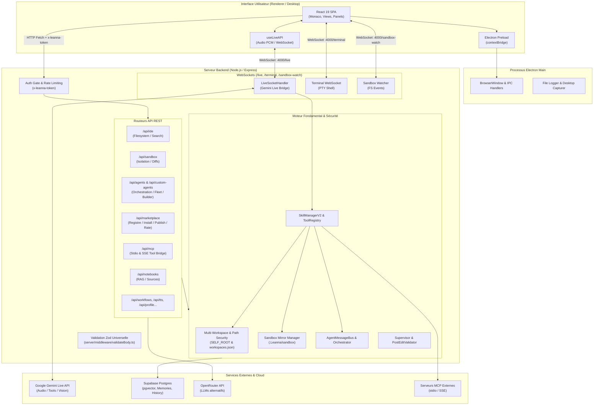
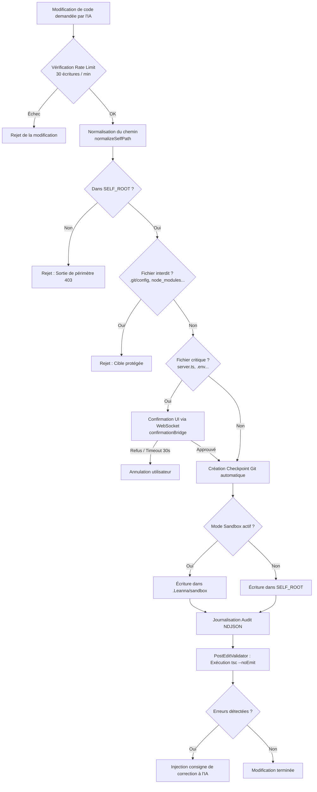

# Architecture système

Le système **Leanna** repose sur une architecture hybride **Desktop / Web** orchestrée autour d'un processus central Node.js / Express intégrant un serveur de développement Vite (en mode middleware), un runtime d'outils pour l'IA, une gestion de bac à sable local (Sandbox) et une connexion temps réel WebSocket avec Google Gemini Live API.



---

## Vue d'ensemble

Leanna fonctionne selon les principes architecturaux suivants :

1. **Mode Multi-Workspace & Périmètre Self-Root** : L'IDE gère dynamiquement plusieurs dépôts externes tout en confinant rigoureusement toutes les compétences IA, explorateurs et opérations au projet actif (`SELF_ROOT`). Les dépôts sont persistés dans `.Leanna/workspaces.json` et les chemins candidats sont pré-validés (rejet des racines disques et dossiers système).
2. **Isolation par Sandbox** : Par défaut, toute écriture effectuée par l'utilisateur ou par l'IA est appliquée dans un dossier miroir `.Leanna/sandbox` du workspace actif. Les modifications ne sont reportées dans le projet principal qu'après validation TypeScript (`tsc --noEmit`) et approbation explicite (`sync` ou `accept-file`).
3. **Dialogue Multimodal Temps Réel** : L'interface échange des flux audio PCM 16kHz et des captures vidéo/écran directement avec l'API Gemini Live. Lorsque l'IA décide d'exécuter une action, elle invoque des outils (`functionDeclarations`) interceptés côté backend par le `LiveSocketHandler`.
4. **Lecture & Indexation des documents PDF** : Les fichiers PDF du workspace sont détectés, lus via `pdf-parse`, indexés dans le `WorkspaceIndexer` et exposés à l’IDE avec un aperçu document et un texte extrait exploitable par le moteur de connaissances.
5. **Coexistence Runtime V1 & V2** : Le système migre progressivement d'un `SkillManager` historique vers une architecture découplée `ToolRegistry` + `RuntimeV2` tout en conservant une compatibilité ascendante complète.

---

## Frontend

L'interface utilisateur est développée en **React 19** avec **TypeScript** et stylisée via **TailwindCSS v4** et **Vanilla CSS** (`src/index.css`, `src/DESIGN_TOKENS.md`).

### Architecture Frontend
* **Point d'entrée** (`src/main.tsx`) : Configure le routage avec React Router v7, le thème (clair/sombre/accent), et applique un intercepteur global sur `window.fetch` avec :
  - Injection automatique du jeton d'authentification `x-leanna-token` depuis `localStorage`.
  - Déduplication des requêtes `GET` idempotentes en vol.
  - **Circuit Breaker** réseau : bloque temporairement les requêtes pendant 8 secondes après 12 échecs consécutifs pour éviter les erreurs `ENOBUFS` / `ECONNREFUSED`.
* **Gestion d'état** : Stores locaux légers, contextes React dédiés (`UserProfileContext`, `LiveAPIContext`, `ScreenShareContext`) et hooks spécialisés (`useLiveAPI`, `useTerminal`, `useSandboxDiff`).
* **Composants majeurs** :
  - `IdeView` (`src/views/IdeView.tsx`) : Environnement de travail avec Monaco Editor, arborescence virtuelle, onglets et panneaux latéraux rétractables.
  - `UnifiedSidebar` : Barre latérale unique supportant les contextes `global` et `ide`.
  - `Panels` (`src/components/panels/`) : Panneaux spécialisés pour le Terminal, le Navigateur webview, les Métriques d'agents, la Flotte d'agents (`AgentFleetPanel`), le Constructeur visuel d'agents (`AgentBuilderPanel`), les Tâches planifiées, les Workflows, les MCP et l'Audit.
  - `StartupProjectModal` : Modale de démarrage permettant de sélectionner ou changer le projet cible géré par `SELF_ROOT`.

---

## Electron (Desktop)

En mode Desktop, Leanna encapsule l'application dans **Electron 43** :

* **Processus Main** (`electron/main.cjs`) :
  - Démarre le splash screen (`electron/splash.html`) visible pendant au moins 5 secondes.
  - En mode packagé (`isPackaged = true`), démarre automatiquement le serveur backend embarqué via `require('dist/server.cjs')`.
  - Configure les répertoires persistants dans `app.getPath('userData')` (`.env`, logs, profils).
  - Fournit des gestionnaires IPC sécurisés.
  - Implémente un **Graceful Shutdown** complet sur l'événement `before-quit` pour libérer les sockets, tuer les sous-processus PTY/MCP sur Windows (`taskkill /T /F`) et fermer proprement les sessions actives.
* **Processus Preload** (`electron/preload.cjs`) :
  - `nodeIntegration: false` et `contextIsolation: true` sont obligatoires.
  - Expose l'objet `window.electronAPI` via `contextBridge.exposeInMainWorld`.
* **IPC Channels enregistrés** :
  - `electron/folder-contents` : lecture des dossiers locaux.
  - `electron/create-file` / `electron/create-folder` : création d'éléments.
  - `electron/delete-path` : suppression de fichiers ou dossiers.
  - `electron/open-path` / `electron/open-external` : ouverture shell native.
  - `electron/get-project-root` : racine courante de l'exécutable.
  - `electron/select-folder` : dialogue natif de sélection de répertoire.
  - `electron/get-screen-sources` : capture des flux d'écrans/fenêtres pour le partage multimodal.
  - `electron/quit` : fermeture propre de l'application.

---

## Backend / API

Le serveur backend repose sur **Express 4** (`server.ts` et `server-bootstrap.ts`) et est articulé en couches fonctionnelles modulaires :

```text
server/
├── routes/             # Contrôleurs et points d'accès HTTP REST modulaires
├── middleware/         # Middlewares Express dont validateBody (Zod validation)
├── live/               # Sessions Gemini Live WebSocket et dispatch d'outils
├── runtime/            # Runtime V2, registre d'outils, observabilité
├── agents/             # Flotte d'agents, registre dynamique, bus de messages
├── autonomy/           # Superviseur anti-boucles de régression
├── knowledge/          # Knowledge Graph, WorkspaceIndexer et mémoire projet
├── notebooks/          # Moteur RAG, découpage, extraction et file de traitement
├── mcp/                # Bridge de protocoles MCP (Stdio & SSE)
└── utils/              # SelfRoot, Sandbox, Checkpoint Git, Cryptographie, RateLimiting
```

### Couche de Validation & Sécurité des Données Entrantes
* **Middleware `validateBody<T>(schema: ZodSchema<T>)`** (`server/middleware/validateBody.ts`) :
  - Intercepte et parse `req.body` avec `schema.safeParse()`.
  - Supprime les champs non déclarés (strip) ou rejette les propriétés interdites (`.strict()`).
  - Renvoie un code `HTTP 400` structuré avec le détail des champs invalides avant d'atteindre la logique métier.
* **Registre Dynamique d'Agents (`DynamicAgentRegistry`)** :
  - Permet l'enregistrement, l'activation, la désactivation et l'orchestration à chaud d'agents définis par l'utilisateur sans redémarrage du serveur.

### Knowledge System & Analyse Syntaxique Tree-sitter
Le sous-système `server/knowledge/` offre une compréhension sémantique et structurelle approfondie du projet :

```text
server/knowledge/
├── ASTParser.ts          # Moteur d'analyse syntaxique Tree-sitter (WASM) pour TS/TSX/JS
├── ASTCallGraph.ts       # Graphe d'appels bidirectionnel (qui appelle qui, BFS call chain)
├── ProjectIndexer.ts     # Scanneur de projet et synchroniseur AST incrémental
├── KnowledgeGraph.ts     # Graphe unifié des entités, relations et dépendances
├── RelationExtractor.ts  # Détecteur sémantique (calls 0.95, extends, composes, tests)
├── FileWatcher.ts        # Surveillance événementielle et ré-indexation à chaud
├── WorkspaceIndexer.ts   # Extraction documentaire du workspace (.md, .txt, .rst...)
├── DocumentStore.ts      # Index sémantique et liens inter-documents
├── DependencyGraph.ts    # Détecteur de cycles DFS et métriques de couplage
├── ProjectMemory.ts      # Faits métier, architecture et conventions protégées
└── UnderstandingEngine.ts # Synthèse contextuelle et calcul de scores pour le LLM
```

* **Indexation AST Incrémentale** :
  - Utilise `web-tree-sitter` (WASM) avec les grammaires TypeScript, TSX et JavaScript sans nécessiter de compilation native.
  - Extrait les positions de code exactes (`lineStart` à `lineEnd`), les paramètres typés et les annotations de retour.
  - Détecte les appels de fonctions directs, chaînés, en contexte `await` ainsi que les appels de méthodes intra-classe (`this.method()`).
* **Extraction documentaire PDF** :
  - `WorkspaceIndexer` inclut désormais les fichiers `.pdf` dans le scan documentaire du workspace.
  - `pdf-parse` extrait le texte encodé des PDF pour le stocker dans le `DocumentStore` et l’exposer aux outils de connaissance, recherche et analyse documentaire.
  - `IdeView` et `PdfPreview` affichent ensuite le document pour une consultation directe dans l’IDE.
* **Graphe d'Appels Bidirectionnel (`ASTCallGraph`)** :
  - Maintient en mémoire la cartographie des appelants (`getCallers`), des fonctions appelées (`getCallees`) et des chaînes d'exécution récursives (`getCallChain`).
  - Mis à jour instantanément à chaque modification de fichier via le `FileWatcher`.

---

## Base de données & Persistance

L'application utilise une architecture de persistance hybride (fichiers locaux + Supabase Postgres) :

### Persistance locale (fichiers JSON / NDJSON)
* `.env` / `.env.local` : Configuration chiffrée (AES-256-CBC via `server/utils/crypto.ts` pour les clés sensibles).
* `.Leanna-profile.json` : Profil utilisateur et préférences d'assistant (chargé et surveillé en temps réel via `fs.watchFile`).
* `.gemini-keys.json` : Pool de clés Google Gemini avec priorités, compteurs d'usage et état d'activation.
* `.Leanna/custom-agents.json` : Définitions persistées des agents créés dans l'Agent Builder ou installés depuis le Marketplace.
* `.Leanna/marketplace-registry.json` : Paquets publiés localement dans le Marketplace (les paquets du catalogue communautaire sont seedés en mémoire).
* `.Leanna/marketplace-installs.json` : Liste des IDs de paquets Marketplace installés sur cette instance.
* `.Leanna/workspaces.json` : Historique ordonné et métadonnées des espaces de travail configurés.
* `.Leanna-audit.log` : Journal d'audit au format NDJSON consignant les actions système et modifications de code.

### Persistance Cloud (Supabase Postgres)
Lorsque `SUPABASE_URL` et `SUPABASE_SERVICE_ROLE_KEY` sont renseignés, les tables suivantes sont exploitées :

| Table | Rôle | Schéma clé |
| :--- | :--- | :--- |
| `memories` | Mémoires à long terme avec recherche vectorielle | `id (uuid)`, `content (text)`, `tags (text[])`, `embedding (vector(768))`, `updated_at` |
| `conversations` | Sessions de discussion et résumés | `id (uuid)`, `title (text)`, `summary (text)`, `started_at`, `ended_at`, `message_count` |
| `conversation_messages` | Messages individuels des conversations | `id (uuid)`, `conversation_id (uuid)`, `role (text)`, `content (text)`, `created_at` |
| `workflows` | Pipelines de tâches et exécutions planifiées | `id (uuid)`, `name (text)`, `steps (jsonb)`, `schedule (text)`, `enabled (boolean)`, `last_run_status` |
| `scheduled_tasks` | Tâches d'automatisation récurrentes | `id (uuid)`, `name (text)`, `action_name (text)`, `args (jsonb)`, `interval_expression (text)` |
| `custom_skills` | Compétences dynamiques créées par l'utilisateur | `id (uuid)`, `name (text)`, `parameters (jsonb)`, `instruction (text)`, `enabled (boolean)` |
| `agent_tasks` | Tâches de la flotte d'agents autonomes | `id (text)`, `orchestration_id`, `role`, `status`, `result (jsonb)`, `context_files` |
| `agent_orchestrations`| Plans d'orchestration multi-agents | `id (text)`, `title`, `status`, `dependencies (jsonb)` |
| `agent_messages` | Historique des messages du bus inter-agents | `id (text)`, `from_role`, `to_role`, `type`, `payload (jsonb)` |

---

## Services externes

| Service | Rôle | Intégration | Configuration || :--- | :--- | :--- | :--- |
| **Google Gemini Live API** | Modèle LLM multimodal temps réel (voix, vision, outils) | `@google/genai` (modèle `gemini-3.1-flash-live-preview`) | `GEMINI_API_KEY` ou `.gemini-keys.json` |
| **Supabase** | Base de données relationnelle, pgvector et RLS | `@supabase/supabase-js` | `SUPABASE_URL`, `SUPABASE_SERVICE_ROLE_KEY` |
| **OpenRouter** | Passerelle vers modèles LLM alternatifs | Requêtes HTTP REST (`https://openrouter.ai/api/v1`) | `OPENROUTER_API_KEY`, `OPENROUTER_MODEL` |
| **GitHub API** | Gestion des dépôts, issues, pull requests | Requêtes HTTP REST (`https://api.github.com`) | `GITHUB_TOKEN` |

---

## Sécurité & Garde-fous

Leanna met en œuvre plusieurs couches défensives pour encadrer la modification du code source :



1. **Path Traversal & Symlink Escapes** : Résolution centralisée dans `server/utils/selfRoot.ts` et `server/security.ts`. Les chemins sortant de `SELF_ROOT` ou contenant des symlinks externes sont immédiatement rejetés.
2. **Fichiers critiques protégés** : Toute modification de `server.ts`, `server/security.ts`, `server/utils/selfRoot.ts`, `electron/main.cjs`, `electron/preload.cjs`, `.env`, `.env.local` nécessite une confirmation explicite de l'utilisateur via une modale bloquante avec timeout de 30 secondes.
3. **Superviseur anti-régression** (`server/autonomy/Supervisor.ts`) : Analyse les erreurs TypeScript retournées après chaque édition. Si un fichier subit 3 échecs consécutifs, l'écriture sur ce fichier est verrouillée pour éviter les boucles infinies de correction.
4. **Prompt Injection Guard** (`server/utils/promptInjectionGuard.ts`) : Filtre les entrées suspectes pouvant tenter de détourner les instructions système.
5. **Isolation Electron** : `nodeIntegration: false`, `contextIsolation: true` et filtrage strict des canaux IPC.

---

## Décisions d'architecture

* **Intégration Vite en mode Middleware dans Express** :
  > Décision : Démarrer Vite au sein du serveur Express via `vite.createServer({ server: { middlewareMode: true, hmr: { server } } })` plutôt que comme deux processus HTTP distincts.
  > Problème résolu : Évite les problèmes de proxy croisé, les boucles TCP infinies (`ENOBUFS`) et permet d'unifier l'écoute sur un port unique (4000) pour l'API, le HMR et les WebSockets.
* **Système de miroir Sandbox fichier par fichier** :
  > Décision : Conserver le projet original intact et dupliquer les fichiers modifiés dans `.Leanna/sandbox`.
  > Problème résolu : Permet à l'IA de proposer des refactorisations massives sans risque de casser l'application en cours d'exécution avant validation de l'utilisateur.
* **Rotation dynamique des clés Gemini** (`server/utils/geminiKeyPool.ts`) :
  > Décision : Mettre en place un pool multi-clés surveillant les statuts d'erreur HTTP 429 / RESOURCE_EXHAUSTED.
  > Problème résolu : Assure la continuité de service des agents et de l'assistant vocal lors des sessions intensives de programmation assistée.
