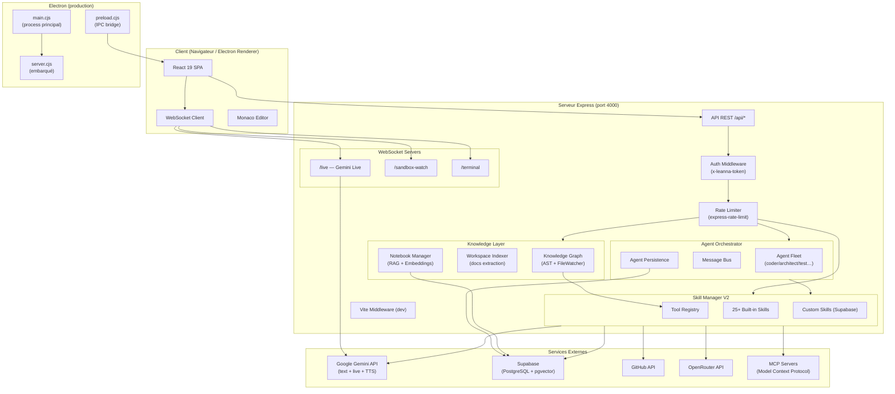

# Architecture — Leanna AI Operating System

## Vue d'ensemble

Leanna est une application full-stack monoprocessus en développement et deux processus en production Electron. Le frontend React est servi par le même serveur Express qui expose l'API REST et les WebSockets. En mode desktop, Electron embarque le tout dans un processus Node.js unique.



---

## Frontend

### Structure des composants

```
src/
├── main.tsx                    # Bootstrap : providers, routing, auth gate, circuit breaker fetch
├── views/                      # Pages (chargées lazy)
│   ├── IdeView.tsx             # IDE principal (Monaco + terminal + panels)
│   ├── NotebooksView.tsx       # RAG notebooks (chat + sources)
│   ├── GitHubView.tsx          # Intégration Git/GitHub
│   ├── AutomationView.tsx      # Workflows et tâches planifiées
│   ├── DocumentsView.tsx       # Gestion de documents
│   ├── MemoriesView.tsx        # Mémoires long-terme Supabase
│   ├── HistoryView.tsx         # Historique conversations
│   ├── ListsView.tsx           # Listes intelligentes
│   └── SettingsView.tsx        # Paramètres, tokens, profil
├── components/
│   ├── UnifiedSidebar.tsx      # Navigation latérale (contexte global / IDE)
│   ├── FloatingOrb.tsx         # Orb flottant draggable (chat rapide hors IDE)
│   ├── CriticalEditConfirm.tsx # Confirmation avant modif de fichiers critiques
│   ├── StartupProjectModal.tsx # Sélecteur de workspace au démarrage
│   ├── ide/                    # FileExplorer, EditorTabs, composants IDE
│   ├── panels/                 # SandboxPanel, AgentPanel, VisionPanel
│   ├── sidebar/                # Éléments de la sidebar
│   ├── settings/               # Sous-vues des paramètres
│   ├── notebooks/              # Composants notebooks RAG
│   ├── workflows/              # Constructeur de workflows
│   ├── github/                 # Composants GitHub
│   ├── knowledge/              # Composants Knowledge Graph
│   └── ui/                     # Toast, ConfirmDialog, composants génériques
├── context/
│   ├── LiveAPIContext.tsx       # Connexion WebSocket Gemini Live
│   ├── UserProfileContext.tsx   # Profil utilisateur (nom, voix, thème…)
│   └── ScreenShareContext.tsx   # Capture et streaming d'écran vers Gemini
├── hooks/
│   └── useLiveAPI.ts           # Hook principal WebSocket Live (connect/disconnect/send)
└── services/
    ├── ideApi.ts               # Client REST pour les opérations IDE (arbre, CRUD fichiers)
    ├── sandboxApi.ts           # Client REST pour le sandbox
    └── supabase.ts             # Client Supabase (frontend)
```

### Routing

React Router v7, mode `BrowserRouter`. Toutes les routes sont chargées en `lazy` pour le code splitting :

| Route | Vue | Description |
|---|---|---|
| `/` | → redirect `/ide` | Redirection par défaut |
| `/ide` | `IdeView` | IDE Monaco + chat + panels |
| `/memories` | `MemoriesView` | Mémoires Supabase |
| `/history` | `HistoryView` | Historique des conversations |
| `/settings` | `SettingsView` | Configuration complète |
| `/lists` | `ListsView` | Listes intelligentes |
| `/github` | `GitHubView` | Git / GitHub |
| `/automation` | `AutomationView` | Workflows et tâches planifiées |
| `/documents` | `DocumentsView` | Documents uploadés |
| `/notebooks` | `NotebooksView` | RAG notebooks |

Les transitions de routes sont animées avec `motion/react` (`AnimatePresence` + `mode="wait"`).

### Gestion d'état

- **React Context** : `LiveAPIContext` (WebSocket), `UserProfileContext` (profil + thème), `ScreenShareContext` (capture vidéo)
- **État local** : hooks `useState` / `useReducer` dans les composants
- **Persistance frontend** : `localStorage` (`Leanna_api_token`, `Leanna_user_profile`)
- **Pas de store global** (Redux/Zustand) : l'état métier est dans les contextes et remonte vers le serveur

### Optimisations réseau (frontend)

Le `window.fetch` est patché dans `main.tsx` avec :
- **Injection automatique** du header `x-leanna-token` sur toutes les requêtes `/api/*`
- **Déduplication in-flight** : les GET identiques en parallèle ne déclenchent qu'une seule requête
- **Circuit breaker** : après 12 échecs réseau consécutifs, toutes les requêtes API renvoient 503 pendant 8 secondes pour prévenir le ENOBUFS

---

## Backend / API

### Couches applicatives

```
server-bootstrap.ts          # 1. Charge .env, déchiffre les clés sensibles, valide Supabase
server.ts                    # 2. Initialise tout et démarre le serveur HTTP
  ├── bootstrapRuntimeSync() # 3. Enregistre tous les skills dans le ToolRegistry
  ├── agentOrchestrator      # 4. Connecte l'orchestrateur au SkillManager
  ├── loadWorkflows()        # 5. Charge les workflows planifiés depuis Supabase
  ├── loadScheduledTasks()   # 6. Charge les tâches automation
  ├── projectIndexer.scanAll()# 7. Lance l'indexation du Knowledge Graph
  └── startServer()          # 8. Express + WebSocket servers
```

### Middlewares (ordre d'application)

1. **Rate limiters globaux** (`express-rate-limit`) — configurés dans `server/config/rateLimits.ts`
2. **Compression** (`compression`) — gzip sur les réponses
3. **Static files** — `dist/` en production, Vite middleware en développement
4. **`requireAuth`** — vérifie le header `x-leanna-token` sur toutes les routes `/api/*` sauf `/api/health`
5. **Routeurs modulaires** — un fichier par domaine dans `server/routes/`
6. **Error handler global** — catch-all Express en fin de chaîne

### Runtime et Skill System

```
server/runtime/
├── bootstrap.ts             # bootstrapRuntimeSync() — point d'entrée unique
├── ToolRegistry             # Registre de tous les outils disponibles
├── Observability.ts         # Métriques et événements du runtime
├── compat/SkillManagerV2.ts # Adaptateur de compatibilité (migration progressive)
└── routes/
    ├── agents.ts            # GET/POST /api/v2/agents/*
    └── metrics.ts           # GET /api/v2/metrics
```

Les 25+ skills natifs (`server/skills/`) sont enregistrés une seule fois au démarrage via `bootstrapRuntimeSync`. Les custom skills sont chargés depuis Supabase (`sm.loadCustomSkills()`).

### Agent Orchestrator

```
server/agents/
├── index.ts                 # AgentOrchestrator, MessageBus, Registry, Persistence
├── AgentPersistence.ts      # Sauvegarde/restauration depuis Supabase
└── ...
```

L'orchestrateur implémente une boucle **Observe → Decide → Act** par rôle. Les agents communiquent via le `MessageBus` interne. Chaque tâche peut être sous-déléguée automatiquement (`delegateAutonomously`).

### Authentification

Toutes les routes `/api/*` (sauf `GET /api/health`) exigent le header :

```
x-leanna-token: <Leanna_API_TOKEN>
```

Le token est comparé via `crypto.timingSafeEqual` pour éviter les timing attacks. Les WebSockets `/live` et `/sandbox-watch` valident le token via cookie `Leanna_token` (posé automatiquement par le premier appel REST authentifié).

Le token est auto-généré (256 bits, URL-safe base64) au premier démarrage si absent du `.env`.

### WebSockets

| Endpoint | Usage | Auth |
|---|---|---|
| `/live` | Session Gemini Live bidirectionnelle (texte, audio, vidéo, tool calls) | Cookie `Leanna_token` |
| `/sandbox-watch` | Notifications temps réel des fichiers modifiés dans le sandbox | Cookie `Leanna_token` |
| `/terminal` | Terminal PTY interactif | Token query/cookie |

---

## Sandbox

Le sandbox est un mécanisme de sécurité central : toutes les modifications de l'IA sont d'abord appliquées dans un dossier miroir (`.Leanna/sandbox/`), jamais directement dans le workspace. L'utilisateur valide (`/api/sandbox/sync`) ou rejette (`/api/sandbox/discard`) les changements.

```
Workspace principal (SELF_ROOT)
       ↕ copie miroir
.Leanna/sandbox/        ← l'IA écrit ici
       ↕ diff + validation TypeScript
/api/sandbox/diff       ← visualisation des changements
/api/sandbox/sync       ← application après validation TSC
/api/sandbox/accept-file / reject-file  ← granularité fichier par fichier
```

La sortie du mode sandbox nécessite un code à 6 chiffres (`SANDBOX_EXIT_CODE`) avec rate limiting et comparaison en temps constant.

---

## Base de données

Supabase (PostgreSQL managé) avec deux extensions activées :

- **`pgvector`** : recherche par similarité vectorielle (RAG, mémoires sémantiques)
- **`pg_trgm`** : recherche textuelle par trigrammes

Toutes les tables ont **RLS activé** avec accès exclusif au `service_role` (backend). Le frontend n'a pas d'accès direct à Supabase.

Voir [DB_SCHEMA.md](DB_SCHEMA.md) pour le détail complet des tables et relations.

---

## Services externes

| Service | Intégration | Rôle |
|---|---|---|
| **Google Gemini API** | `@google/genai` | Génération de texte, Gemini Live (voix + vision), TTS, embeddings |
| **Supabase** | `@supabase/supabase-js` (backend uniquement) | Persistance : mémoires, conversations, workflows, custom skills, agents |
| **GitHub API** | `GITHUB_TOKEN` via `githubSkill` | Liste repos, issues, PRs, notifications, recherche |
| **OpenRouter** | REST via `OPENROUTER_API_KEY` | Modèles alternatifs (GPT-4o-mini, etc.) pour analyse de code |
| **MCP Servers** | `server/mcp/` bridge | Extensibilité via le Model Context Protocol |
| **Puppeteer** | `puppeteer` (headless Chrome) | Automatisation web, captures d'écran, scraping |
| **FTP** | `basic-ftp` | Connexions FTP (sécurité : IPs privées bloquées par défaut) |

### Pool de clés Gemini

`server/utils/geminiKeyPool.ts` maintient plusieurs clés Gemini (configurées dans `.gemini-keys.json`) et effectue une rotation automatique sur erreur 429. Cela évite les limitations de débit pour les utilisateurs intensifs.

---

## Décisions d'architecture

### Vite embarqué dans Express (pas de port séparé)

En développement, Vite est monté comme middleware Express (`middlewareMode: true`) sur le même port (4000). Cela évite les problèmes de CORS, simplifie l'authentification cookie, et empêche la boucle TCP infinie (ENOBUFS) qui survenait quand le proxy Vite pointait vers lui-même.

### Monoprocessus en développement

Le backend et le frontend partagent le même processus Node.js. C'est intentionnel : les skills (système de fichiers, terminal, Git) ont besoin d'un accès direct au système, et un processus séparé complexifierait la communication sans avantage réel pour un IDE local.

### SkillManagerV2 + ToolRegistry (migration progressive)

L'ancien SkillManager inline a été remplacé par un `ToolRegistry` centralisé avec un adaptateur de compatibilité (`SkillManagerV2`). Cela permet la coexistence de l'ancien code et du nouveau runtime V2 (`/api/v2/*`) pendant la migration.

### Sandbox par défaut activé

Par sécurité, le sandbox est activé dès qu'un projet est sélectionné. L'IA ne peut jamais écrire directement dans le workspace sans validation explicite. Ce choix protège contre les modifications accidentelles ou malveillantes sur le code source de l'application elle-même (Leanna est un IDE auto-hébergé qui gère son propre code).

### Écoute sur `127.0.0.1` par défaut

Le serveur n'écoute que sur la loopback pour éviter l'exposition du terminal shell et des outils de fichiers sur le réseau local. `Leanna_LISTEN_HOST=0.0.0.0` est disponible pour les cas d'usage réseau, avec avertissement explicite.

### TypeScript strict end-to-end

`tsconfig.json` active `strict`, `noUnusedLocals`, `noUnusedParameters`, `noImplicitReturns`. Le build esbuild du serveur est séparé du build Vite du frontend pour permettre un bundle CJS compatible Electron.

---

## Tests

### Stratégie de test

Leanna utilise le **Node.js test runner natif** (`node:test`) pour tous les tests unitaires et d'intégration. Pas de framework externe (Jest, Mocha) : les tests sont simples, rapides et portables.

**Couverture actuelle :**
- ✅ **Skills** : ≥60% de couverture (136+ tests unitaires)
- ✅ **Routes REST** : 74 tests d'intégration

### Tests unitaires (Skills)

Fichiers : `server/skills/*.test.ts`

**Objectif** : valider la logique métier de chaque skill isolément
- Validation des schémas Zod
- Gestion d'erreurs
- Cas nominaux et cas limites
- Aucune dépendance réseau (mocks)

Exemple : `server/skills/browser.test.ts` valide que les appels Puppeteer sont correctement formatés sans lancer un navigateur réel.

### Tests d'intégration (Routes REST)

Fichiers : `server/routes/*.test.ts`

**Objectif** : valider le comportement end-to-end des endpoints HTTP
- Création d'un serveur Express isolé par test
- Tests sur un port aléatoire (évite les conflits)
- Validation des codes HTTP (200, 400, 404, 500, 503)
- Validation des schémas de réponse JSON
- Tests d'authentification et rate limiting

**Couverture complète des domaines fonctionnels :**

| Domaine | Tests | Couverture |
|---|---|---|
| Agents | 15 | Statut, tâches, rôles, flotte, bus de messages, collaboration, persistance, tool-mapping, tool-categories |
| Marketplace | 13 | Recherche, featured, installed, stats, installation, publication, rating, sécurité, export |
| Workflows | 7 | Liste, création, exécution, toggle, suppression |
| Browser | 7 | Validation requêtes, résolution promesses, actions |
| Upload Document | 7 | Validation types fichiers, rate limiting, contexte |
| Conversations | 7 | Liste, recherche, messages, mise à jour titre, suppression |
| Skills | 6 | Liste, propriétés requises, core skills, statut Supabase |
| Profile & Tokens | 6 | GET/POST profile, GET/POST tokens, validation clés |
| Terminal | 5 | Configuration, sessions actives, authentification |
| Memories | 3 | Liste, suppression globale, suppression par ID |
| Workspace | 3 | Info workspace, verrouillage POST |
| Health | 1 | Health check |

### Exécution des tests

```bash
# Tous les tests (skills + routes)
npm test

# Tests d'intégration seulement
npm test -- server/routes/*.test.ts

# Tests unitaires seulement
npm test -- server/skills/*.test.ts

# Un fichier spécifique
npm test -- server/routes/agents.test.ts

# Mode watch (relance sur changement)
npm test -- --watch

# Coverage (expérimental)
npm test -- --coverage
```

### CI/CD

Les tests sont automatiquement exécutés sur chaque push et pull request via GitHub Actions. Un build échoué ou des tests en erreur bloquent le merge.

**Seuils de qualité :**
- Build TypeScript doit passer (`tsc --noEmit`)
- Lint doit passer (`npm run lint`)
- Tous les tests doivent passer (`npm test`)
- Coverage skills ≥60%
