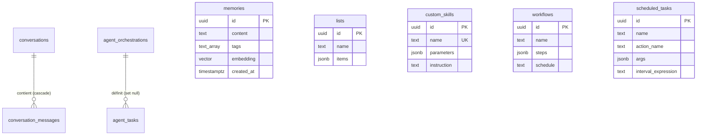

# 🗄️ Schéma de base de données — Jarvis-OS

Ce document décrit la structure de la base de données relationnelle de Jarvis-OS. Les tables sont hébergées sur Supabase et exploitées par le backend Express.

---

## 📋 Inventaire des Tables

### 1. `memories`
*   **Description fonctionnelle** : Stockage des mémoires utilisateur et de leurs embeddings vectoriels pour la recherche sémantique à long terme (RAG).
*   **Colonnes** :
    | Nom | Type | Contraintes | Description |
    | :--- | :--- | :--- | :--- |
    | `id` | uuid | `PRIMARY KEY`, `DEFAULT gen_random_uuid()` | Identifiant unique de la mémoire |
    | `content` | text | `NOT NULL` | Contenu textuel de la mémoire |
    | `tags` | text[] | `DEFAULT '{}'::text[]` | Liste de tags pour classement |
    | `embedding` | vector(768) | `NULLABLE` | Vecteur d'embedding pour recherche RAG (768 dimensions) |
    | `created_at` | timestamptz | `NOT NULL`, `DEFAULT now()` | Date de création |
    | `updated_at` | timestamptz | `NOT NULL`, `DEFAULT now()` | Date de mise à jour |

*   **Relations** : Aucune relation directe.
*   **Index notables** :
    *   `memories_content_idx` : Index GIN avec `gin_trgm_ops` sur la colonne `content` pour recherche textuelle rapide.
*   **Politiques RLS** : Active. Accès total restreint à `service_role` (backend).

---

### 2. `lists`
*   **Description fonctionnelle** : Listes personnelles créées et gérées par l'utilisateur (tâches, notes, rappels).
*   **Colonnes** :
    | Nom | Type | Contraintes | Description |
    | :--- | :--- | :--- | :--- |
    | `id` | uuid | `PRIMARY KEY`, `DEFAULT gen_random_uuid()` | Identifiant unique de la liste |
    | `name` | text | `NOT NULL` | Nom d'affichage de la liste |
    | `name_lower` | text | `NOT NULL` | Version en minuscules pour assurer l'unicité |
    | `items` | jsonb | `NOT NULL`, `DEFAULT '[]'::jsonb` | Éléments de la liste |
    | `created_at` | timestamptz | `NOT NULL`, `DEFAULT now()` | Date de création |
    | `updated_at` | timestamptz | `NOT NULL`, `DEFAULT now()` | Date de mise à jour |

*   **Relations** : Aucune relation directe.
*   **Index notables** :
    *   `lists_name_lower_unique` : Index unique sur `name_lower`.
    *   `lists_updated_at_idx` : Index descendant sur `updated_at`.
*   **Politiques RLS** : Active. Accès total restreint à `service_role` (backend).

---

### 3. `conversations`
*   **Description fonctionnelle** : Sessions de conversation historique entre l'utilisateur et l'IA.
*   **Colonnes** :
    | Nom | Type | Contraintes | Description |
    | :--- | :--- | :--- | :--- |
    | `id` | uuid | `PRIMARY KEY`, `DEFAULT gen_random_uuid()` | Identifiant unique de la session |
    | `title` | text | `NULLABLE` | Titre de la conversation |
    | `summary` | text | `NULLABLE` | Résumé automatique généré par l'IA |
    | `started_at` | timestamptz | `NOT NULL`, `DEFAULT now()` | Date de début |
    | `ended_at` | timestamptz | `NULLABLE` | Date de fin |
    | `message_count` | integer | `DEFAULT 0` | Nombre total de messages |
    | `created_at` | timestamptz | `NOT NULL`, `DEFAULT now()` | Date d'enregistrement |

*   **Relations** : Relation un-à-plusieurs (1:N) avec `conversation_messages`.
*   **Politiques RLS** : Active. Accès total restreint à `service_role` (backend).

---

### 4. `conversation_messages`
*   **Description fonctionnelle** : Messages individuels appartenant à une session de conversation historique.
*   **Colonnes** :
    | Nom | Type | Contraintes | Description |
    | :--- | :--- | :--- | :--- |
    | `id` | uuid | `PRIMARY KEY`, `DEFAULT gen_random_uuid()` | Identifiant unique du message |
    | `conversation_id` | uuid | `NOT NULL`, `REFERENCES conversations(id) ON DELETE CASCADE` | Lien vers la conversation parente |
    | `role` | text | `NOT NULL`, `CHECK (role IN ('user', 'assistant'))` | Rôle de l'émetteur du message |
    | `content` | text | `NOT NULL` | Contenu textuel brut |
    | `created_at` | timestamptz | `NOT NULL`, `DEFAULT now()` | Date d'envoi |

*   **Relations** : Clé étrangère vers `conversations.id`.
*   **Index notables** :
    *   `idx_conversation_messages_conversation_id` : Index de clé étrangère standard.
    *   `idx_conversation_messages_content_search` : Index GIN full-text (configuration `french`) sur `content`.
*   **Politiques RLS** : Active. Accès total restreint à `service_role` (backend).

---

### 5. `scheduled_tasks`
*   **Description fonctionnelle** : Tâches automatisées répétitives ou planifiées à déclencher localement.
*   **Colonnes** :
    | Nom | Type | Contraintes | Description |
    | :--- | :--- | :--- | :--- |
    | `id` | uuid | `PRIMARY KEY`, `DEFAULT gen_random_uuid()` | Identifiant de la tâche |
    | `name` | text | `NOT NULL` | Nom explicite |
    | `description` | text | `NULLABLE` | Rôle de la tâche |
    | `action_name` | text | `NOT NULL` | Identifiant de l'action/skill à exécuter |
    | `args` | jsonb | `DEFAULT '{}'::jsonb` | Arguments passés à l'action |
    | `interval_expression` | text | `NOT NULL` | Intervalle temporel (ex: `24h`, `10m`) |
    | `enabled` | boolean | `DEFAULT true` | Statut d'activation |
    | `last_run_at` | timestamptz | `NULLABLE` | Date de dernière exécution |
    | `created_at` | timestamptz | `NOT NULL`, `DEFAULT now()` | Date de création |

*   **Relations** : Peut être lié optionnellement à des workflows.
*   **Politiques RLS** : Active. Accès total restreint à `service_role`.

---

### 6. `workflows`
*   **Description fonctionnelle** : Chaînes de traitement composées de plusieurs étapes de skills (pipelines).
*   **Colonnes** :
    | Nom | Type | Contraintes | Description |
    | :--- | :--- | :--- | :--- |
    | `id` | uuid | `PRIMARY KEY`, `DEFAULT gen_random_uuid()` | Identifiant unique du workflow |
    | `name` | text | `NOT NULL` | Nom du workflow |
    | `description` | text | `DEFAULT ''` | Descriptif |
    | `steps` | jsonb | `NOT NULL`, `DEFAULT '[]'::jsonb` | Liste ordonnée des étapes à exécuter |
    | `schedule` | text | `NULLABLE` | Intervalle de planification |
    | `enabled` | boolean | `DEFAULT true` | Activé ou non |
    | `last_run_at` | timestamptz | `NULLABLE` | Dernière date d'exécution |
    | `last_run_status` | text | `NULLABLE` | `success`, `partial` ou `failed` |
    | `created_at` | timestamptz | `NOT NULL`, `DEFAULT now()` | Date de création |

*   **Relations** : Aucune relation directe obligatoire.
*   **Index notables** :
    *   `idx_workflows_enabled_schedule` : Index partiel sur `enabled` filtrant les éléments avec une planification active.
*   **Politiques RLS** : Active. Accès restreint à `service_role`.

---

### 7. `custom_skills`
*   **Description fonctionnelle** : Compétences dynamiques personnalisées développées par l'utilisateur via l'interface graphique.
*   **Colonnes** :
    | Nom | Type | Contraintes | Description |
    | :--- | :--- | :--- | :--- |
    | `id` | uuid | `PRIMARY KEY`, `DEFAULT gen_random_uuid()` | Identifiant du skill |
    | `name` | text | `NOT NULL`, `UNIQUE` | Nom de la compétence (identifiant system) |
    | `description` | text | `NOT NULL`, `DEFAULT ''` | Description servant au LLM pour le function calling |
    | `parameters` | jsonb | `NOT NULL`, `DEFAULT '[]'::jsonb` | Liste des arguments attendus par l'outil |
    | `instruction` | text | `NOT NULL`, `DEFAULT ''` | Prompt système à injecter lors de l'appel |
    | `category` | text | `NOT NULL`, `DEFAULT 'custom'` | Catégorie thématique |
    | `enabled` | boolean | `NOT NULL`, `DEFAULT true` | Actif ou désactivé |
    | `icon` | text | `DEFAULT 'Sparkles'` | Nom d'une icône Lucide |
    | `created_at` | timestamptz | `NOT NULL`, `DEFAULT now()` | Date de création |
    | `updated_at` | timestamptz | `NOT NULL`, `DEFAULT now()` | Date de mise à jour |

*   **Relations** : Aucune.
*   **Index notables** :
    *   `idx_custom_skills_enabled` : Index partiel filtrant sur `enabled = true`.
*   **Politiques RLS** : Active. Accès total restreint à `service_role` (avec validation `auth.role() = 'service_role'`).

---

### 8. `agent_tasks`
*   **Description fonctionnelle** : Tâches de développement individuelles créées par l'orchestrateur pour être résolues par des agents autonomes.
*   **Colonnes** :
    | Nom | Type | Contraintes | Description |
    | :--- | :--- | :--- | :--- |
    | `id` | uuid | `PRIMARY KEY` | Identifiant de la tâche |
    | `orchestration_id` | uuid | `REFERENCES agent_orchestrations(id) ON DELETE SET NULL` | ID du plan d'orchestration parent |
    | `role` | text | `NOT NULL`, `CHECK (role IN ('coder', 'test', 'docs', 'refactor', 'security', 'review', 'architect'))` | Rôle d'agent affecté |
    | `title` | text | `NOT NULL` | Titre ou libellé de l'action |
    | `description` | text | `NOT NULL` | Description détaillée des attendus |
    | `priority` | text | `NOT NULL`, `DEFAULT 'medium'`, `CHECK` (low, medium, high, critical) | Niveau de priorité |
    | `status` | text | `NOT NULL`, `DEFAULT 'pending'`, `CHECK` (pending, running, completed, failed, cancelled) | Statut d'avancement |
    | `context_files` | text[] | `NOT NULL`, `DEFAULT '{}'` | Chemins des fichiers concernés |
    | `context_instructions`| text | `NULLABLE` | Recommandations complémentaires |
    | `context_metadata` | jsonb | `NULLABLE` | Métadonnées de contexte additionnelles |
    | `result` | jsonb | `NULLABLE` | Données de résultat / logs de sortie |
    | `created_at` | timestamptz | `NOT NULL`, `DEFAULT now()` | Date de création |
    | `started_at` | timestamptz | `NULLABLE` | Début de l'exécution |
    | `completed_at` | timestamptz | `NULLABLE` | Fin de l'exécution |
    | `timeout_ms` | integer | `NULLABLE` | Temps limite alloué |

*   **Relations** : Clé étrangère vers `agent_orchestrations.id`.
*   **Index notables** :
    *   `idx_agent_tasks_status` : Index sur `status`.
    *   `idx_agent_tasks_role` : Index sur `role`.
    *   `idx_agent_tasks_orchestration` : Index sur `orchestration_id`.
*   **Politiques RLS** : Active (désactivée par défaut, configurable si multi-tenant).

---

### 9. `agent_orchestrations`
*   **Description fonctionnelle** : Plans de mission globaux regroupant plusieurs tâches interdépendantes résolues en parallèle ou séquentiellement.
*   **Colonnes** :
    | Nom | Type | Contraintes | Description |
    | :--- | :--- | :--- | :--- |
    | `id` | uuid | `PRIMARY KEY` | Identifiant du plan |
    | `title` | text | `NOT NULL` | Nom de la mission |
    | `description` | text | `NOT NULL` | Descriptif global |
    | `status` | text | `NOT NULL`, `DEFAULT 'pending'`, `CHECK` (pending, running, completed, failed, cancelled) | Statut d'avancement global |
    | `dependencies` | jsonb | `NOT NULL`, `DEFAULT '{}'` | Graphe ou liste des dépendances inter-tâches |
    | `created_at` | timestamptz | `NOT NULL`, `DEFAULT now()` | Date de création |
    | `completed_at` | timestamptz | `NULLABLE` | Date de complétion globale |

*   **Relations** : Relation un-à-plusieurs (1:N) avec `agent_tasks`.
*   **Index notables** :
    *   `idx_agent_orchestrations_status` : Index sur `status`.
    *   `idx_agent_orchestrations_created_at` : Index descendant sur `created_at`.
*   **Politiques RLS** : Active (configurable).

---

### 10. `agent_messages`
*   **Description fonctionnelle** : Historique d'échange de messages sur le bus inter-agents de communication (Pub/Sub).
*   **Colonnes** :
    | Nom | Type | Contraintes | Description |
    | :--- | :--- | :--- | :--- |
    | `id` | uuid | `PRIMARY KEY` | Identifiant unique du message |
    | `type` | text | `NOT NULL` | Type du message (événement, requête, réponse) |
    | `from_role` | text | `NOT NULL` | Agent émetteur |
    | `to_role` | text | `NOT NULL` | Agent destinataire (ou `broadcast`) |
    | `priority` | text | `NOT NULL`, `DEFAULT 'medium'` | Niveau d'urgence |
    | `payload` | jsonb | `NOT NULL`, `DEFAULT '{}'` | Données du message |
    | `correlation_id` | uuid | `NULLABLE` | ID de corrélation pour les requêtes-réponses |
    | `metadata` | jsonb | `NULLABLE` | Métadonnées système |
    | `created_at` | timestamptz | `NOT NULL`, `DEFAULT now()` | Date d'envoi |

*   **Relations** : Aucune relation stricte.
*   **Index notables** :
    *   `idx_agent_messages_type` : Index sur `type`.
    *   `idx_agent_messages_from_role` : Index sur `from_role`.
*   **Politiques RLS** : Active (configurable).

---

## 📊 Diagramme ERD (Entity Relationship Diagram)

Le schéma ci-dessous modélise les relations clés au sein du système.

