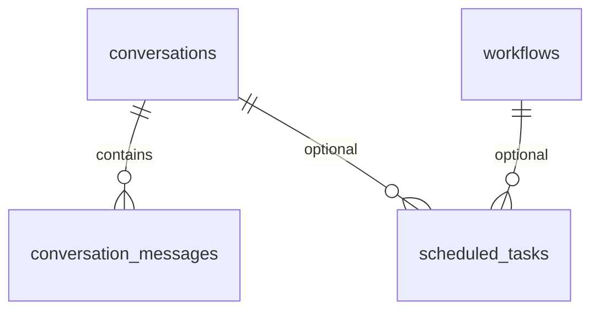

# Schéma de base de données

## Tables principales

### memories
Description fonctionnelle : stockage des mémoires utilisateur et de leurs embeddings pour la recherche sémantique.

| Colonne | Type | Contraintes | Description |
|---|---|---|---|
| id | uuid | PK | Identifiant unique |
| content | text | NOT NULL | Contenu de la mémoire |
| tags | text[] | default '{}' | Tags associés |
| embedding | vector(768) | nullable | Embedding vectoriel |
| created_at | timestamptz | NOT NULL | Date de création |
| updated_at | timestamptz | NOT NULL | Date de mise à jour |

Relations : aucune relation directe avec d’autres tables dans le schéma actuel.

Index notables : `memories_content_idx` sur `content` avec GIN trigram, fonction `match_memories`.

RLS : activée, accès réservé au service role.

### lists
Description fonctionnelle : listes personnelles persistées dans Supabase.

| Colonne | Type | Contraintes | Description |
|---|---|---|---|
| id | uuid | PK | Identifiant unique |
| name | text | NOT NULL | Nom de la liste |
| name_lower | text | NOT NULL | Version lowercase pour recherche unique |
| items | jsonb | NOT NULL | Liste d’éléments JSON |
| created_at | timestamptz | NOT NULL | Date de création |
| updated_at | timestamptz | NOT NULL | Date de mise à jour |

Relations : aucune relation directe.

Index notables : index unique sur `name_lower`.

RLS : activée, accès réservé au service role.

### conversations
Description fonctionnelle : sessions de conversation.

| Colonne | Type | Contraintes | Description |
|---|---|---|---|
| id | uuid | PK | Identifiant de la conversation |
| title | text | nullable | Titre de la conversation |
| summary | text | nullable | Résumé automatique |
| started_at | timestamptz | NOT NULL | Date de début |
| ended_at | timestamptz | nullable | Date de fin |
| message_count | integer | default 0 | Nombre de messages |
| created_at | timestamptz | NOT NULL | Date de création |

Relations : `conversation_messages.conversation_id -> conversations.id` (1:N).

RLS : activée, accès réservé au service role.

### conversation_messages
Description fonctionnelle : messages individuels d’une conversation.

| Colonne | Type | Contraintes | Description |
|---|---|---|---|
| id | uuid | PK | Identifiant du message |
| conversation_id | uuid | FK -> conversations.id, NOT NULL | Conversation parente |
| role | text | CHECK (`user`,`assistant`) | Rôle de l’émetteur |
| content | text | NOT NULL | Contenu du message |
| created_at | timestamptz | NOT NULL | Date d’envoi |

Relations : plusieurs messages par conversation.

Index notables : index sur `conversation_id`, index GIN full-text sur `content`.

RLS : activée, accès réservé au service role.

### scheduled_tasks
Description fonctionnelle : tâches planifiées d’automatisation.

| Colonne | Type | Contraintes | Description |
|---|---|---|---|
| id | uuid | PK | Identifiant de la tâche |
| name | text | NOT NULL | Nom de la tâche |
| description | text | nullable | Description |
| action_name | text | NOT NULL | Action à exécuter |
| args | jsonb | default '{}' | Paramètres de l’action |
| interval_expression | text | NOT NULL | Intervalle, ex. `24h` |
| enabled | boolean | default true | Activation |
| last_run_at | timestamptz | nullable | Dernière exécution |
| created_at | timestamptz | NOT NULL | Date de création |

RLS : activée, accès réservé au service role.

### workflows
Description fonctionnelle : workflows automatisés persistés.

| Colonne | Type | Contraintes | Description |
|---|---|---|---|
| id | uuid | PK | Identifiant du workflow |
| name | text | NOT NULL | Nom |
| description | text | default '' | Description |
| steps | jsonb | NOT NULL | Étapes du workflow |
| schedule | text | nullable | Expression d’intervalle |
| enabled | boolean | default true | Activation |
| last_run_at | timestamptz | nullable | Dernière exécution |
| last_run_status | text | nullable | `success`, `partial`, `failed` |
| created_at | timestamptz | NOT NULL | Date de création |

RLS : activée, accès réservé au service role.

### custom_skills
Description fonctionnelle : skills personnalisés ajoutés par l’utilisateur.

| Colonne | Type | Contraintes | Description |
|---|---|---|---|
| id | uuid | PK | Identifiant |
| name | text | NOT NULL UNIQUE | Nom du skill |
| description | text | NOT NULL | Description |
| parameters | jsonb | NOT NULL | Paramètres du skill |
| instruction | text | NOT NULL | Prompt de l’IA |
| category | text | NOT NULL | Catégorie |
| enabled | boolean | NOT NULL default true | Activé ou non |
| icon | text | nullable | Icône Lucide |
| created_at | timestamptz | NOT NULL | Date de création |
| updated_at | timestamptz | NOT NULL | Date de mise à jour |

RLS : activée, accès réservé au service role.

## Diagramme ERD

> ⚠️ À compléter : le dépôt ne contient pas encore la définition SQL complète des tables d’agent persistence (agent_tasks, agent_orchestrations, agent_messages), mais leur structure est décrite dans le code source.
