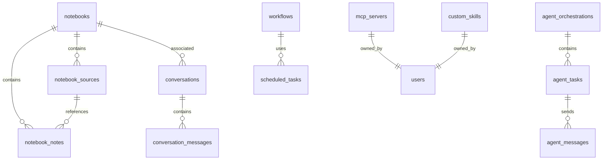

# Database Schema - Leanna OS

## Sommaire

- [Apercu general](#-apercu-general)
- [Tables Supabase](#-tables-supabase)
  - [agent_tasks](#agent_tasks)
  - [agent_orchestrations](#agent_orchestrations)
  - [agent_messages](#agent_messages)
  - [memories](#memories)
  - [scheduled_tasks](#scheduled_tasks)
  - [workflows](#workflows)
  - [notebooks](#notebooks)
  - [notebook_sources](#notebook_sources)
  - [notebook_notes](#notebook_notes)
  - [conversations](#conversations)
  - [conversation_messages](#conversation_messages)
  - [mcp_servers](#mcp_servers)
  - [custom_skills](#custom_skills)
- [RLS Policies](#-rls-policies)
- [Stockage local](#-stockage-local)
- [Relations entre les tables](#-relations-entre-les-tables)
- [Exemples de requetes](#-exemples-de-requetes)

---

## Apercu general

Leanna OS utilise **Supabase (PostgreSQL)** comme base de donnees principale pour la persistance des donnees utilisateur et systeme.

### Configuration

| Variable | Description |
|----------|-------------|
| `SUPABASE_URL` | URL de l instance Supabase |
| `SUPABASE_SERVICE_ROLE_KEY` | Cle d admin pour les operations backend |
| `VITE_SUPABASE_URL` | URL publique pour le frontend |
| `VITE_SUPABASE_ANON_KEY` | Cle publique pour le frontend |

### Client

```typescript
import { createClient } from '@supabase/supabase-js';

const supabase = createClient(
  process.env.SUPABASE_URL,
  process.env.SUPABASE_SERVICE_ROLE_KEY
);
```

---

## Tables Supabase

---

### agent_tasks

Table pour la persistance des taches des agents.

| Colonne | Type | Nullable | Default | Description |
|---------|------|----------|---------|-------------|
| id | uuid | NO | gen_random_uuid() | Identifiant unique |
| orchestration_id | uuid | YES | null | Reference a l orchestration |
| role | text | NO | | Role de l agent (coder, refactor, etc.) |
| title | text | NO | | Titre de la tache |
| description | text | YES | null | Description detaillee |
| priority | text | NO | 'medium' | Priorite (low, medium, high, critical) |
| status | text | NO | 'pending' | Etat (pending, running, completed, failed, cancelled) |
| context_files | text[] | YES | '{}' | Liste des fichiers contexte |
| context_instructions | text | YES | null | Instructions contextuelles |
| context_metadata | jsonb | YES | null | Metadonnees contextuelles |
| result | jsonb | YES | null | Resultat de l execution |
| created_at | timestamp with time zone | NO | now() | Date de creation |
| started_at | timestamp with time zone | YES | null | Date de debut |
| completed_at | timestamp with time zone | YES | null | Date de fin |
| timeout_ms | bigint | YES | null | Timeout en millisecondes |

**Indexes** :
- Primary key: `id`
- Index: `agent_tasks_orchestration_id_idx` (orchestration_id)
- Index: `agent_tasks_status_idx` (status)
- Index: `agent_tasks_priority_idx` (priority)
- Index: `agent_tasks_created_at_idx` (created_at)

**RLS** : Actif (restreint aux utilisateurs authentifies)

---

### agent_orchestrations

Table pour les plans d orchestration multi-agents.

| Colonne | Type | Nullable | Default | Description |
|---------|------|----------|---------|-------------|
| id | uuid | NO | gen_random_uuid() | Identifiant unique |
| title | text | NO | | Titre de l orchestration |
| description | text | YES | null | Description |
| status | text | NO | 'pending' | Etat (pending, running, completed, failed) |
| dependencies | jsonb | YES | '{}' | Dependances entre taches |
| created_at | timestamp with time zone | NO | now() | Date de creation |
| completed_at | timestamp with time zone | YES | null | Date de completion |

**Indexes** :
- Primary key: `id`
- Index: `agent_orchestrations_status_idx` (status)
- Index: `agent_orchestrations_created_at_idx` (created_at)

**RLS** : Actif

---

### agent_messages

Table pour l historique des messages inter-agents.

| Colonne | Type | Nullable | Default | Description |
|---------|------|----------|---------|-------------|
| id | uuid | NO | gen_random_uuid() | Identifiant unique |
| type | text | NO | | Type de message (task, result, error, etc.) |
| from_role | text | NO | | Role de l expediteur |
| to_role | text | NO | | Role du destinataire |
| priority | text | NO | 'normal' | Priorite |
| payload | jsonb | YES | '{}' | Contenu du message |
| correlation_id | uuid | YES | null | ID de correlation |
| metadata | jsonb | YES | null | Metadonnees |
| created_at | timestamp with time zone | NO | now() | Date de creation |

**Indexes** :
- Primary key: `id`
- Index: `agent_messages_correlation_id_idx` (correlation_id)
- Index: `agent_messages_created_at_idx` (created_at)

**RLS** : Actif

---

### memories

Table pour la memoire long terme.

| Colonne | Type | Nullable | Default | Description |
|---------|------|----------|---------|-------------|
| id | uuid | NO | gen_random_uuid() | Identifiant unique |
| content | text | NO | | Contenu de la memoire |
| metadata | jsonb | YES | '{}' | Metadonnees |
| created_at | timestamp with time zone | NO | now() | Date de creation |
| updated_at | timestamp with time zone | YES | now() | Date de mise a jour |

**Indexes** :
- Primary key: `id`
- Index: `memories_created_at_idx` (created_at)

**RLS** : Actif

---

### scheduled_tasks

Table pour les taches planifiees (cron-like).

| Colonne | Type | Nullable | Default | Description |
|---------|------|----------|---------|-------------|
| id | uuid | NO | gen_random_uuid() | Identifiant unique |
| name | text | NO | | Nom de la tache |
| description | text | YES | null | Description |
| action_name | text | NO | | Nom de l action a executer |
| args | jsonb | YES | '{}' | Arguments de l action |
| interval_ms | bigint | NO | | Intervalle en millisecondes |
| interval_expression | text | NO | | Expression cron ou interval |
| enabled | boolean | NO | true | Tache active |
| created_at | timestamp with time zone | NO | now() | Date de creation |
| last_run_at | timestamp with time zone | YES | null | Derniere execution |
| last_success | boolean | YES | null | Succes de la derniere execution |
| last_error | text | YES | null | Derniere erreur |
| consecutive_failures | integer | YES | 0 | Nombre d echecs consecutifs |

**Indexes** :
- Primary key: `id`
- Index: `scheduled_tasks_enabled_idx` (enabled)
- Index: `scheduled_tasks_created_at_idx` (created_at)

**RLS** : Actif

---

### workflows

Table pour les workflows documentaires.

| Colonne | Type | Nullable | Default | Description |
|---------|------|----------|---------|-------------|
| id | uuid | NO | gen_random_uuid() | Identifiant unique |
| name | text | NO | | Nom du workflow |
| description | text | YES | null | Description |
| type | text | NO | | Type (document, code, etc.) |
| config | jsonb | YES | '{}' | Configuration |
| is_active | boolean | NO | true | Workflow actif |
| created_at | timestamp with time zone | NO | now() | Date de creation |
| updated_at | timestamp with time zone | YES | now() | Date de mise a jour |

**Indexes** :
- Primary key: `id`
- Index: `workflows_is_active_idx` (is_active)

**RLS** : Actif

---

### notebooks

Table principale des notebooks RAG.

| Colonne | Type | Nullable | Default | Description |
|---------|------|----------|---------|-------------|
| id | uuid | NO | gen_random_uuid() | Identifiant unique |
| title | text | NO | 'Untitled Notebook' | Titre du notebook |
| description | text | YES | null | Description |
| user_id | text | YES | null | Reference a l utilisateur (non implemente) |
| is_archived | boolean | NO | false | Archive |
| created_at | timestamp with time zone | NO | now() | Date de creation |
| updated_at | timestamp with time zone | YES | now() | Date de mise a jour |

**Indexes** :
- Primary key: `id`
- Index: `notebooks_user_id_idx` (user_id)
- Index: `notebooks_is_archived_idx` (is_archived)
- Index: `notebooks_created_at_idx` (created_at)

**RLS** : Actif

---

### notebook_sources

Table pour les sources des notebooks.

| Colonne | Type | Nullable | Default | Description |
|---------|------|----------|---------|-------------|
| id | uuid | NO | gen_random_uuid() | Identifiant unique |
| notebook_id | uuid | NO | | Reference au notebook |
| file_name | text | NO | | Nom du fichier |
| mime_type | text | YES | null | Type MIME |
| title | text | YES | null | Titre extrait |
| text_content | text | YES | null | Contenu texte extrait |
| metadata | jsonb | YES | '{}' | Metadonnees (taille, mots, etc.) |
| embedding | jsonb | YES | null | Vecteur d embedding |
| chunks | jsonb | YES | '[]' | Chunks pour la recherche |
| is_processed | boolean | NO | false | Traitement termine |
| created_at | timestamp with time zone | NO | now() | Date de creation |

**Indexes** :
- Primary key: `id`
- Index: `notebook_sources_notebook_id_idx` (notebook_id)
- Index: `notebook_sources_is_processed_idx` (is_processed)

**Relations** :
- Foreign key: `notebook_id` references `notebooks(id)` (ON DELETE CASCADE)

**RLS** : Actif

---

### notebook_notes

Table pour les notes des notebooks.

| Colonne | Type | Nullable | Default | Description |
|---------|------|----------|---------|-------------|
| id | uuid | NO | gen_random_uuid() | Identifiant unique |
| notebook_id | uuid | NO | | Reference au notebook |
| title | text | YES | null | Titre de la note |
| content | text | NO | | Contenu de la note |
| x | integer | YES | 0 | Position X (canvas) |
| y | integer | YES | 0 | Position Y (canvas) |
| color | text | YES | null | Couleur |
| tags | text[] | YES | '{}' | Tags |
| created_at | timestamp with time zone | NO | now() | Date de creation |
| updated_at | timestamp with time zone | YES | now() | Date de mise a jour |

**Indexes** :
- Primary key: `id`
- Index: `notebook_notes_notebook_id_idx` (notebook_id)

**Relations** :
- Foreign key: `notebook_id` references `notebooks(id)` (ON DELETE CASCADE)

**RLS** : Actif

---

### conversations

Table pour les sessions de conversation.

| Colonne | Type | Nullable | Default | Description |
|---------|------|----------|---------|-------------|
| id | uuid | NO | gen_random_uuid() | Identifiant unique |
| title | text | YES | null | Titre de la conversation |
| user_id | text | YES | null | Reference utilisateur |
| notebook_id | uuid | YES | null | Reference au notebook |
| is_pinned | boolean | NO | false | Conversation epinglee |
| created_at | timestamp with time zone | NO | now() | Date de creation |
| updated_at | timestamp with time zone | YES | now() | Date de mise a jour |

**Indexes** :
- Primary key: `id`
- Index: `conversations_user_id_idx` (user_id)
- Index: `conversations_notebook_id_idx` (notebook_id)
- Index: `conversations_is_pinned_idx` (is_pinned)

**Relations** :
- Foreign key: `notebook_id` references `notebooks(id)` (ON DELETE SET NULL)

**RLS** : Actif

---

### conversation_messages

Table pour les messages des conversations.

| Colonne | Type | Nullable | Default | Description |
|---------|------|----------|---------|-------------|
| id | uuid | NO | gen_random_uuid() | Identifiant unique |
| conversation_id | uuid | NO | | Reference a la conversation |
| role | text | NO | | Role (user, assistant, system) |
| content | text | NO | | Contenu du message |
| metadata | jsonb | YES | '{}' | Metadonnees |
| sources | jsonb | YES | '[]' | Sources referencees |
| tokens | integer | YES | null | Nombre de tokens |
| created_at | timestamp with time zone | NO | now() | Date de creation |

**Indexes** :
- Primary key: `id`
- Index: `conversation_messages_conversation_id_idx` (conversation_id)

**Relations** :
- Foreign key: `conversation_id` references `conversations(id)` (ON DELETE CASCADE)

**RLS** : Actif

---

### mcp_servers

Table pour les serveurs MCP configures.

| Colonne | Type | Nullable | Default | Description |
|---------|------|----------|---------|-------------|
| id | uuid | NO | gen_random_uuid() | Identifiant unique |
| name | text | NO | | Nom du serveur |
| url | text | NO | | URL du serveur |
| type | text | NO | 'stdio' | Type (stdio, sse) |
| config | jsonb | YES | '{}' | Configuration |
| is_connected | boolean | NO | false | Connecte |
| created_at | timestamp with time zone | NO | now() | Date de creation |
| updated_at | timestamp with time zone | YES | now() | Date de mise a jour |

**Indexes** :
- Primary key: `id`
- Index: `mcp_servers_is_connected_idx` (is_connected)

**RLS** : Actif

---

### custom_skills

Table pour les skills personnalisees.

| Colonne | Type | Nullable | Default | Description |
|---------|------|----------|---------|-------------|
| id | uuid | NO | gen_random_uuid() | Identifiant unique |
| name | text | NO | | Nom de la skill |
| description | text | YES | null | Description |
| code | text | NO | | Code de la skill |
| config | jsonb | YES | '{}' | Configuration |
| is_active | boolean | NO | true | Active |
| created_at | timestamp with time zone | NO | now() | Date de creation |
| updated_at | timestamp with time zone | YES | now() | Date de mise a jour |

**Indexes** :
- Primary key: `id`
- Index: `custom_skills_is_active_idx` (is_active)

**RLS** : Actif

---

## RLS Policies

Toutes les tables ont **Row Level Security (RLS)** active avec les politiques suivantes :

### Politique par defaut

```sql
-- Pour la plupart des tables
CREATE POLICY "Enable read for authenticated users"
ON public.table_name
FOR SELECT
USING (true);

CREATE POLICY "Enable insert for authenticated users"
ON public.table_name
FOR INSERT
WITH CHECK (true);

CREATE POLICY "Enable update for authenticated users"
ON public.table_name
FOR UPDATE
USING (true);

CREATE POLICY "Enable delete for authenticated users"
ON public.table_name
FOR DELETE
USING (true);
```

### Exceptions

Certaines tables peuvent avoir des politiques plus restrictives :

```sql
-- Exemple: Restreindre les custom_skills a leur createur
CREATE POLICY "Custom skills ownership"
ON public.custom_skills
FOR ALL
USING (auth.uid() = user_id);
```

> **Note** : Dans Leanna OS, l'authentification utilisateur n'est pas encore completement implementee, donc la plupart des politiques permettent l'acces complet aux utilisateurs authentifies.

---

## Stockage local

En plus de Supabase, Leanna OS utilise le stockage local pour :

### Fichiers de configuration

| Fichier | Description | Format |
|---------|-------------|--------|
| `.env` | Variables d'environnement | Key=Value |
| `.env.local` | Variables locales (override) | Key=Value |
| `.gemini-keys.json` | Pool de cles API Gemini (chiffre) | JSON |
| `.Leanna-profile.json` | Profil utilisateur | JSON |
| `.Leanna/lastProject.json` | Dernier projet selectionne | JSON |

### Donnees de connaissance

| Fichier | Description | Format |
|---------|-------------|--------|
| `ProjectKnowledge.json` | Connaissances du projet indexees | JSON |
| `ProjectMemory.json` | Memoire du projet | JSON |

### Sandbox

| Dossier | Description |
|---------|-------------|
| `.Leanna/sandbox/` | Environnement isole pour les modifications | Filesystem |
| `.Leanna/sandbox/.env` | Configuration sandbox | Key=Value |
| `.Leanna/sandbox/.Leanna-profile.json` | Profil sandbox | JSON |

### Backups

| Dossier | Description |
|---------|-------------|
| `.Leanna/notebooks/backups/` | Sauvegardes des notebooks | JSON + binaires |
| `.Leanna/notebooks/backups/backup-{timestamp}/` | Sauvegarde incrementale | - |
| `.Leanna/notebooks/embeddings/` | Embeddings caches | JSON |

---

## Relations entre les tables



---

## Exemples de requetes

### Backend (Node.js avec @supabase/supabase-js)

#### Creer une tache d agent

```typescript
import { createClient } from '@supabase/supabase-js';

const supabase = createClient(process.env.SUPABASE_URL, process.env.SUPABASE_SERVICE_ROLE_KEY);

const { data, error } = await supabase
  .from('agent_tasks')
  .insert({
    role: 'coder',
    title: 'Implémenter nouvelle fonction',
    description: 'Implémenter la fonction getUserData',
    priority: 'high',
    status: 'pending',
    context_files: ['src/utils/data.ts'],
    context_instructions: 'Utiliser TypeScript strict'
  })
  .select();

if (error) {
  console.error('Erreur:', error);
} else {
  console.log('Tache creee:', data[0]);
}
```

#### Obtenir les taches en cours

```typescript
const { data, error } = await supabase
  .from('agent_tasks')
  .select('*')
  .eq('status', 'running')
  .order('created_at', { ascending: false });

if (error) {
  console.error('Erreur:', error);
} else {
  console.log('Taches en cours:', data);
}
```

#### Obtenir un notebook avec ses sources

```typescript
const { data: notebook, error: notebookError } = await supabase
  .from('notebooks')
  .select('*, notebook_sources(*)')
  .eq('id', notebookId)
  .single();
```

### Frontend (avec Supabase Client)

Voir `src/services/supabase.ts` pour le client configure.

---

## Schema SQL complet

Le schema SQL suivant peut etre utilise pour recreer la base de donnees :

```sql
-- Activer les extensions necessaires
CREATE EXTENSION IF NOT EXISTS "uuid-ossp";
CREATE EXTENSION IF NOT EXISTS "pg_trgm";

-- Creer les tables

-- Agent Tasks
CREATE TABLE IF NOT EXISTS agent_tasks (
  id UUID PRIMARY KEY DEFAULT uuid_generate_v4(),
  orchestration_id UUID REFERENCES agent_orchestrations(id) ON DELETE SET NULL,
  role TEXT NOT NULL,
  title TEXT NOT NULL,
  description TEXT,
  priority TEXT NOT NULL DEFAULT 'medium',
  status TEXT NOT NULL DEFAULT 'pending',
  context_files TEXT[] DEFAULT '{}',
  context_instructions TEXT,
  context_metadata JSONB,
  result JSONB,
  created_at TIMESTAMPTZ NOT NULL DEFAULT NOW(),
  started_at TIMESTAMPTZ,
  completed_at TIMESTAMPTZ,
  timeout_ms BIGINT
);

-- Indexes for agent_tasks
CREATE INDEX IF NOT EXISTS agent_tasks_orchestration_id_idx ON agent_tasks(orchestration_id);
CREATE INDEX IF NOT EXISTS agent_tasks_status_idx ON agent_tasks(status);
CREATE INDEX IF NOT EXISTS agent_tasks_priority_idx ON agent_tasks(priority);
CREATE INDEX IF NOT EXISTS agent_tasks_created_at_idx ON agent_tasks(created_at);

-- Agent Orchestrations
CREATE TABLE IF NOT EXISTS agent_orchestrations (
  id UUID PRIMARY KEY DEFAULT uuid_generate_v4(),
  title TEXT NOT NULL,
  description TEXT,
  status TEXT NOT NULL DEFAULT 'pending',
  dependencies JSONB DEFAULT '{}',
  created_at TIMESTAMPTZ NOT NULL DEFAULT NOW(),
  completed_at TIMESTAMPTZ
);

CREATE INDEX IF NOT EXISTS agent_orchestrations_status_idx ON agent_orchestrations(status);
CREATE INDEX IF NOT EXISTS agent_orchestrations_created_at_idx ON agent_orchestrations(created_at);

-- Agent Messages
CREATE TABLE IF NOT EXISTS agent_messages (
  id UUID PRIMARY KEY DEFAULT uuid_generate_v4(),
  type TEXT NOT NULL,
  from_role TEXT NOT NULL,
  to_role TEXT NOT NULL,
  priority TEXT NOT NULL DEFAULT 'normal',
  payload JSONB DEFAULT '{}',
  correlation_id UUID,
  metadata JSONB,
  created_at TIMESTAMPTZ NOT NULL DEFAULT NOW()
);

CREATE INDEX IF NOT EXISTS agent_messages_correlation_id_idx ON agent_messages(correlation_id);
CREATE INDEX IF NOT EXISTS agent_messages_created_at_idx ON agent_messages(created_at);

-- Memories
CREATE TABLE IF NOT EXISTS memories (
  id UUID PRIMARY KEY DEFAULT uuid_generate_v4(),
  content TEXT NOT NULL,
  metadata JSONB DEFAULT '{}',
  created_at TIMESTAMPTZ NOT NULL DEFAULT NOW(),
  updated_at TIMESTAMPTZ DEFAULT NOW()
);

CREATE INDEX IF NOT EXISTS memories_created_at_idx ON memories(created_at);

-- Scheduled Tasks
CREATE TABLE IF NOT EXISTS scheduled_tasks (
  id UUID PRIMARY KEY DEFAULT uuid_generate_v4(),
  name TEXT NOT NULL,
  description TEXT,
  action_name TEXT NOT NULL,
  args JSONB DEFAULT '{}',
  interval_ms BIGINT NOT NULL,
  interval_expression TEXT NOT NULL,
  enabled BOOLEAN NOT NULL DEFAULT TRUE,
  created_at TIMESTAMPTZ NOT NULL DEFAULT NOW(),
  last_run_at TIMESTAMPTZ,
  last_success BOOLEAN,
  last_error TEXT,
  consecutive_failures INTEGER DEFAULT 0
);

CREATE INDEX IF NOT EXISTS scheduled_tasks_enabled_idx ON scheduled_tasks(enabled);

-- Workflows
CREATE TABLE IF NOT EXISTS workflows (
  id UUID PRIMARY KEY DEFAULT uuid_generate_v4(),
  name TEXT NOT NULL,
  description TEXT,
  type TEXT NOT NULL,
  config JSONB DEFAULT '{}',
  is_active BOOLEAN NOT NULL DEFAULT TRUE,
  created_at TIMESTAMPTZ NOT NULL DEFAULT NOW(),
  updated_at TIMESTAMPTZ DEFAULT NOW()
);

CREATE INDEX IF NOT EXISTS workflows_is_active_idx ON workflows(is_active);

-- Notebooks
CREATE TABLE IF NOT EXISTS notebooks (
  id UUID PRIMARY KEY DEFAULT uuid_generate_v4(),
  title TEXT NOT NULL DEFAULT 'Untitled Notebook',
  description TEXT,
  user_id TEXT,
  is_archived BOOLEAN NOT NULL DEFAULT FALSE,
  created_at TIMESTAMPTZ NOT NULL DEFAULT NOW(),
  updated_at TIMESTAMPTZ DEFAULT NOW()
);

CREATE INDEX IF NOT EXISTS notebooks_user_id_idx ON notebooks(user_id);
CREATE INDEX IF NOT EXISTS notebooks_is_archived_idx ON notebooks(is_archived);

-- Notebook Sources
CREATE TABLE IF NOT EXISTS notebook_sources (
  id UUID PRIMARY KEY DEFAULT uuid_generate_v4(),
  notebook_id UUID NOT NULL REFERENCES notebooks(id) ON DELETE CASCADE,
  file_name TEXT NOT NULL,
  mime_type TEXT,
  title TEXT,
  text_content TEXT,
  metadata JSONB DEFAULT '{}',
  embedding JSONB,
  chunks JSONB DEFAULT '[]',
  is_processed BOOLEAN NOT NULL DEFAULT FALSE,
  created_at TIMESTAMPTZ NOT NULL DEFAULT NOW()
);

CREATE INDEX IF NOT EXISTS notebook_sources_notebook_id_idx ON notebook_sources(notebook_id);
CREATE INDEX IF NOT EXISTS notebook_sources_is_processed_idx ON notebook_sources(is_processed);

-- Notebook Notes
CREATE TABLE IF NOT EXISTS notebook_notes (
  id UUID PRIMARY KEY DEFAULT uuid_generate_v4(),
  notebook_id UUID NOT NULL REFERENCES notebooks(id) ON DELETE CASCADE,
  title TEXT,
  content TEXT NOT NULL,
  x INTEGER DEFAULT 0,
  y INTEGER DEFAULT 0,
  color TEXT,
  tags TEXT[] DEFAULT '{}',
  created_at TIMESTAMPTZ NOT NULL DEFAULT NOW(),
  updated_at TIMESTAMPTZ DEFAULT NOW()
);

CREATE INDEX IF NOT EXISTS notebook_notes_notebook_id_idx ON notebook_notes(notebook_id);

-- Conversations
CREATE TABLE IF NOT EXISTS conversations (
  id UUID PRIMARY KEY DEFAULT uuid_generate_v4(),
  title TEXT,
  user_id TEXT,
  notebook_id UUID REFERENCES notebooks(id) ON DELETE SET NULL,
  is_pinned BOOLEAN NOT NULL DEFAULT FALSE,
  created_at TIMESTAMPTZ NOT NULL DEFAULT NOW(),
  updated_at TIMESTAMPTZ DEFAULT NOW()
);

CREATE INDEX IF NOT EXISTS conversations_user_id_idx ON conversations(user_id);
CREATE INDEX IF NOT EXISTS conversations_notebook_id_idx ON conversations(notebook_id);

-- Conversation Messages
CREATE TABLE IF NOT EXISTS conversation_messages (
  id UUID PRIMARY KEY DEFAULT uuid_generate_v4(),
  conversation_id UUID NOT NULL REFERENCES conversations(id) ON DELETE CASCADE,
  role TEXT NOT NULL,
  content TEXT NOT NULL,
  metadata JSONB DEFAULT '{}',
  sources JSONB DEFAULT '[]',
  tokens INTEGER,
  created_at TIMESTAMPTZ NOT NULL DEFAULT NOW()
);

CREATE INDEX IF NOT EXISTS conversation_messages_conversation_id_idx ON conversation_messages(conversation_id);

-- MCP Servers
CREATE TABLE IF NOT EXISTS mcp_servers (
  id UUID PRIMARY KEY DEFAULT uuid_generate_v4(),
  name TEXT NOT NULL,
  url TEXT NOT NULL,
  type TEXT NOT NULL DEFAULT 'stdio',
  config JSONB DEFAULT '{}',
  is_connected BOOLEAN NOT NULL DEFAULT FALSE,
  created_at TIMESTAMPTZ NOT NULL DEFAULT NOW(),
  updated_at TIMESTAMPTZ DEFAULT NOW()
);

CREATE INDEX IF NOT EXISTS mcp_servers_is_connected_idx ON mcp_servers(is_connected);

-- Custom Skills
CREATE TABLE IF NOT EXISTS custom_skills (
  id UUID PRIMARY KEY DEFAULT uuid_generate_v4(),
  name TEXT NOT NULL,
  description TEXT,
  code TEXT NOT NULL,
  config JSONB DEFAULT '{}',
  is_active BOOLEAN NOT NULL DEFAULT TRUE,
  created_at TIMESTAMPTZ NOT NULL DEFAULT NOW(),
  updated_at TIMESTAMPTZ DEFAULT NOW()
);

CREATE INDEX IF NOT EXISTS custom_skills_is_active_idx ON custom_skills(is_active);

-- Activer RLS sur toutes les tables
ALTER TABLE agent_tasks ENABLE ROW LEVEL SECURITY;
ALTER TABLE agent_orchestrations ENABLE ROW LEVEL SECURITY;
ALTER TABLE agent_messages ENABLE ROW LEVEL SECURITY;
ALTER TABLE memories ENABLE ROW LEVEL SECURITY;
ALTER TABLE scheduled_tasks ENABLE ROW LEVEL SECURITY;
ALTER TABLE workflows ENABLE ROW LEVEL SECURITY;
ALTER TABLE notebooks ENABLE ROW LEVEL SECURITY;
ALTER TABLE notebook_sources ENABLE ROW LEVEL SECURITY;
ALTER TABLE notebook_notes ENABLE ROW LEVEL SECURITY;
ALTER TABLE conversations ENABLE ROW LEVEL SECURITY;
ALTER TABLE conversation_messages ENABLE ROW LEVEL SECURITY;
ALTER TABLE mcp_servers ENABLE ROW LEVEL SECURITY;
ALTER TABLE custom_skills ENABLE ROW LEVEL SECURITY;

-- Creer les politiques RLS de base
CREATE POLICY "Enable read access for authenticated users on agent_tasks"
ON agent_tasks FOR SELECT USING (true);

CREATE POLICY "Enable insert access for authenticated users on agent_tasks"
ON agent_tasks FOR INSERT WITH CHECK (true);

CREATE POLICY "Enable update access for authenticated users on agent_tasks"
ON agent_tasks FOR UPDATE USING (true);

CREATE POLICY "Enable delete access for authenticated users on agent_tasks"
ON agent_tasks FOR DELETE USING (true);

-- Repeter pour les autres tables...
-- (Voir les politiques par defaut ci-dessus)
```

---

## Migration et mise a jour

### Appliquer les migrations

```bash
# Via Supabase Dashboard
# 1. Aller dans SQL Editor
# 2. Executer le schema SQL

# Via Supabase CLI
supabase db push
```

### Backup

```bash
# Exporter la base de donnees
supabase db dump --db-url postgresql://... -f backup.sql

# Importer la base de donnees
supabase db reset --db-url postgresql://... -f backup.sql
```

---

## Notes

1. **Pas d'authentification utilisateur** : Actuellement, Leanna OS utilise principalement le systeme de fichiers local et Supabase avec la Service Role Key. L'authentification multi-utilisateurs n'est pas encore completement implementee.

2. **Chiffrement des donnes sensibles** : Les cles API sont stockees chiffrees dans `.gemini-keys.json` et `.env.local` avec AES-256-GCM.

3. **Stockage des embeddings** : Les embeddings sont stockes dans la table `notebook_sources` sous forme de JSONB, mais peuvent aussi etre caches localement dans `.Leanna/notebooks/embeddings/`.

4. **Performance** : Pour les gros volumes de donnees (beaucoup de notebooks/sources), considerer l'ajout d'indexes supplementaires ou le partitionnement des tables.
