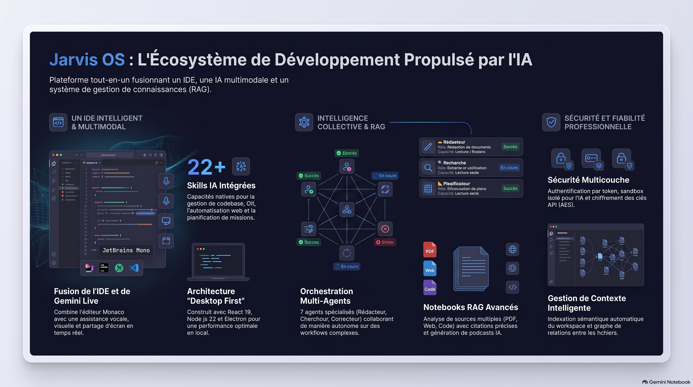

# 🧠 Jarvis-OS ORIGINAL — L'IDE universel piloté par l'IA



[](https://github.com/yourusername/Jarvis-os-beta/releases)
[](https://nodejs.org)
[](./LICENSE)
[](./CONTRIBUTING.md)
[]()

> **Un système d'exploitation IA multimodal en temps réel : interaction vocale, vision par ordinateur, agents autonomes et un IDE intégré, le tout dans une interface immersive de bureau.**

Jarvis‑OS est un environnement de développement universel capable d'importer n'importe quel projet local (React, Node, Python, Go, Rust…). L'IA le comprend en profondeur grâce à un Knowledge System qui indexe le code, mémorise les décisions et modélise les dépendances – puis agit directement sur vos fichiers, en lecture, écriture, refactorisation ou test.

L'application combine :
- Un **assistant IA conversationnel temps réel** basé sur l'API Gemini Live (voix, texte, vision webcam/écran).
- Un **IDE complet intégré** (éditeur Monaco, explorateur de fichiers, terminal, Git/GitHub, diff viewer).
- Un **système d'agents autonomes** capable de planifier, déléguer et exécuter des missions multi-étapes avec vérification continue.
- Un **moteur de connaissance projet** (graphe de dépendances, recherche sémantique, mémoire de projet).
- Un système de **skills** extensible couvrant Git, GitHub, mémoire long terme, automatisation navigateur, et bien plus.

**Sécurité et confiance avant tout** : toutes les modifications sont d'abord réalisées dans un sandbox isolé par projet, validées par `tsc` et les tests, puis synchronisées après votre accord. Un checkpoint Git est automatiquement créé avant chaque écriture, vous offrant un rollback instantané.

---

## 📑 Sommaire

- [Pourquoi Jarvis‑OS ?](#-pourquoi-jarvisos-)
- [Fonctionnalités principales](#-fonctionnalités-principales)
- [Architecture](#-architecture)
- [Stack technique](#-stack-technique)
- [Installation](#-installation)
- [Configuration (.env)](#-configuration-env)
- [Scripts disponibles](#-scripts-disponibles)
- [Utilisation](#-utilisation)
- [Structure du projet](#-structure-du-projet)
- [Sécurité & Sandboxing](#-sécurité--sandboxing)
- [Tests & Qualité](#-tests--qualité)
- [Build & Distribution (Electron/Windows)](#-build--distribution-electronwindows)
- [Roadmap](#-roadmap)
- [Contribution & Licence](#-contribution--licence)
- [Remerciements](#-remerciements)

---

## 🎯 Pourquoi Jarvis‑OS ?

Les outils de développement classiques sont **statiques** : ils attendent vos actions. Jarvis‑OS, lui, **comprend, planifie et exécute** avec vous. C'est un IDE qui ne se contente pas de colorer votre code : il le lit, l'analyse, le modifie, le teste et l'améliore, **sous votre contrôle**.

**Problème** : vous passez des heures à chercher où se trouve une fonction, à comprendre des dépendances complexes, à écrire des tests répétitifs ou à corriger des erreurs de compilation.

**Solution** : Jarvis‑OS intègre une IA conversationnelle qui connaît votre projet dans sa globalité, anticipe les impacts de vos modifications et exécute les tâches à votre place – dans un environnement sécurisé qui protège votre code.

L'IA ne travaille pas seule : un système d'agents multi‑rôles délègue les sous‑tâches en parallèle, et un moteur de missions planifie, exécute et réfléchit sur des objectifs complexes. Le tout est piloté par une interface conversationnelle en temps réel (Gemini Live), avec une mémoire persistante, une recherche sémantique et un apprentissage continu.

---

## ✨ Fonctionnalités principales

### 🎙️ Assistant multimodal (Gemini Live)

- Interaction vocale en temps réel (WebSocket `/live`)
- Vision par webcam et partage d'écran
- Function calling natif pour piloter l'ensemble des skills du système
- Deux modes :
  - `Full` : accès complet aux outils (lecture, écriture, tests, Git, système)
  - `Ask` : lecture seule + recherche (écritures bloquées, sauf fichiers `.md`)

### 💻 IDE intégré

| Composant | Description |
|-----------|-------------|
| **Éditeur Monaco** | Coloration syntaxique multi-langages, autocomplétion, diff interactif, recherche globale |
| **Prévisualisation Markdown** | Rendu HTML des fichiers `.md`. Bascule texte brut ↔ preview via `Ctrl+Shift+M` |
| **Explorateur de fichiers** | Arborescence virtualisée, onglets, breadcrumb, renommage, copier/coller, glisser‑déposer |
| **Terminal intégré** | Shell interactif (bash/PowerShell) via `node-pty` avec PTY complet |
| **Panneau Git** | Statut, diff, historique et intégration GitHub (repos, PR) |
| **Barre d'état** | Branche Git, statut du build, connexion MCP, compteur de tokens, mode compact |
| **Palette de commandes** | Accès rapide à toutes les actions (`Ctrl+Shift+P`) |
| **Thème clair/sombre** | Adaptatif et personnalisable |

### 🤖 Agents & Autonomie

- **Orchestrateur multi-agents** (`AgentOrchestrator`, `AgentExecutor`, `AgentRegistry`) avec bus de messages dédié
- **Agents spécialisés** :
  - `architect` : analyse architecturale, dépendances, couplage
  - `review` : revue de code, qualité, patterns
  - `refactor` : réduction de complexité, suppression de duplication
  - `security` : audit de vulnérabilités
  - `test` : tests unitaires/intégration
  - `docs` : documentation technique (JSDoc, Markdown)
- **Système de missions** : décomposition automatique d'une tâche complexe en sous-objectifs, planification, exécution et réflexion post-exécution (`Planner`, `Executor`, `Reflection`, `SkillScorer`)
- **Boucle d'autonomie supervisée** (`Supervisor`, `AutonomousLoop`) avec guardrails
- **Workflows déclaratifs** (JSON) : `feature.workflow.json`, `refactor-safe.workflow.json`, `security-audit.workflow.json`

### 🧠 Compréhension & Mémoire du projet (Knowledge System)

| Composant | Rôle |
|-----------|------|
| **ProjectIndexer** | Scanne tous les fichiers et extrait les entités (classes, fonctions, interfaces, exports, imports) |
| **KnowledgeGraph** | Graphe permanent des connaissances (fichiers, entités, dépendances), persisté dans `.jarvis/ProjectKnowledge.json` |
| **DependencyGraph** | Graphe orienté des dépendances, détection de cycles, calcul de centralité, chaînes d'impact |
| **ProjectMemory** | Mémoire projet persistante (architecture, conventions, décisions, bugs, patterns) |
| **SemanticSearch** | Moteur de recherche sémantique (TF‑IDF) pour retrouver des fichiers ou sections pertinentes |
| **ReasoningPipeline** | Pipeline de raisonnement en 6 étapes : compréhension → recherche → contexte → raisonnement → auto‑critique → final |
| **ImpactAnalyzer** | Évalue l'impact d'une modification (score de risque, recommandations de tests, validation hiérarchique) |
| **PlanningEngine** | Ordonnancement multi‑fichiers (stratégies `dependency`, `risk_first`, `critical_path`) |
| **UnderstandingEngine** | Orchestre tous les piliers pour fournir un score de compréhension et des recommandations |
| **LearningEngine** | Extraction automatique de leçons après chaque mission (patterns d'erreur, optimisations, décisions) |

- **Mémoire vectorielle (RAG)** : préférences utilisateur, décisions et faits importants stockés dans Supabase avec embeddings et recherche sémantique
- **Historique conversationnel** : sauvegarde avec résumé automatique (compression intelligente au-delà de 850k tokens)
- **Watcher de fichiers** : tient la connaissance à jour en continu

### 🧩 Skills (function calling)

L'IA expose plus de **50 outils** regroupés par catégories :

| Catégorie | Exemples |
|-----------|----------|
| **Codebase** | `read_project_file`, `write_project_file`, `patch_project_file`, `search_in_files`, `list_project_files` |
| **Git & GitHub** | `git_status`, `git_commit`, `git_push`, `github_list_issues`, `github_create_issue` |
| **Mémoire & Connaissances** | `save_memory`, `search_memory`, `knowledge_build_context`, `knowledge_impact_analyze` |
| **Raisonnement** | `reasoning_think` (Chain of Thought, décomposition, auto‑critique, tree-of-thought) |
| **Automatisation** | Navigateur headless via Puppeteer : `automation_search`, `automation_navigate`, `automation_click`, `automation_screenshot` |
| **Système** | `run_command`, `system_info`, `notify_user`, ouverture d'apps/fichiers locaux |
| **Missions & Agents** | `mission_create`, `mission_status`, délégation multi-agents |
| **Validation** | `verify_file`, `verify_typecheck`, `verify_run_script` |
| **Workflows** | `workflow_create`, `workflow_run`, `workflow_list` |
| **Divers** | `get_weather`, `get_current_time`, `list_create`, `list_add_item` |

Les skills sont **chargés dynamiquement** (tier 1 / tier 2) pour optimiser la consommation de tokens. Un système de **skills personnalisées** permet d'en créer de nouvelles.

### 🔌 MCP (Model Context Protocol)

Jarvis‑OS est compatible avec le **Model Context Protocol**, qui permet d'intégrer des serveurs d'outils externes (stdio ou SSE) et d'exposer leurs compétences à l'IA comme des skills natifs.

- **McpBridge / McpClient** : orchestre plusieurs serveurs MCP, agrège leurs outils et les convertit en déclarations Gemini
- **Hot‑reload** : les serveurs peuvent être activés/désactivés dynamiquement via l'interface
- **Auto‑reconnexion** : backoff exponentiel et health‑check pour maintenir les connexions
- **Métriques** : chaque appel d'outil est enregistré (durée, succès/erreur) pour le monitoring

### 📂 Gestion de projets externes

- **Sélection au démarrage** : modal pour choisir un dossier existant, créer un projet vierge ou le scaffolder (React, Next.js, React Router)
- **Persistance automatique** : le dernier projet est mémorisé dans `.jarvis/lastProject.json`
- **Changement à chaud** : réinitialise le workspace, le sandbox et le Knowledge System en un clic
- **Indexation automatique** : dès qu'un projet est chargé, le Knowledge Graph, la mémoire et l'indexeur sont recalculés

---

## 🏗️ Architecture

```
┌─────────────────────────────────────────────────────────────────────────────┐
│                           Jarvis‑OS                                         │
├─────────────────────────────────────────────────────────────────────────────┤
│  FRONTEND (React 19 + Vite 6)                                              │
│  ┌─────────────┐ ┌─────────────┐ ┌─────────────┐ ┌─────────────────────┐  │
│  │ IDE Views   │ │ Chat Panel  │ │ Sidebar     │ │ Settings / Modals   │  │
│  └─────────────┘ └─────────────┘ └─────────────┘ └─────────────────────┘  │
│         │              │              │              │                      │
│         ▼              ▼              ▼              ▼                      │
│  ┌────────────────────────────────────────────────────────────────────┐    │
│  │              WebSocket / REST API                                  │    │
│  └────────────────────────────────────────────────────────────────────┘    │
│                             │                                              │
├─────────────────────────────┼──────────────────────────────────────────────┤
│  BACKEND (Node.js + Express)│                                              │
│  ┌──────────────────────────┼──────────────────────────────────────────┐   │
│  │  Gemini Live             │  Skills & Agents                         │   │
│  │  (session, tools, audio) │  ┌────────────────────────────────────┐  │   │
│  └──────────────────────────┘  │ AgentOrchestrator (6 rôles)        │  │   │
│  ┌──────────────────────────┐  │ Missions (Planner/Executor/Reflect)│  │   │
│  │  Knowledge System        │  │ Autonomy (Supervisor/Loop)         │  │   │
│  │  (Graph, Memory, Search) │  └────────────────────────────────────┘  │   │
│  └──────────────────────────┘  ┌────────────────────────────────────┐  │   │
│  ┌──────────────────────────┐  │ Runtime (workflow engine, state     │  │   │
│  │  MCP Bridge              │  │  machine, agents spécialisés)      │  │   │
│  │  (serveurs externes)     │  └────────────────────────────────────┘  │   │
│  └──────────────────────────┘  ┌────────────────────────────────────┐  │   │
│                                │ Sandbox & Checkpoints               │  │   │
│                                │ (isolation, validation, rollback)   │  │   │
│                                └────────────────────────────────────┘  │   │
│  ┌──────────────────────────────────────────────────────────────────┐  │   │
│  │  Sécurité : Auth, Rate Limit, Prompt Injection Guard, Audit     │  │   │
│  └──────────────────────────────────────────────────────────────────┘  │   │
└─────────────────────────────────────────────────────────────────────────────┘
               │
     Gemini Live API · Supabase · OpenRouter · GitHub API
```

L'application peut être lancée en tant qu'application web locale (`npm run dev`) ou packagée en application de bureau **Electron** (`electron/main.cjs`). Vite est monté en middleware directement dans `server.ts` (ne jamais lancer `vite dev` séparément).

### Canaux WebSocket

| Endpoint | Usage |
|----------|-------|
| `/live` | Session Gemini Live (audio + texte + outils) |
| `/terminal` | Terminal PTY interactif |
| `/sandbox-watch` | Notifications en temps réel des modifications de fichiers dans le sandbox |

### Gestion du workspace (SELF_ROOT)

```
Démarrage serveur
├── initSelfRoot()
│   ├── .jarvis/lastProject.json existe ? → SELF_ROOT = chemin persisté
│   └── pas de fichier ? → SELF_ROOT = "" (aucun projet)
│
├── hasProject() = false → skip Sandbox + KnowledgeGraph
│
└── Frontend : GET /api/self-root/status → { noProject: true }
    └── StartupProjectModal s'affiche
        └── Utilisateur sélectionne un dossier
            └── POST /api/self-root/change
                ├── setSelfRoot() + persistProject()
                ├── initSandbox() + startWatching()
                └── knowledgeGraph.load() + projectIndexer.scanAll()
```

---

## 🔧 Stack technique

| Domaine | Technologies |
|---------|-------------|
| Frontend | React 19, React Router 7, Vite 6, Tailwind CSS 4, Monaco Editor, xterm.js, Framer Motion |
| Backend | Node.js, Express 4, WebSocket (`ws`), `node-pty` (terminal), Puppeteer (automatisation navigateur) |
| IA | `@google/genai` (Gemini Live, function calling), OpenRouter (analyse alternative) |
| Données | Supabase (mémoire long terme, historique, missions) |
| Desktop | Electron 43, electron-builder (packaging Windows/NSIS) |
| Outillage | TypeScript 5 (strict), esbuild, tsx |

---

## 📦 Installation

### Prérequis

- **Node.js** ≥ 22.12.0 (recommandé : version LTS)
- **npm** ≥ 10.x
- **Git** (pour les checkpoints et les commandes git)
- **Clé API** Gemini (ou OpenRouter) — [obtenez une clé Gemini](https://ai.google.dev/)

### Installation Standard

```bash
# 1. Cloner le dépôt
git clone https://github.com/yourusername/Jarvis-os-beta.git
cd Jarvis-os-beta

# 2. Installer les dépendances
npm install

# 3. Copier et configurer l'environnement
cp .env.example .env
# → Éditer .env : renseigner au minimum GEMINI_API_KEY (ou OPENROUTER_API_KEY)

# 4. Lancer en développement
npm run dev
```

L'application sera disponible sur `http://localhost:5000`.

Au premier démarrage, un modal vous demandera de sélectionner le dossier du projet sur lequel vous souhaitez travailler.

### Installation Desktop (Electron)

```bash
# Développement avec DevTools
npm run desktop:debug

# Build production + packaging Windows
npm run dist:win
```

Le fichier `.exe` sera généré dans le dossier `release/`.

---

## ⚙️ Configuration (.env)

| Variable | Description | Requis |
|----------|-------------|--------|
| `GEMINI_API_KEY` | Clé API Gemini (ou pool de clés via `.gemini-keys.json`) | ✅ |
| `OPENROUTER_API_KEY` | Clé API OpenRouter (alternative à Gemini) | ❌ |
| `JARVIS_API_TOKEN` | Jeton d'authentification pour sécuriser l'API (header `x-jarvis-token`) | Recommandé |
| `SUPABASE_URL` | URL du projet Supabase (mémoire vectorielle, historique) | ❌* |
| `SUPABASE_SERVICE_ROLE_KEY` | Clé service‑role Supabase | ❌* |
| `GITHUB_TOKEN` | Token GitHub (panneau GitHub, PR, dépôts) | ❌ |
| `VITE_SERVER_PORT` | Port du serveur (défaut : `5000`) | ❌ |
| `SELF_HEAL_READONLY` | `true` (défaut) : auto‑guérison en lecture seule ; `false` : écriture automatique | ❌ |
| `JARVIS_LISTEN_HOST` | `127.0.0.1` (défaut) ; `0.0.0.0` pour accès réseau (exige `JARVIS_API_TOKEN`) | ❌ |
| `JARVIS_CONFIG_PATH` | Chemin du dossier de configuration (Electron) | ❌ |
| `DISABLE_HMR` | Désactive le hot-reload Vite | ❌ |

> *`SUPABASE_URL` et `SUPABASE_SERVICE_ROLE_KEY` doivent être définies **ensemble** ou pas du tout — le serveur refuse de démarrer sinon.

Les valeurs sensibles sont chiffrées/déchiffrées au démarrage via `server/utils/crypto.ts` (AES-256).

---

## 📜 Scripts disponibles

| Commande | Description |
|----------|-------------|
| `npm run dev` | Démarre le serveur (backend Express + Vite en middleware) en mode développement |
| `npm run build` | Build de production (frontend Vite + bundle serveur esbuild) |
| `npm start` | Lance le build de production (`dist/server.cjs`) |
| `npm run desktop` | Lance l'application Electron en développement |
| `npm run desktop:debug` | Electron avec DevTools/debug activés |
| `npm run preview` | Prévisualise le build Vite seul |
| `npm run test` | Exécute tous les tests unitaires (`server/**/*.test.ts`) |
| `npm run lint` | Linter maison (longueur de ligne, `console.log`, TODO, etc.) |
| `npm run clean` | Supprime `dist/` et `server.js` |
| `npm run pack:win` | Package l'app Windows sans installeur (dossier `release/`) |
| `npm run dist:win` | Génère l'installeur Windows (NSIS) |

---

## 🧰 Utilisation

### 1. Lancer l'application

```bash
npm run dev
```

### 2. Sélectionner un projet

Au premier démarrage (ou après « Changer de projet »), un modal s'affiche.  
Entrez ou parcourez le chemin vers votre projet, puis cliquez **Ouvrir le projet**.  
Jarvis charge le projet, initialise le sandbox et indexe le code.

### 3. Se connecter à l'IA

- Cliquez sur l'icône « brain » dans la barre latérale de l'IDE.
- Choisissez votre mode (`Full`, `Ask`).
- Parlez ou tapez votre demande.

### 4. Changer de projet

- Cliquez sur le bouton **« Changer de projet »** en haut de l'explorateur de fichiers.
- Le serveur efface la persistance, et le modal de sélection réapparaît.
- Sélectionnez votre nouveau projet → Jarvis bascule, réindexe et reprend.

### 5. Exemples de commandes

| Commande | Action |
|----------|--------|
| `Affiche la structure du projet` | `list_project_files` |
| `Lis le fichier server.ts` | `read_project_file` |
| `Corrige l'erreur de typage dans src/App.tsx` | `patch_project_file` + `verify_file` |
| `Crée un test unitaire pour la fonction parseConfig` | Délégation à l'agent `test` |
| `Quel est l'impact de modifier server.ts ?` | `knowledge_impact_analyze` |
| `Recherche la documentation de React 19` | `automation_search` |
| `Lance un audit de sécurité complet` | Workflow `security-audit` |

### 6. Raccourcis clavier (IDE)

| Raccourci | Action |
|-----------|--------|
| `Ctrl+P` | Palette de fichiers |
| `Ctrl+Shift+P` | Palette de commandes |
| `Ctrl+Shift+F` | Recherche globale |
| `Ctrl+Shift+K` | Créer un checkpoint manuel |
| `Ctrl+Shift+B` | Valider le code (`tsc --noEmit`) |
| `Ctrl+Shift+H` | Afficher le panneau des checkpoints |
| `Ctrl+Shift+M` | Basculer prévisualisation Markdown (fichiers `.md` uniquement) |
| `Ctrl+Shift+S` | Ouvrir les paramètres |
| `` Ctrl+` `` | Ouvrir le terminal |

---

## 📁 Structure du projet

```
Jarvis-os-beta/
├── electron/                # Code Electron (main, preload, splash)
├── server/                  # Backend Node.js/Express
│   ├── agents/              # Orchestration multi-agents, délégation, exécution
│   ├── autonomy/            # Superviseur de la boucle d'autonomie, smart skills
│   ├── knowledge/           # Knowledge System (KG, mémoire, recherche, raisonnement)
│   ├── mcp/                 # Intégration MCP (McpBridge, McpClient)
│   ├── mission/             # Planification/exécution/réflexion des missions autonomes
│   ├── prompts/             # Prompts système modulaires
│   ├── routes/              # Routes API REST
│   ├── runtime/             # Runtime d'agents (workflow engine, state machine)
│   ├── skills/              # Skills IA (outils / function calling)
│   ├── utils/               # Utilitaires (checkpoint, sandbox, crypto, selfRoot, etc.)
│   └── workflows/           # Workflows automatisés (audit, évolution)
├── src/                     # Frontend React
│   ├── components/          # Composants UI (IDE, panneaux, settings, modals)
│   │   └── ide/             # Composants spécifiques à l'IDE intégré
│   ├── context/             # Contextes React (LiveAPI, UserProfile, ScreenShare)
│   ├── hooks/               # Hooks personnalisés
│   ├── services/            # Services API
│   ├── types/               # Définitions TypeScript partagées
│   ├── utils/               # Utilitaires frontend
│   └── views/               # Pages (IdeView, Settings, etc.)
├── tests/                   # Tests d'intégration (end-to-end)
├── docs/                    # Documentation (analyses, plans, propositions)
├── .jarvis/                 # Données internes de l'app Jarvis (lastProject.json)
├── server.ts                # Point d'entrée backend
├── server-bootstrap.ts      # Bootstrap serveur
├── package.json
├── tsconfig.json
└── vite.config.ts
```

> **Note** : chaque projet que vous ouvrez avec Jarvis aura son propre dossier `.jarvis/` contenant `sandbox/`, `ProjectKnowledge.json`, `ProjectMemory.json`. Ces fichiers restent dans votre projet et ne sont pas partagés entre projets.

---

## 🔒 Sécurité & Sandboxing

| Couche | Description |
|--------|-------------|
| **Authentification** | Jeton API (`JARVIS_API_TOKEN`, header `x-jarvis-token`) requis pour toutes les routes `/api/*` et les WebSockets |
| **Sandbox par projet** | Toutes les écritures sont d'abord dirigées vers `.jarvis/sandbox/` dans le projet actif |
| **Checkpoints Git** | Commit automatique avant toute modification → rollback instantané |
| **Validation automatique** | `tsc --noEmit` après chaque écriture ; erreur → correction ou rollback |
| **Fichiers critiques** | Confirmation utilisateur requise (`server.ts`, `.env`, `package.json`, `electron/main.cjs`…) |
| **Rate limiting** | Limites différenciées (polling, écriture, authentification) pour prévenir les abus |
| **Chiffrement AES-256** | Variables d'environnement sensibles chiffrées |
| **Prompt Injection Guard** | Détection de tentatives d'injection de prompt (`promptInjectionGuard.ts`) |
| **Post-Edit Validator** | Validation de chaque fichier modifié par un agent avant validation finale |
| **Journal d'audit** | Toutes les actions sensibles enregistrées (`audit.ts` + route `/api/audit`) |
| **Auto-guérison** | En cas d'erreur (compilation, import manquant), l'IA tente de réparer automatiquement (max 3 tentatives) |
| **Isolation de workspace** | `/api/ide/tree` retourne `{ entries: [], noProject: true }` si aucun projet actif |

---

## 🧪 Tests & Qualité

```bash
# Tous les tests
npm run test

# Tests d'un module spécifique
node --import tsx --test server/**/security.test.ts

# Linter (quality gate)
npm run lint
```

### Couverture par module

| Module | Fichiers de test | Statut |
|--------|------------------|--------|
| Agents | `server/agents/*.test.ts` | ✅ |
| Audit | `server/audit.test.ts` | ✅ |
| Checkpoint | `server/utils/checkpoint.test.ts` | ✅ |
| Codebase | `server/skills/codebase.test.ts` | ✅ |
| Confirmation | `server/utils/confirmationBridge.test.ts` | ✅ |
| Crypto | `server/utils/crypto.test.ts` | ✅ |
| Evolution | `server/utils/evolutionStore.test.ts` | ✅ |
| GeminiKeyPool | `server/utils/geminiKeyPool.test.ts` | ✅ |
| Git | `server/skills/git.test.ts` | ✅ |
| GitHub | `server/skills/github.test.ts` | ✅ |
| Guidelines | `server/skills/guidelines.test.ts` | ✅ |
| History | `server/skills/history.test.ts` | ✅ |
| Logger | `server/utils/logger.test.ts` | ✅ |
| Planning | `server/knowledge/PlanningEngine.test.ts` | ✅ |
| Reasoning | `server/skills/reasoning.test.ts` | ✅ |
| Sandbox | `server/utils/sandbox.test.ts` | ✅ |
| Security | `server/security.test.ts` | ✅ |
| SelfRoot | `server/selfRoot.test.ts` | ✅ |
| SelfHealing | `server/skills/SelfHealing.test.ts` | ✅ |
| SkillManager | `server/skills/SkillManager.test.ts` | ✅ |
| Verify | `server/skills/verify.test.ts` | ✅ |
| Weather | `server/skills/weather.test.ts` | ✅ |
| Workflows | `server/skills/workflow.test.ts` | ✅ |

---

## 📦 Build & Distribution (Electron/Windows)

```bash
npm run build        # Build web (Vite + bundle serveur)
npm run pack:win     # Package Windows sans installeur (dossier release/)
npm run dist:win     # Génère l'installeur NSIS
```

La configuration `electron-builder` embarque le frontend, l'enveloppe Electron et les fichiers de configuration dans le package final.

> ⚠️ **Attention** : vérifier que les fichiers `.env` ne sont pas inclus dans le package avant toute distribution publique.

---

## 🗺️ Roadmap

### ✅ V0.2 — Architecture Universelle Multi‑Projets (Livrée)

- [x] Workspace dynamique multi‑projets
- [x] Initialisation « Projet Vide » au démarrage
- [x] Persistance & restauration du dernier projet
- [x] Changement de projet à chaud
- [x] Explorer & API IDE défensifs (gestion de l'état « aucun projet »)
- [x] Instruction système adaptative
- [x] Sandbox découplé par projet
- [x] Knowledge System contextuel (indexation, graphe, mémoire, recherche)
- [x] Système d'agents multi‑rôles (test, docs, refactor, security, review, architect)
- [x] Missions & auto‑évolution (moteur de réflexion, workflows)
- [x] Pont MCP (Model Context Protocol)
- [x] RAG vectoriel & optimiseur de contexte

### ✅ V0.4 — Agents Autonomes & Runtime (Livrée — Beta)

- [x] Boucle d'autonomie supervisée (Supervisor, AutonomousLoop)
- [x] Runtime d'agents (workflow engine, state machine, agents spécialisés)
- [x] Workflows déclaratifs JSON
- [x] Garde anti-injection de prompt
- [x] Validation post-édition automatique
- [x] Explorateur de fichiers virtualisé
- [x] Panneau Vision (webcam/écran)

### 🚧 V0.5 — Expérience Développeur & Multi‑Workspaces (En cours)

- [ ] Historique des projets récents (MRU) dans le modal
- [ ] Clonage Git intégré (GitHub/GitLab)
- [ ] Workflows visuels low‑code (éditeur graphique)
- [ ] Support de workspaces multi‑racines (monorepo, micro‑services)
- [ ] Profils utilisateur (préférences individualisées)
- [ ] Auto‑tests E2E avancés (Puppeteer/Playwright)
- [ ] Robustesse de la boucle d'autonomie sur des missions longues
- [ ] Couverture de tests sur le module `runtime/`

### 📋 V1.0 — Déploiement & Enterprise Readiness (3‑6 mois)

- [ ] CI/CD intégré (builds, tests sur PR, déploiement continu)
- [ ] Monitoring & diagnostic système (tableau de bord de santé)
- [ ] Documentation auto‑générée (TypeDoc, JSDoc, MkDocs)
- [ ] Analyse de sécurité SAST & audit dépendances (CVE)
- [ ] Mode hors‑ligne (modèles locaux via Ollama/llama.cpp)
- [ ] Durcissement de la configuration de packaging Electron (gestion des secrets)

### 💡 V2+ — Écosystème Autonome & Multi‑Agents

- [ ] Orchestration d'IA spécialisées (essaims d'agents)
- [ ] Extension Marketplace (plugins créés par la communauté ou auto‑générés)
- [ ] Auto‑refactoring autonome avancé (dette technique résolue en arrière‑plan)

---

## 🤝 Contribution & Licence

### Contribution

Les contributions sont les bienvenues ! Voici les règles :

1. **Tester** : ajouter ou mettre à jour les tests unitaires correspondants.
2. **Documenter** : mettre à jour le README ou la documentation interne si nécessaire.
3. **Bonnes pratiques** : suivre les conventions de code (ESLint, Prettier) et le style de commit (Conventional Commits).
4. **Soumettre une PR** avec une description claire des changements et leur raison.
5. **Modifications de `server.ts` ou de `selfRoot.ts`** : doivent être validées par au moins un mainteneur.
6. **Changements d'API** : documentés dans `API_DOCS.md`.
7. **Respecter la sécurité** : ne jamais contourner les garde‑fous (sandbox, checkpoint, fichiers critiques).

### Licence

Ce projet est sous licence **MIT** — voir le fichier [LICENSE](./LICENSE) pour plus de détails.

---

## 🙏 Remerciements

- **Google Gemini** pour l'API Live et le modèle de langage.
- **Vite** et **React** pour le frontend réactif.
- **Electron** pour l'encapsulation desktop.
- **Supabase** pour la base de données et la mémoire vectorielle.
- **MCP** (Model Context Protocol) pour l'intégration d'outils externes.
- **Monaco Editor** pour l'éditeur de code intégré.
- **Tous les contributeurs** qui ont fait vivre ce projet.

---

*Jarvis‑OS — L'IA qui travaille avec vous, sur vos projets.*
