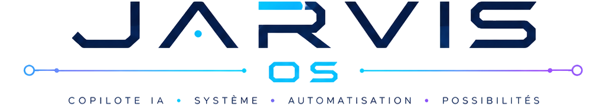
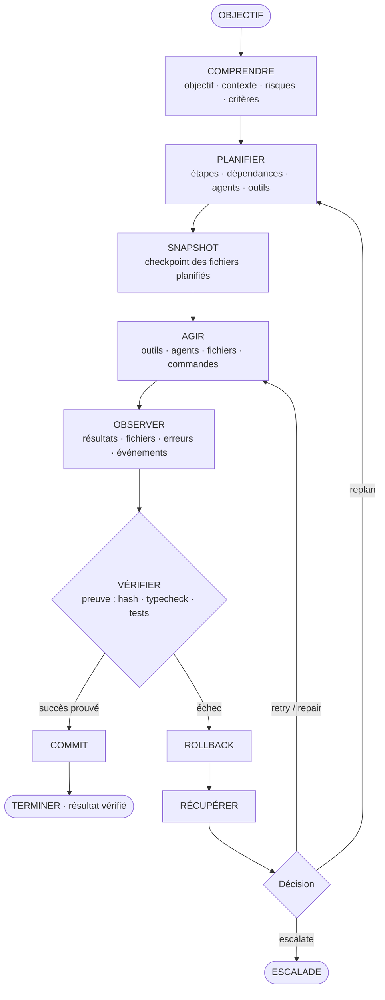
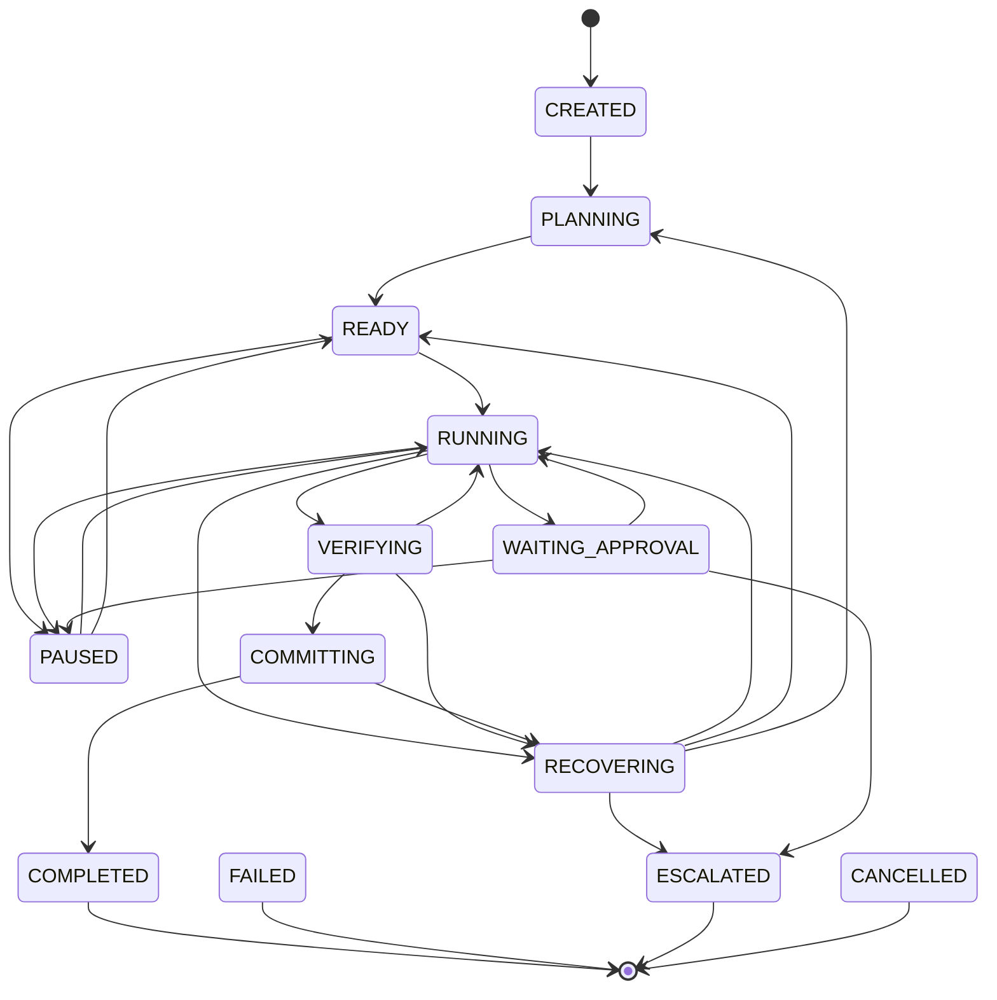

<div align="center">

<!-- ═══════════════════════════════════════════════════════════════════════ -->
<!-- HERO SECTION — DARK DESIGN                                             -->
<!-- ═══════════════════════════════════════════════════════════════════════ -->

<br>

<picture>
  <source media="(prefers-color-scheme: dark)" srcset="assets/images/logo.png">
  <source media="(prefers-color-scheme: light)" srcset="assets/images/logo.png">
  
</picture>

<br><br>

# 🧠 LEANNA

**Environnement d'exécution d'agents IA autonomes, local-first**

<br>


<br>

<sub>Leanna est une plateforme desktop local-first dédiée à l'exécution sécurisée et transparente d'agents IA autonomes. Conçue pour offrir un contrôle total, l'application orchestre des tâches complexes via un cycle strict : Comprendre, Planifier, Agir, Observer, Vérifier et Récupérer.

Rien ne quitte votre machine sans action explicite. Chaque action à effet de bord traverse une chaîne de sécurité rigoureuse (idempotence, permissions, sandbox, dry-run, Safety Gate Jev), et surtout un **noyau transactionnel** qui snapshot, agit, vérifie par la preuve, puis commit ou rollback.</sub>

<br><br>

<!-- Badges row 1 — Status -->

&nbsp;

&nbsp;


<br>

<!-- Badges row 2 — Tech stack -->

&nbsp;

&nbsp;

&nbsp;

&nbsp;

&nbsp;

&nbsp;


<br><br>

<!-- Quick links -->
<a href="#-installation"><kbd>🚀 Installation</kbd></a>&nbsp;&nbsp;
<a href="#-noyau-p0--le-noyau-transactionnel"><kbd>⚙️ Noyau P0</kbd></a>&nbsp;&nbsp;
<a href="#-architecture-multi-agents"><kbd>🤖 Agents</kbd></a>&nbsp;&nbsp;
<a href="#-autonomie-proactive"><kbd>🛰️ Autonomie</kbd></a>&nbsp;&nbsp;
<a href="#-architecture-de-sécurité"><kbd>🔐 Sécurité</kbd></a>

<br><br>

</div>

<!-- ═══════════════════════════════════════════════════════════════════════ -->
<!-- LÉGENDE DES MARQUEURS                                                   -->
<!-- ═══════════════════════════════════════════════════════════════════════ -->

> **Légende de maturité.** Ce README distingue explicitement le niveau de preuve de
> chaque composant. Rien n'est marqué ✅ sans un fichier **et** un symbole identifiables
> dans le code, la plupart étant par ailleurs couverts par des tests.
>
> | Marqueur | Signification |
> |:---:|---|
> | ✅ | Implémenté — fichier + symbole présents (généralement avec `.test.ts`) |
> | 🟡 | Partiel / scaffolding — présent mais incomplet, ou chemin d'émission limité |
> | 📋 | Planifié — prévu mais non implémenté |
> | 💡 | Idée / piste de conception |

<br>


<br>

<!-- ═══════════════════════════════════════════════════════════════════════ -->
<!-- TABLE OF CONTENTS                                                       -->
<!-- ═══════════════════════════════════════════════════════════════════════ -->

<details open>
<summary><b>📋 Table des matières</b></summary>

<br>

| | Section | | Section |
|---|---|---|---|
| 🧠 | [Qu'est-ce que Leanna ?](#-quest-ce-que-leanna-) | ⚙️ | [**Noyau P0 — le noyau transactionnel**](#-noyau-p0--le-noyau-transactionnel) |
| 💡 | [L'idée centrale](#-lidée-centrale) | 🔄 | [Machine à états de mission](#machine-à-états-de-mission) |
| 🎯 | [Pourquoi Leanna existe](#-pourquoi-leanna-existe) | 💾 | [Store durable + Ledger d'idempotence](#store-durable--ledger-didempotence) |
| ✨ | [Ce que Leanna peut faire](#-ce-que-leanna-peut-faire) | 📸 | [Checkpoints & cycle transactionnel](#checkpoints--cycle-transactionnel) |
| 🔄 | [Boucle d'exécution autonome](#-la-boucle-dexécution-autonome) | 🧾 | [Moteur de preuve (Evidence)](#moteur-de-preuve-evidence) |
| 🧠 | [Cerveau de l'agent](#-cerveau-de-lagent-agent-brain) | 🛡️ | [Safety Gate Jev](#safety-gate-jev) |
| ⚡ | [Runtime agentique & budget](#-runtime-agentique--budget-transactionnel) | 🤖 | [Architecture multi-agents](#-architecture-multi-agents) |
| 🎯 | [Système de missions & estimation](#-système-de-missions) | 🧩 | [Rôles d'agents (20)](#rôles-dagents-20-rôles-statiques) |
| 🛰️ | [Autonomie proactive](#-autonomie-proactive) | 🐝 | [Swarm & Contract-Net](#composition-déquipe--swarmcomposer) |
| 🧠 | [Anticipation](#moteur-danticipation-anticipationengine) | 🖥️ | [Computer Use](#computer-use-computeruseagent) |
| 🧪 | [Smart Skills](#smart-skills--boucles-intégrées) | 📚 | [Connaissance & raisonnement](#-connaissance-et-compréhension) |
| 🔐 | [Architecture de sécurité](#-architecture-de-sécurité) | 🌐 | [Navigateur intégré (29 outils)](#-navigateur-intégré) |
| 📓 | [Notebooks & RAG hybride](#-notebooks-et-rag) | 🎙️ | [Assistant vocal notebook](#-assistant-vocal-du-notebook) |
| 🔌 | [MCP](#-mcp) • [Telegram](#-telegram) • [TTS](#-synthèse-vocale-tts) | 👁️ | [Observabilité](#observabilité) |
| 🚀 | [Installation & configuration](#-installation) | 🧪 | [Tests & validation](#tests) • [Contribuer](#contribuer) |

</details>

<br>


<br>

## 🧠 Qu'est-ce que Leanna ?

**Leanna est un environnement d'agent IA autonome natif pour le bureau.**

Il est conçu autour d'une différence fondamentale entre un assistant conversationnel classique et un système agentique.

Un assistant classique suit principalement ce modèle :

```text
Utilisateur → Question → IA → Réponse
```

Leanna est conçu autour de :

```text
Utilisateur → Objectif → Comprendre → Planifier → Agir → Observer
            → Vérifier → Récupérer / Replanifier → Terminer
```

L'objectif n'est pas simplement de générer du texte. L'objectif est de créer un
runtime capable de :

* comprendre un objectif et le contexte du projet ;
* déterminer quels outils et agents sont pertinents ;
* construire un plan d'exécution ;
* exécuter des actions et observer leurs résultats ;
* **vérifier le résultat par la preuve, pas par la narration du modèle** ;
* détecter les échecs et tenter une récupération bornée ;
* replanifier lorsque nécessaire ;
* maintenir la mémoire et le contexte ;
* respecter les permissions et les politiques d'autonomie ;
* **survivre à un crash sans rejouer une action destructive** ;
* exposer l'état d'exécution à l'utilisateur.

Leanna combine une interface de bureau, un runtime IA, un système d'agents, un
registre d'outils, un système de missions, la connaissance du projet, une
mémoire persistante, des contrôles de sécurité, un **noyau transactionnel
durable** et l'observabilité au sein d'un même environnement.

<br><br>

## 💡 L'idée centrale

Le principe de conception central de Leanna est :

> **Un agent IA ne doit pas être considéré comme performant parce qu'il a produit
> une réponse. Il doit être considéré comme performant lorsque l'objectif demandé
> a été exécuté et vérifié selon des critères de succès explicites — et prouvé par
> des faits observables, pas par ce que le modèle affirme avoir fait.**

Cette distinction est au cœur du **Moteur de preuve** (`EvidenceEngine`) et du
**Superviseur** (`LeannaSupervisor`) décrits plus bas : une action qui retourne
`ok: true` ne vaut rien tant que la vérification indépendante (hash de fichier,
typecheck, tests) ne l'a pas confirmée.

### Exécution orientée agent

```text
Objectif
  ↓
Acquisition du contexte  →  Compréhension  →  Planification
  ↓
Sélection d'outil / d'agent  →  Snapshot (checkpoint)  →  Exécution
  ↓
Observation  →  Vérification par preuve
  ↓
Succès prouvé ? ── oui → Commit → Résultat vérifié
               └─ non → Rollback → Récupération / Replanification
```

Par exemple, pour « Corriger le bug d'authentification », Leanna ne considère pas
la tâche terminée parce qu'un modèle a suggéré une modification. Une exécution
complète implique : comprendre, inspecter, planifier, snapshotter l'état,
modifier, **relire et hasher le fichier**, exécuter les vérifications, détecter
les échecs, corriger, revérifier, puis commit — ou rollback en cas d'échec.

<br><br>

## 🎯 Pourquoi Leanna existe

Les systèmes d'IA modernes sont de plus en plus capables de raisonnement et
d'utilisation d'outils, mais les tâches complexes nécessitent encore une
coordination entre le contexte, la planification, l'exécution, les outils, les
agents spécialisés, la mémoire, la vérification, la sécurité, la gestion des
échecs et l'approbation humaine.

Au lieu de traiter chaque requête comme une conversation isolée, Leanna traite
une requête comme une **mission** potentielle. Une mission possède : un objectif,
un contexte, des contraintes, un plan, **une estimation coût / durée / risque
avant exécution**, des étapes, des outils, des agents, des observations, des
critères de vérification, un comportement de récupération, un **état durable**
(machine à états persistée) et un résultat prouvé.

<br><br>

## ✨ Ce que Leanna peut faire

| Domaine | Capacités | Statut |
|---|---|:---:|
| **Noyau transactionnel** | Machine à états durable, ledger d'idempotence, checkpoints snapshot/rollback, moteur de preuve, superviseur unique | ✅ |
| **Interaction IA** | Chat, sélection de modèle, Live audio, visibilité des tokens, tâches en arrière-plan | ✅ |
| **Ingénierie logicielle** | Inspecter/lire/modifier le code, analyser dépendances, vérifier, Git/GitHub, terminal contrôlé, audits de sécurité | ✅ |
| **Exécution autonome** | Missions, planification, multi-étapes, suivi d'état, vérification, récupération, budgets bornés | ✅ |
| **Multi-agents** | 20 rôles statiques + rôles dynamiques, orchestration, délégation, swarm, contract-net | ✅ |
| **Autonomie proactive** | Anticipation (observe→détecte→propose), Computer Use, Smart Skills, heartbeat adaptatif | ✅ |
| **Connaissance** | Graphe de connaissances, AST (tree-sitter), call-graph, dépendances, impact, mémoire de stratégie | ✅ |
| **Productivité** | Notebooks, RAG hybride, embeddings, génération de documents, génération d'images, export PDF/DOCX/HTML | ✅ |
| **Navigateur intégré** | 29 outils `browser_*`, multi-onglets, profils, extensions, recherche serveur, vision | ✅ |
| **Intégrations** | Gemini, OpenRouter, Supabase, GitHub, Telegram, MCP (stdio/HTTP/SSE), Puppeteer | ✅ |
| **Workflow builder visuel** | Constructeur de workflows dans l'interface | 🟡 |
| **Marketplace** | Registre de compétences | 🟡 |

La disponibilité effective d'un rôle ou d'un outil au runtime dépend de son
enregistrement et de sa configuration d'exécution.

<br><br>

## 🔄 La boucle d'exécution autonome

Le modèle d'exécution repose sur une boucle de rétroaction fermée dans laquelle
**la vérification fait partie de l'exécution**, et non d'une étape finale
optionnelle.



La caractéristique importante est que la boucle est **transactionnelle** : l'état
est capturé avant d'agir, la vérification repose sur des faits observables, et un
échec déclenche un rollback plutôt qu'un abandon silencieux.

<br><br>

## 🧠 Cerveau de l'agent (Agent Brain)

Le dépôt contient un sous-système explicite de cerveau d'agent, situé sous
`server/agents/brain/`. Le Brain contient des composants dédiés pour la
compréhension de l'objectif, la planification dynamique, la validation de plan,
l'ordonnancement, la vérification, la correction et l'orchestration :

```text
AgentBrain.ts · GoalUnderstandingEngine.ts · DynamicPlanner.ts
BrainPlanValidator.ts · BrainVerifier.ts · BrainCorrectionLoop.ts · BrainScheduler.ts
```

Le `GoalUnderstandingEngine` dérive de l'objectif brut une représentation
structurée (intention, domaine, complexité, technologies, fichiers pertinents,
exigences, critères de succès, risques, justification). Le `DynamicPlanner`
génère des étapes d'exécution ordonnées et dépendantes, validées par schéma
(graphe + invariants) avant toute exécution.

<br><br>
## ⚙️ Noyau P0 — le noyau transactionnel

> **Section nouvelle.** Le noyau P0 (« Kernel ») est le socle d'industrialisation
> de Leanna. Il transforme une boucle agentique « best-effort » en un système
> **durable, idempotent et transactionnel**. Tout vit sous `server/core/` et
> persiste localement sous `.Leanna/core/` — aucune dépendance Supabase requise
> pour survivre à un crash.

Le noyau se compose de dix briques, assemblées par une fabrique unique
(`createCoreKernel`). Chaque brique a une responsabilité étroite ; le
`LeannaSupervisor` les coud ensemble en un cycle transactionnel.

| Brique | Fichier | Rôle | Statut |
|---|---|---|:---:|
| Machine à états | `MissionStateMachine.ts` | 13 états durables + transitions validées | ✅ |
| Store durable | `DurableMissionStore.ts` | Persistance atomique des missions | ✅ |
| Ledger | `ExecutionLedger.ts` | Idempotence + reprise sûre après crash | ✅ |
| Checkpoints | `CheckpointManager.ts` | Snapshot / commit / rollback de fichiers | ✅ |
| Preuve | `EvidenceEngine.ts` | Preuve d'exécution (prime sur la narration) | ✅ |
| Superviseur | `LeannaSupervisor.ts` | Autorité unique de mission | ✅ |
| Garde idempotence | `LedgerGuard.ts` | Hook ToolRegistry ↔ ledger | ✅ |
| Safety Gate | `JevSafetyGate.ts` | Jugement sémantique de risque (Jev) | ✅ |
| Couture agentique | `AgenticMissionRunner.ts` | Adaptateur Supervisor ↔ AgenticRuntime | ✅ |
| Fabrique | `kernel.ts` | `createCoreKernel` + activation par env | ✅ |

> Toutes les briques sont couvertes par des tests `.test.ts` dans `server/core/`,
> à l'exception de `DurableMissionStore.ts`, `paths.ts` et `index.ts` (barrel).

### Le cycle transactionnel

Le superviseur exécute chaque tentative de mission comme une **transaction** :

```text
            PREPARE
               │
               ▼
         ┌───────────┐   capture l'état des fichiers planifiés
         │ SNAPSHOT  │   AVANT toute modification (hash SHA-256)
         └─────┬─────┘
               ▼
         ┌───────────┐   le moteur réel agit (runner agentique/mission)
         │    ACT    │
         └─────┬─────┘
               ▼
         ┌───────────┐   la PREUVE prime : hash fichiers · typecheck · tests
         │  VERIFY   │   (EvidenceEngine), pas la narration du modèle
         └─────┬─────┘
          ┌────┴────┐
   prouvé │         │ non prouvé
          ▼         ▼
    ┌─────────┐ ┌──────────┐
    │ COMMIT  │ │ ROLLBACK │  restaure l'état d'origine (ou supprime
    │ (fige)  │ │          │  les créations) puis RÉCUPÉRER
    └────┬────┘ └────┬─────┘
         ▼           ▼
    COMPLETED   retry / repair / replan / escalate
```

Le cycle `PREPARE → SNAPSHOT → ACT → VERIFY → COMMIT/ROLLBACK` est implémenté dans
`LeannaSupervisor.runMission()`. Les primitives individuelles vivent dans
`CheckpointManager` (snapshot/commit/rollback) et `EvidenceEngine` (verify), tandis
que `MissionStateMachine` garantit l'ordre légal des transitions.

<br>

### Machine à états de mission

`MissionStateMachine` est une machine à états **pure** (aucune I/O) et réentrante.
Elle expose **13 états** et une table de transitions validée : toute paire absente
de la table lève une `IllegalTransitionError`. La persistance est déléguée au
`DurableMissionStore`, qui sauvegarde un snapshot après chaque transition.



Les quatre **états terminaux** (`COMPLETED`, `FAILED`, `ESCALATED`, `CANCELLED`)
n'ont aucune transition sortante. `CANCELLED` est atteignable depuis tout état non
terminal (annulation utilisateur). `FAILED` est atteignable depuis les états
actifs. Une fonction `toGoalStatus()` mappe l'état durable vers l'ancien
`GoalStatus` (`pending` / `in_progress` / `blocked` / `completed` / `failed` /
`cancelled`) pour l'affichage et la compatibilité.

| Phase du cycle | États associés |
|---|---|
| Préparation | `CREATED` → `PLANNING` → `READY` |
| Exécution | `RUNNING` |
| Vérification | `VERIFYING` |
| Validation | `COMMITTING` → `COMPLETED` |
| Récupération | `RECOVERING` (→ retry/replan) ou `ESCALATED` |
| Attente humaine | `WAITING_APPROVAL`, `PAUSED` |
| Échec | `FAILED`, `CANCELLED` |

<br>

### Store durable + Ledger d'idempotence

**`DurableMissionStore`** persiste chaque machine à états sous
`.Leanna/core/missions/<id>.json`, en écriture **atomique** (`tmp` + `rename`, avec
repli `copyFile` sur Windows via `writeJsonAtomic` de `paths.ts`). Le nom de
fichier est assaini (`[^a-zA-Z0-9_.-]` → `_`) pour empêcher toute traversée de
chemin. Il expose `save`, `load` (restaure via `fromSnapshot`), `listResumable`
(missions dans un état non terminal) et `delete`.

**`ExecutionLedger`** résout un problème précis : un crash survenant **après** un
effet de bord (écriture, push Git, commande shell…) mais **avant** l'enregistrement
du résultat ne doit **jamais** conduire à rejouer une action destructive.

Le ledger est un **journal append-only** (`.Leanna/core/ledger/actions.jsonl`).
Chaque action reçoit une clé d'idempotence déterministe :

```text
idempotencyKey = missionId:stepId:tool:argsHash
                 (argsHash = SHA-256 des arguments, clés triées → stable)
```

Avant d'exécuter, `begin(parts, sideEffect)` décide :

```text
begin(action)
   │
   ├── clé déjà « completed »              → skip   (retourne le résultat mémorisé)
   │
   ├── clé « unknown » (started orphelin)
   │     ├── effet de bord                 → block  (rejeu interdit)
   │     └── sans effet de bord            → execute
   │
   └── inédite / « failed »                → execute, puis complete() ou fail()
```

À la reprise, `hydrate()` rejoue le JSONL (dernière entrée par clé = vérité) puis
requalifie toute entrée restée `started` en `unknown` (interrompue par un crash).
Le ledger **ignore les outils** : l'appelant fournit le flag `sideEffect`, dérivé
des permissions via `permissionsHaveSideEffect()` (`write` / `exec` / `execute` /
`network` / `dangerous`). Un helper `runIdempotent()` enveloppe `begin → run →
complete/fail`.

La garde est branchée sur le point de passage unique des outils via `LedgerGuard`
(adaptateur `IdempotencyGuard`, hooké par `ToolRegistry.setIdempotencyGuard`). Elle
s'active via `.env` :

```env
# Idempotence (ledger d'exécution + reprise sûre après crash).
LEANNA_IDEMPOTENCY="false"
```

Sans configuration, aucun outil n'est impacté — le comportement reste strictement
inchangé.

<br>

### Checkpoints & cycle transactionnel

`CheckpointManager` implémente les primitives `PREPARE/SNAPSHOT`, `COMMIT` et
`ROLLBACK` au-dessus d'un `FileGateway` injectable (par défaut `node:fs`). Les
checkpoints persistent sous `.Leanna/core/checkpoints/<id>.json`.

| Méthode | Comportement |
|---|---|
| `snapshot(files, meta)` | Capture par fichier : `{ path, existed, content?, hash SHA-256? }`. Statut `open`. |
| `commit(id)` | Fige le checkpoint. **Le rollback devient impossible.** |
| `rollback(id)` | Fichier existant → réécrit l'original ; fichier créé → supprimé. Refusé si `committed`, idempotent si déjà `rolledback`. |
| `changedFiles(id)` | Diffe les hash courants vs le snapshot (support de la phase VERIFY). |

Les trois statuts possibles sont `open` → `committed` **ou** `rolledback`. Le hash
réutilise `WorkspaceState.hash()` (SHA-256), garantissant une détection de
changement content-addressed.

<br>

### Moteur de preuve (Evidence)

`EvidenceEngine` matérialise le principe « **la narration du LLM n'est pas une
preuve d'exécution ; la preuve doit toujours gagner** ». Un `EvidenceBundle`
agrège uniquement des faits **observables** :

```text
EvidenceBundle
├── changes          (FileChange : hashBefore / hashAfter)
├── filesModified · filesRead · toolsExecuted
├── testsExecuted    (CheckResult[])
├── typecheck · lint · runtimeChecks
├── approvals · policyDecisions · unresolvedRisks
├── confidence       (DÉRIVÉE déterministe, pas d'auto-évaluation du modèle)
└── passed
```

`deriveConfidence()` est **déterministe** : aucune preuve → 0.1 ; un contrôle
échoué → confiance fortement abaissée ; tous les contrôles mesurés passent → base
0.9 (ou 0.6 si seules des modifications de fichiers existent), moins 0.1 par risque
non résolu. `evidenceEstablishesSuccess()` ne renvoie `true` que si **tous** les
contrôles exécutés passent. Chaque bundle est persisté sous
`.Leanna/core/evidence/<id>.json`.

<br>

### LeannaSupervisor — l'autorité unique de mission

`LeannaSupervisor` est l'**autorité unique** qui décide « quelle est la prochaine
action ? ». Il ne remplace pas les moteurs d'exécution : il les **pilote** via une
fonction `MissionRunner` injectée, et compose les briques P0.

```text
runMission({ missionId, goal, runner, plannedFiles })
   │
   ├─ CREATED → PLANNING → READY
   │
   └─ boucle (≤ maxAttempts, défaut 3) :
        RUNNING
          → checkpoints.snapshot(plannedFiles)        ← PREPARE + SNAPSHOT
          → runner({ missionId, goal, attempt })      ← ACT
        VERIFYING
          → evidence.record(...)                      ← VERIFY (preuve)
          → proven = bundle.passed && outcome.success
        ┌── proven ──→ COMMITTING → checkpoints.commit → COMPLETED
        └── sinon  ──→ RECOVERING → checkpoints.rollback
                        → decideRecovery() :
                             retry | repair | replan | escalate
```

Chaque transition est persistée (`store.save`), rendant la mission **reprenable
après crash**. La décision de récupération honore d'abord la suggestion du runner,
sinon applique une escalade progressive (première tentative → `retry`, puis
`replan`, et `escalate` à l'épuisement du budget d'essais).

<br>

### Safety Gate Jev

Le **Safety Gate Jev** est une couche de sécurité **sémantique** qui évalue chaque
action à effet de bord **avant** son exécution et peut la bloquer. Là où les
contrôles déterministes répondent « cette action touche-t-elle une zone
protégée ? », le Safety Gate répond « cette action est-elle **risquée dans son
intention** ? ». Il interroge le modèle de décision **Jev** (TypeSafe, via
OpenRouter) avec des **questions typées** dont on route les probabilités, au lieu
d'un « OUI/NON » libre à parser.

```text
Appel d'outil
      │
      ▼
JevSafetyGate  (pré-filtre + jugement Jev typé)
      │
      ▼
ToolRegistry → Exécution
```

**Composants :**

```text
server/core/JevSafetyGate.ts     adaptateur ToolRegistry ↔ Jev (modes, fail-closed)
server/utils/jevGating.ts        politique pure decideGate() + GATE_THRESHOLDS
server/utils/jevDecisions.ts     questions typées posées à Jev
scripts/jev-gate-calibrate.ts    calibration rejouable des seuils
```

**Pré-filtre.** Jev n'est consulté **que** pour les actions réellement à risque :
outils dont le nom correspond à une opération sensible (`RISKY_TOOL_PATTERNS` :
write, delete, exec/run/shell/command, push, deploy, move/rename…) **ou** appels
portant effectivement un chemin, une commande ou une URL. Les outils de lecture /
mémoire / mission / vérification (`SAFE_TOOL_PATTERNS`) passent sans appel réseau.

**Décision.** Jev renvoie des probabilités sur des catégories de risque typées
puis une politique **pure** (`decideGate`) tranche. Comme la politique est pure et
déterministe, les seuils sont **rejouables** sur des jugements déjà payés — d'où le
script de calibration.

| Question | Type | Valeurs / seuil |
|---|---|---|
| `risk` | `choice` | `none` · `destructive_data` · `security_control` · `production_or_infra` · `exfiltration` |
| `irreversible` | `noul` | probabilité d'irréversibilité |
| **Seuils** (`GATE_THRESHOLDS`) | | `blockRiskConfidence = 0.85` · `reviewRiskConfidence = 0.4` · `reviewIrreversible = 0.6` |

```text
risque net et confiant (≥ 0.85)        → block
risque probable/incertain OU irréversible → review
action ordinaire réversible            → allow
```

**Modes.** Pilotés par `LEANNA_SAFETY_GATE` :

| Mode | Comportement |
|---|---|
| `off` | Désactivé (défaut) — comportement strictement inchangé, garde non branchée |
| `audit` | Évalue et journalise les verdicts **sans jamais bloquer** |
| `enforce` | Bloque les actions jugées risquées — **`review` ET `block` sont refusés** |

En mode `enforce`, le garde est **fail-closed** : en cas de panne, d'erreur ou
d'absence de clé OpenRouter, `jevGating` route l'action vers `review`, donc vers un
blocage, plutôt que de la laisser passer.

```env
# off | audit | enforce
LEANNA_SAFETY_GATE="off"
```

```bash
npm run jev:calibrate
# ou en ciblant un modèle
npx tsx scripts/jev-gate-calibrate.ts --model typesafe/jev-latest
```

### Fabrique du noyau

`createCoreKernel(options?)` assemble les briques et retourne un `CoreKernel`
(`ledger`, `guard`, `checkpoints`, `evidence`, `missionStore`, `supervisor`,
`idempotencyEnabled`, `safetyGate?`, `safetyGateMode`, `runSupervisedAgenticMission`).
Les gardes ne sont branchées sur le `ToolRegistry` que si un registre est fourni et
que l'activation est demandée (via `enableIdempotency` / `LEANNA_IDEMPOTENCY` et
`safetyGateMode` / `LEANNA_SAFETY_GATE`). `runSupervisedAgenticMission()` génère un
`missionId`, construit le runner agentique, fixe le contexte ambiant sur les gardes
puis appelle `supervisor.runMission`, en nettoyant le contexte dans un `finally`.

<br><br>
## ⚡ Runtime agentique & budget transactionnel

Le runtime agentique (`server/runtime/agentic/`) exécute la boucle fermée
`plan → act → observe → verify → recover → complete`. Il est l'un des deux moteurs
qui satisfont le contrat `AgentTaskRunner` (voir plus bas).

```text
AgenticRuntime.run()
   │
   ├─ plan()        UNDERSTAND + PLAN
   │
   └─ while (étapes) :
        execute()   ACT + OBSERVE   (admitCall → invokeTool)
        verify()    VERIFY          (hash par fichier écrit)
        recover()   RECOVER         (applyRecovery si échec)
   │
   └─ finalize()    COMPLETE
```

Chaque appel d'outil est classé en une **phase** : `discovery` · `plan` · `write`
· `verify` · `recovery` (`AgentPhase`).

### Budget en valeurs absolues (8 / 3 / 9 / 6 / 4)

Contrairement à un simple plafond global, **chaque phase a son propre quota**. Les
réserves d'écriture, de vérification et de récupération **ne peuvent pas être
consommées par l'exploration** — c'est l'invariant qui garantit qu'après la
découverte, l'agent a toujours de quoi écrire *et* vérifier.

```text
DEFAULT_AGENT_BUDGET (server/runtime/agentic/types.ts)
┌───────────────┬───────┬─────────────────────────────────────────┐
│ Phase         │ Quota │ Nature                                    │
├───────────────┼───────┼─────────────────────────────────────────┤
│ discovery     │   8   │ lecture / exploration (maxRead)           │
│ plan          │   3   │ (re)planification (maxPlan)               │
│ write         │   9   │ écriture — RÉSERVÉ (maxWrite)             │
│ verify        │   6   │ vérification — RÉSERVÉ (maxVerify)        │
│ recovery      │   4   │ correction — RÉSERVÉ (maxRecovery)        │
├───────────────┼───────┼─────────────────────────────────────────┤
│ maxToolCalls  │  30   │ = 8 + 3 + 9 + 6 + 4 (dérivé, invariant)   │
└───────────────┴───────┴─────────────────────────────────────────┘

Autres bornes : maxIterations 20 · maxFilesRead 20 · maxExecutionTimeMs 5 min
```

`normalizeBudget()` recalcule `maxToolCalls` comme somme des quotas (les cinq
phases sont la **source de vérité** ; les fractions ne servent qu'à l'affichage).
`admitCall(session, kind)` gate chaque appel par son **propre** quota de phase,
jamais par le total : les réserves sont **étanches**.

**Écriture transactionnelle.** Dès le retour du handler d'écriture, le fichier est
enregistré dans `filesModified` puis **relu et hashé** (`WorkspaceState.reread`),
**avant** tout contrôle de budget ultérieur. Une limite atteinte plus tard
n'annule jamais une modification déjà émise et réussie.

**Cache de contexte anti search→read→search.** Les lectures (`read_project_file`,
`read_file_outline`, `list_project_files`, `search_in_files`,
`analyze_project_file`) sont mises en cache par clé (`nom + arguments triés`) dans
`session.readCache`. Une relecture identique est resservie en `durationMs: 0`,
`cached: true`, **sans nouvel appel ni consommation de budget**.

### Guidage par phase (phasePrompts)

`server/agents/phasePrompts.ts` expose `buildPhaseGuidance(phase)` avec un
`PHASE_GUIDANCE` couvrant les cinq phases. La consigne contextuelle est injectée
dans le prompt système par `AgenticRuntime.buildSystemPrompt()`.

| Phase | Guidage injecté (intention) |
|---|---|
| `discovery` | Comprendre avant d'agir : lire, chercher, construire le contexte |
| `plan` | Ordonner les étapes, identifier dépendances et risques |
| `write` | Modifications chirurgicales, préserver les conventions |
| `verify` | Prouver par hash/typecheck/tests, ne pas se fier au retour d'outil |
| `recovery` | Diagnostiquer, pivoter de stratégie, ne pas répéter le même patch |

### Exécution d'outils non-bloquante (`server/live/toolExecution.ts`)

Pour éviter de figer la session Live pendant un outil long, l'exécution supporte
trois modes de livraison :

| Mode (`LEANNA_LIVE_TOOL_MODE`) | Comportement |
|---|---|
| `blocking` | Attend la fin de l'outil avant de rendre la main |
| `ack` (défaut) | Accuse réception après `LEANNA_LIVE_TOOL_ACK_MS` (défaut 1500 ms), poursuit en arrière-plan |
| `nonblocking` | Tague les outils longs `NON_BLOCKING` et n'attend pas |

Un ensemble `LONG_RUNNING_TOOLS` (16 entrées : `security_audit`, `browser_research`,
`knowledge_reindex`, `graphify_update`…) et des primitives d'annulation
(`raceWithAbort`, `abortableSleep`, `ToolCancelledError`, `ToolCallTracker` basé sur
`AbortController`) complètent le dispositif.

<br><br>

## 🎯 Système de missions

Le sous-système de missions (`server/mission/`) est responsable de l'exécution
orientée objectif. Composants principaux :

```text
Mission.ts · MissionStore.ts · Planner.ts · Executor.ts
Reflection.ts · AutonomyPolicy.ts · SkillScorer.ts · PlanEstimator.ts
```

Une mission est créée, planifiée, exécutée, observée, vérifiée, soumise à
réflexion, réessayée/replanifiée, puis terminée ou arrêtée. Lorsque le noyau P0 est
actif, l'exécution est gouvernée par le `LeannaSupervisor` et son cycle
transactionnel.

### Estimation avant exécution

Avant qu'une seule action ne soit exécutée, `PlanEstimator` calcule une estimation
structurée du coût LLM, de la durée et du niveau de risque, affichée dans le
panneau de mission (`MissionPlanSummary`).

| Métrique | Calcul |
|---|---|
| **Coût** (`estimatedCostUsd`) | Tokens entrée/sortie par catégorie × tarif réel du modèle actif (`TelemetryService.calculateCost()`), overhead de planification inclus |
| **Durée** (`estimatedDurationMs`) | Somme des durées moyennes observées par skill (`SkillScorer`), repli conservateur par catégorie, +15 % d'overhead de réflexion |
| **Risque** (`riskLevel`) | Score multi-facteurs 0–100 → `low` ≤ 25 · `medium` ≤ 50 · `high` ≤ 75 · `critical` > 75 |
| **Confiance** (`estimationConfidence`) | Proportion d'actions disposant d'un historique, pondérée par le risque |

Les facteurs de risque incluent : nombre d'actions, présence d'actions à effet de
bord élevé (écriture, shell, push Git), mots-clés à risque (suppression, migration,
production, credentials), fichiers sensibles ciblés (`.env`, schémas d'auth) et
score de fiabilité moyen des actions.

```text
┌──────────────────────────────────────────┐
│  Plan d'action              ~4 200 tokens  │
├──────────────────────────────────────────┤
│  💲 $0.0012  │  ⏱ ~3min 20s  │  🛡 Modéré  │
├──────────────────────────────────────────┤
│  ████████░░░░░░░░  65% confiance           │
└──────────────────────────────────────────┘
```

La barre de confiance est colorée : ≥ 70 % vert · ≥ 40 % orange · < 40 % rouge. Les
durées réelles enregistrées par `SkillScorer.recordUsage()` améliorent
automatiquement les estimations futures, amorcées depuis `StrategyMemory` à chaque
démarrage de mission.

<br><br>
## 🤖 Architecture multi-agents

Leanna ne se limite pas à un seul agent monolithique. L'architecture compose un
cerveau, un orchestrateur, des rôles spécialisés, un bus de messages, un
protocole de négociation et une composition dynamique d'équipe.

```text
                 OBJECTIF UTILISATEUR
                        │
                        ▼
                 ┌─────────────┐
                 │ Agent Brain │
                 └──────┬──────┘
                        ▼
                 ┌─────────────┐        ┌──────────────────┐
                 │Orchestrateur│◀──────▶│  SwarmComposer   │ compose l'équipe
                 └──────┬──────┘        └──────────────────┘
                        │               ┌──────────────────┐
                        │◀─────────────▶│ ContractNet      │ appel d'offres
                        │               └──────────────────┘
       ┌────────────────┼────────────────┬───────────────┐
       ▼                ▼                ▼               ▼
    coder           reviewer          tester          ui_ux ...
       │                │                │               │
       └────────────────┴────────────────┴───────────────┘
                        ▼
                   ToolRegistry  →  Audits (attribution/capability)
                        ▼
          LedgerGuard  +  JevSafetyGate  +  AuthorizationGate
                        ▼
                    Exécution
```

### Rôles d'agents (20 rôles statiques)

Les rôles sont déclarés dans `server/agents/types.ts` (`STATIC_AGENT_ROLES`). Le
type `AgentRole` est une **union** `(typeof STATIC_AGENT_ROLES)[number] | string` :
il couvre les rôles statiques **et** les rôles dynamiques enregistrés via l'Agent
Builder ou l'API. Chaque rôle statique possède un `AgentDefinition` dans
`server/agents/roles.ts` (capacités, prompt système dédié, concurrence, timeout) et
des alias contrôlés (`AGENT_ROLE_ALIASES`) qui normalisent les synonymes fournis
par le LLM.

> Le README précédent annonçait « 15 rôles ». Le registre statique en compte en
> réalité **20**. Aucun rôle n'est inventé aux frontières LLM : seuls les alias
> approuvés sont normalisés.

| # | Groupe | Rôle | Focus (prompt système) |
|---|---|---|---|
| 1 | Code & Ingénierie | `coder` | Implémentation, code typé, conventions du projet |
| 2 | | `refactor` | Restructuration, clean code, dette technique |
| 3 | | `debugger` | Diagnostic de bug, correctifs |
| 4 | | `reviewer` | Revue de qualité, audit de code |
| 5 | | `tester` | Tests, couverture, validation |
| 6 | | `security` | Audit de sécurité, vulnérabilités |
| 7 | | `architect` | Conception, architecture, schémas |
| 8 | | `vision` | Analyse visuelle (captures, UI) via vision |
| 9 | Rédaction & Doc | `writer` | Rédaction de contenu |
| 10 | | `formatter` | Formatage, mise en forme |
| 11 | | `researcher` | Recherche, analyse, dépendances |
| 12 | | `proofreader` | Relecture |
| 13 | | `translator` | Traduction / i18n |
| 14 | | `summarizer` | Synthèse |
| 15 | | `planner` | Planification |
| 16 | **Web & Qualité** ✨ | `ui_ux` | UI/UX — **10 heuristiques de Nielsen**, design system, parcours |
| 17 | | `seo` | Référencement — meta, JSON-LD, sitemap, **Core Web Vitals** |
| 18 | | `documentation` | Doc technique — **JSDoc/TSDoc**, guides, CHANGELOG |
| 19 | | `accessibility` | **WCAG 2.1/2.2 AA**, ARIA, contrastes (4.5:1 / 3:1) |
| 20 | | `performance` | Bundles, re-renders, fuites mémoire, **LCP < 2.5s · CLS < 0.1** |

Les six rôles signalés ✨ (plus `vision`, rattaché au groupe Code) étendent le
périmètre documenté précédemment. Chacun dispose d'un prompt système français
détaillé structuré en sections (`IDENTITÉ`, `MISSION`, `PROCESS`, `RÈGLES`,
`INTERDICTIONS`, `CRITÈRES`, `OUTPUT_FORMAT`).

### Infrastructure d'agents

```text
AgentOrchestrator · AgentRegistry · DynamicAgentRegistry
DelegationManager · DelegationDispatcher · AgentTaskRunner
AutonomousAgent · AutonomousLoop · AgentRepairLoop
AgentEventStream · AgentMessageBus · AgentContextResolver
SwarmComposer · ContractNetNegotiator · MessageBusMonitor
```

### Contrat `AgentTaskRunner` — 10 invariants, deux moteurs

Le contrat d'exécution est séparé des boucles autonomes de plus haut niveau via
l'abstraction `AgentTaskRunner`. Deux implémentations le satisfont :
`AgentExecutor` (legacy, scraping d'appels d'outils dans le texte) et
`AgentRuntimeExecutor` (agentique, `plan→act→verify→recover`). La suite commune
`AgentTaskRunnerContract.test.ts` est **exécutée contre les deux moteurs** pour
garantir qu'ils ne divergent pas silencieusement.

| # | Invariant | Garantie |
|---|---|---|
| 1 | Statut à jour | Après `execute()`, `status` est terminal, jamais `pending`/`running` |
| 2 | Résultat cohérent | `result` toujours défini, `success` cohérent avec `status`, `outcome` renseigné |
| 3 | Erreurs normalisées | Échec → `success:false`, `outcome:"failed"`, `error` non vide ; aucune exception ne fuit |
| 4 | Annulation | Une tâche annulée n'est jamais rapportée `completed` |
| 5 | Exécution d'outils | Point de passage unique (skillHandler / ToolRegistry) ; pas de bash arbitraire |
| 6 | `filesModified` fiable | Ne liste que des fichiers réellement écrits |
| 7 | Aucune écriture non comptabilisée | Toute écriture réussie est reflétée (transactionnel) |
| 8 | Budget respecté | Exécution bornée, pas de boucle infinie |
| 9 | Vérification observable | Le succès est étayé par des preuves, pas par la narration |
| 10 | Résultat déterministe | À entrées identiques, `status` et `outcome` reproductibles |

### Composition d'équipe — SwarmComposer

`SwarmComposer` compose dynamiquement une équipe à partir du texte de l'objectif
(et, optionnellement, des skills planifiés). `compose()` retourne un `SwarmHandle`
avec une méthode **`dissolve()`** qui ne démonte que les rôles **dynamiquement
créés** (jamais les rôles statiques). La planification (`plan()`) est pure et
déterministe : des `KEYWORD_ROLES` (regex → rôle) et `SKILL_ROLES` sélectionnent
les membres, toujours amorcés par `researcher` et complétés par
`coder`/`tester`/`reviewer` quand un changement de code est impliqué.

Le pipeline suit un ordre d'étapes fixe (8 étapes) :

```text
research → design → build → verify → review → security → optimize → document
```

L'équipe est plafonnée (défaut 6 membres) tout en préservant la colonne vertébrale
`build` / `verify` / `review`.

### Négociation — Contract-Net

`ContractNetNegotiator` implémente le protocole contract-net :

```text
negotiate(task)
   │
   ├─ announce()        broadcast « call_for_proposals » (initiateur neutre)
   ├─ wait(500 ms)      fenêtre d'enchères (biddingWindowMs)
   ├─ submitBid()       les agents soumettent leurs offres
   ├─ scoreBids()       scoring pondéré
   └─ award()           task_request ciblé au gagnant éligible
```

Le scoring combine trois critères clampés dans [0, 1] :

| Critère | Poids (`DEFAULT_WEIGHTS`) | Source |
|---|:---:|---|
| `skillMatch` | **0.60** | part des capacités requises couvertes par l'agent |
| `confidence` | **0.25** | fiabilité estimée depuis le bus (`successRate`, neutre 0.5 sans données) |
| `loadPenalty` | **−0.15** | charge normalisée (`activeMessages × 0.25`, plafonné) |

```text
score = 0.60·skillMatch + 0.25·confidence − 0.15·loadPenalty
```

Un bid n'est **éligible** que si `skillMatch > 0`. L'initiateur par défaut est un
pseudo-rôle neutre `orchestrator` : aucun agent n'y est abonné, donc tous (y
compris `architect`) reçoivent l'appel d'offres sans biais d'émetteur.

### Délégation structurée — DelegationManager

`DelegationManager` remplace le parsing Markdown par une **délégation JSON
structurée validée par Zod** (`structuredDelegationSchema`,
`batchDelegationSchema`). Il prend en charge :

* le **batch** (`BatchDelegation` : `parallel` / `sequential` / `conditional`) ;
* les **conditions** d'exécution (`always` / `on_success` / `on_failure` /
  `on_complete`, et au niveau batch `allSucceed` / `anySucceed` / `maxFailures`) ;
* la **corrélation** (`correlationId`, `z.string().uuid()`) ;
* `parseFromJSON` **et** `parseFromYAML`.

### Monitoring du bus — MessageBusMonitor

`MessageBusMonitor` surveille le bus de messages inter-agents : état de santé
(`getHealthStatus` / `isHealthy`), alertes (détection de flood, dead-letter queue,
taux d'échec élevé), graphe de flux (`generateMessageFlowGraph`), **dashboard
ASCII** (`generateASCIIFlowGraph` + `generateDashboard`) et métriques agrégées
(`getAggregatedMetrics`).

### Réparation bornée — AgentRepairLoop

`AgentRepairLoop` produit une `RepairDirective` (`continue` / `change_strategy` /
`stop`). Elle est **progress-aware** : le progrès se mesure à la réduction du
nombre d'issues, à la disparition de clés d'issues non résolues ou au changement de
hash de contenu. La détection de **stall** (`stalls >= 2` → `stop`), la détection de
**régression** (issue critique ou explosion du nombre d'issues → `stop`) et la
détection de **patch identique répété** (hash SHA-256 du patch → `stop`) empêchent
les boucles de réparation stériles.

### Vérification de l'espace de travail — WorkspaceState & AgentValidation

* **`WorkspaceState`** — hash **SHA-256** par fichier, `VerificationRecord`
  (`hashBefore` / `hashAfter` / `contentHash` / `status`), `completionReport()` qui
  ne « passe » que si chaque fichier modifié est `verified` **et** que
  `verifiedHash === contentHash` (content-addressed : rejette une vérification
  périmée liée à un hash obsolète).
* **`AgentValidation`** — `snapshot()` / `compare()` capturent les régressions
  **globales** (typecheck / lint / sécurité / tests) et n'échouent que si une
  dimension **dépasse** la baseline : les échecs préexistants du projet sont
  tolérés, mais une **nouvelle** régression ne peut pas se cacher.

### Audits de boot : attribution & capacités

Chaque outil du registre doit être rattaché de façon **déterministe** à un agent
propriétaire. Deux audits symétriques peuvent faire échouer le démarrage.

```text
server/agents/attributionAudit.ts   outils non attribués
server/agents/capabilityAudit.ts    capacités « fantômes » (déclarées mais non exécutables)
server/agents/toolAgentMapper.ts    cascade de résolution d'attribution
```

| Audit | Variable d'env | Mode `strict` lève |
|---|---|---|
| Attribution | `Leanna_ATTRIBUTION_ENFORCEMENT` (défaut `warn`) | `UnattributedToolsError` |
| Capacités | `Leanna_CAPABILITY_ENFORCEMENT` (défaut `warn`) | `PhantomCapabilityError` |

L'attribution est résolue par `toolAgentMapper.resolveToolAttribution()` selon une
**cascade** explicite :

```text
1. explicite   (cache ToolRegistry, puis SENSITIVE_TOOL_ATTRIBUTION)
2. capability  (dérivée des capacités déclarées)
3. category    (heuristique par catégorie d'outil)
4. unattributed (rôle système par défaut)
```

L'audit de capacités évite les **boucles de retry stériles** : si un agent déclare
une capacité pour un outil qui n'existe pas ou n'est pas enregistré, le
désalignement est détecté au boot (en `strict`) plutôt qu'en pleine mission.

<br><br>
## 🛰️ Autonomie proactive

Au-delà de l'exécution de missions à la demande, Leanna embarque une couche
d'autonomie **proactive** sous `server/autonomy/`. L'idée directrice : une présence
qui **observe, détecte, propose** — et agit de façon bornée — plutôt qu'un
assistant purement réactif.

```text
Événements runtime ───▶ AnticipationEngine ───▶ Propositions typées
       ▲                       │                        │
       │                 (sweeps + réflexions)          │ auto-launch borné
HeartbeatService ──tick──┘                              ▼
 (active/idle/sleep)                              TaskManager → Mission
```

| Composant | Rôle | Test |
|---|---|:---:|
| `AnticipationEngine.ts` | Boucle observe→détecte→propose, auto-launch borné | ✅ |
| `ComputerUseAgent.ts` | Boucle observe→plan→act→verify, gating par risque | ✅ |
| `SmartSkills.ts` | Skills composites à boucle intégrée | ✅ |
| `Supervisor.ts` | Anti-boucle par fichier + coupe-circuit de session | ✅ |
| `HeartbeatService.ts` | Timer adaptatif ACTIVE/IDLE/SLEEP | 🟡 (pas de test dédié) |

### Moteur d'anticipation (AnticipationEngine)

`AnticipationEngine` combine un chemin **réactif** (classifie les événements
runtime au fil de l'eau), un chemin **proactif** (sweeps périodiques adossés au
heartbeat, sans second timer) et des **réflexions de fond** quand Leanna est au
repos.

**Types de proposition** (`AnticipationKind`) :

| Kind | Émis par | Statut |
|---|---|:---:|
| `problem` | sweep (skills défaillants, erreurs récurrentes) + réactif | ✅ |
| `optimization` | sweep (optimisations récurrentes) | ✅ |
| `risk` | réactif (permission refusée) + sweep (tâches en échec) | ✅ |
| `opportunity` | réactif + réflexions idle | ✅ |
| `automation` | déclaré dans l'union de types | 🟡 (pas de chemin d'émission dédié dans le sweep) |

**Sweep proactif** — scanne trois signaux durables qu'aucun événement unique ne
révèle : (1) skills historiquement défaillants (`StrategyMemory.getFailingSkills`),
(2) patterns d'erreur / optimisations récurrents (`LearningEngine`), (3) tâches
runtime en échec non traitées.

**Réflexions « vivant »** — quand le heartbeat est `idle`/`sleep` et que rien de
plus pressant n'émerge, Leanna émet une proposition de faible importance (jamais
auto-lancée) tous les `reflectEveryTicks` ticks (défaut 3, `0` désactive).

**Auto-launch borné** — une proposition actionnable n'est transformée en mission
que si `importance >= autoLaunchThreshold` (défaut `0.85`) **et** qu'un `submitTask`
est câblé. Le lancement passe ensuite par le pipeline complet (executive →
`executeMission` → permissions / dry-run / approbation). Déduplication par
`fingerprint` + TTL (défaut 600 000 ms), historique borné (défaut 50).

```env
LEANNA_ANTICIPATION_SWEEP_TICKS="4"
LEANNA_ANTICIPATION_MIN_IMPORTANCE="0.4"
LEANNA_ANTICIPATION_AUTOLAUNCH="0.85"
LEANNA_ANTICIPATION_DEDUPE_TTL_MS="600000"
LEANNA_ANTICIPATION_HISTORY_LIMIT="50"
LEANNA_ANTICIPATION_REFLECT_TICKS="3"
```

### Computer Use (ComputerUseAgent)

`ComputerUseAgent` est un contrôleur **déterministe** (aucune I/O directe) qui
exécute une boucle `observe → plan → act → verify` avec gating par risque.

```text
run(goal)
  └─ pour chaque étape (≤ maxSteps, défaut 20) :
       observe   (lecture seule, libre)
       planNext  → ComputerAction (observe|navigate|click|type|scroll|wait|done)
       risk ≥ confirmAtOrAbove ? ──oui──▶ confirmation requise
                                   └─ pas de handler → FAIL-CLOSED (bloqué)
       act
       verify    (refreshObservation après tout effet de bord)
```

| Dimension | Valeurs |
|---|---|
| `ComputerActionType` | `observe` · `navigate` · `click` · `type` · `scroll` · `wait` · `done` |
| `ComputerRisk` | `none` · `low` · `medium` · `high` (click sur delete/pay/submit/logout → `high`) |
| Statuts de sortie | `completed` · `stopped` · `blocked` · `budget_exhausted` |

Le seuil `confirmAtOrAbove` (défaut `low`) fait confirmer **chaque** effet de bord
par défaut. En l'absence de handler de confirmation câblé, l'agent échoue en
sécurité (bloqué) plutôt que d'agir sans accord.

### Smart Skills — boucles intégrées

`createSmartSkills()` enregistre un skill `smart` exposant quatre outils composites
qui intègrent leur propre boucle de qualité ou de compréhension :

| Outil | Boucle intégrée | Sortie |
|---|---|---|
| `quality_loop` | `read → baseline → modify → format → typecheck → tests → diff/régression` | `stoppedAt` = modify / format / typecheck / tests / regression / complete (**1 passe**, s'arrête à la 1re phase en échec, jamais de retry infini) |
| `validate_patch` | `modify → verify → analyse+corrige → re-verify` (**≤ 3 tentatives**) | `valid` / `failed_max_retries` / `needs_human` |
| `read_until_understood` | `knowledge_build_context → lecture ciblée` jusqu'à confiance cible | confiance finale, fichiers lus, findings (`maxFiles` 8, `targetConfidence` 80) |
| `plan_code_change` | `semantic_search → impact_analyze → plan ordonné` | fichiers par impact croissant, risques, tests associés, complexité |

Ces skills encapsulent le principe « action ≠ succès » : `quality_loop` et
`validate_patch` ne retournent `success` que si la vérification indépendante le
confirme.

### Anti-boucle par fichier (Supervisor)

Le `Supervisor` d'autonomie empêche l'agent de s'enfermer dans une boucle de
correction. Il tient un historique par fichier (`correctionHistory`) et applique la
règle **« 2 tentatives × 3 approches = 6 corrections max »** :

```text
échec de vérification sur un fichier
   │
   ├─ boucle d'erreur (erreur identique) OU boucle de contenu (hash déjà vu)
   │     → pivot immédiat vers une nouvelle approche
   │
   ├─ attemptInApproach ≥ attemptsPerApproach (défaut 2)
   │     → nouvelle approche (approachNumber++)
   │
   ├─ approachNumber ≥ maxApproaches (défaut 3)
   │     → fichier BLOQUÉ + escalade
   │
   └─ totalCorrections ≥ MAX_TOTAL_CORRECTIONS (10, tous fichiers confondus)
         → coupe-circuit de SESSION : mission mise en pause
```

Un **backoff exponentiel** (`BACKOFF_BASE_MS = 500`, doublé par tentative) espace
les directives. La détection de boucle de contenu s'appuie sur un hash du fichier
avant modification (`recordFileHashBefore` / `detectContentLoop`). Une mission mise
en pause ne reprend qu'après validation humaine explicite (`resumeMission`).

### Heartbeat adaptatif (HeartbeatService)

`HeartbeatService` est un **unique** timer adaptatif qui pilote la cadence de
l'autonomie et sert d'horloge aux sweeps d'anticipation :

| État | Intervalle (défaut) | Condition |
|---|---|---|
| `active` | 15 s | attention requise ou activité < `idleAfterMs` |
| `idle` | 60 s | activité < `idleAfterMs × 2` |
| `sleep` | 300 s | au-delà |

À chaque tick, il émet un événement `autonomy:heartbeat`. `wake(reason)` ramène
immédiatement en `active` et replanifie, pour que les événements n'attendent jamais
le prochain poll. `idleAfterMs` vaut 300 000 ms par défaut.

<br><br>
## 📚 Connaissance et compréhension

Leanna contient un sous-système dédié à la compréhension du projet, combinant
plusieurs sources de connaissance plutôt que de traiter le projet comme une
collection plate de fichiers.

```text
                 PROJET
                    │
     ┌──────────────┼───────────────┬───────────────┐
     ▼              ▼               ▼               ▼
Graphe de      Graphe de       AST + Call       Mémoire du
connaissances  dépendances     Graph            projet / stratégie
     │              │               │               │
     └──────────────┴───────┬───────┴───────────────┘
                            ▼
                   Moteur de compréhension (UnderstandingEngine)
                            ▼
                      Contexte de l'agent
```

### Analyse AST (tree-sitter) & call-graph

`ASTParser` utilise **Tree-sitter via WebAssembly** (`web-tree-sitter`) avec les
grammaires TypeScript, TSX et JavaScript chargées depuis les paquets
`tree-sitter-typescript` / `tree-sitter-javascript`. L'initialisation est lazy ; en
cas d'indisponibilité du runtime WASM, le parseur bascule proprement sur un
**fallback regex** (`usedFallback = true`), laissant le `ProjectIndexer` utiliser
son extraction heuristique.

```text
ASTParser          web-tree-sitter WASM (TS / TSX / JS) + fallback regex
ASTCallGraph       call-graph bidirectionnel : getCallers / getCallees / getCallChain
DependencyGraph    graphe orienté : detectCycles (DFS) · getCouplingScore
                   · getModificationRisk · getCriticalModules
KnowledgeGraph     fichiers · entités · relations · AST · call-graph (persistance par workspace)
```

### Indexation incrémentale

`ProjectIndexer` indexe le projet de façon **incrémentale** : scan complet
(`scanAll`) puis mises à jour ciblées (`scanFile` / `removeFile` / `refreshRelations`),
avec un index AST (`buildASTIndex`) et une invalidation de cache de contenu.
`startWatching()` branche un `FileWatcher` dont les événements batchés (debounce)
re-indexent uniquement les fichiers modifiés. Le `FileWatcher` applique un
**backoff de redémarrage** (`RESTART_BACKOFF_MS`) : après plusieurs tentatives
infructueuses, il journalise l'échec, émet un `WatcherErrorEvent` et désactive la
surveillance plutôt que de boucler.

### Briefing quotidien & santé du projet

| Composant | Rôle | Test |
|---|---|:---:|
| `DailyBriefing.ts` | Digest matinal : critiques / en attente / améliorations + missions recommandées | ✅ |
| `ProjectDoctor.ts` | Diagnostic de santé sur 7 dimensions (architecture, sécurité, tests, perf, dette, maintenabilité, autonomie) | ✅ |
| `OpportunityEngine.ts` | « Chasseur » de travail utile : `Opportunity` triées par `payoff = valeur / effort` | ✅ |
| `ProjectProfile.ts` | Intelligence durable : stack détectée, stats de missions | ✅ |

`DailyBriefing.generate()` compose son digest purement à partir de
`ProjectDoctor.diagnose()`, `OpportunityEngine.scan()` et `ProjectProfile` (aucun
appel modèle), et produit des `recommendedMissions` priorisées.

<br>

### Architecture de la mémoire

Leanna superpose plusieurs couches de mémoire :

```text
              SYSTÈME DE MÉMOIRE
                      │
     ┌────────────────┼────────────────┬──────────────┐
     ▼                ▼                ▼              ▼
Conversation       Projet          Stratégie      Notebook
                      │                │
          Mémoire hiérarchique   (fiabilité outils)
                      │
                      ▼
               Contexte de l'agent
```

* **Conversation** — contexte lié aux interactions.
* **Projet** (`ProjectMemory`) — faits, décisions, prose au niveau du projet.
* **Hiérarchique** (`HierarchicalMemoryService`) — portées structurées.
* **Connaissances** — connaissance structurée du projet (graphe).
* **Stratégie** (`StrategyMemory`) — compteurs compacts de fiabilité des skills.
* **Notebook** — connaissance orientée documents (RAG).

### Apprentissage & fiabilité (StrategyMemory)

`StrategyMemory` ferme la boucle d'apprentissage **cross-mission** : le signal de
fiabilité est **durable et partagé entre les missions**, persisté par workspace en
JSON atomique (`tmp` + `rename`).

> **Chemin de persistance :** `.Leanna/strategy.json`. L'ancien emplacement racine
> `.Leanna-strategy.json` est **legacy** — lu une fois, migré automatiquement vers
> `.Leanna/strategy.json`, puis supprimé.

Le store ne contient **aucun secret ni payload** — uniquement des compteurs
compacts (`SkillReliability` : succès, échecs, durées, `recent[]` plafonné à 20). Un
skill est marqué `failing` au-delà de `MIN_EVIDENCE` (3 appels) et sous un
`FAILING_THRESHOLD` de succès récent (0.34).

```text
Mission N
  exécution d'outil
      ↓
  SkillScorer.recordUsage  +  StrategyMemory.recordSkillOutcome   (JSON durable)

Mission N+1
  startMission
      ↓
  SkillScorer.seedFromReliability( StrategyMemory.getAllStats() )
      ↓
  Planner  ←  avertissements « failing-skill » (getFailingSkills)
```

Au démarrage d'une mission, `seedFromReliability()` amorce le scoring depuis le
store durable : un outil historiquement défaillant est déprioritisé **dès la
première planification**. Les observations vivantes de la mission priment ensuite.
En cas d'erreur d'E/S, le store dégrade proprement en mémoire seule sans jamais
faire échouer la boucle.

<br><br>

## ✅ Vérification et récupération

La vérification est une partie de **premier ordre** du runtime, pas une étape
finale optionnelle. Selon le chemin d'exécution, elle peut impliquer : vérification
de fichiers, contrôles de syntaxe, tests, contrôles sémantiques, contrôles visuels,
critères de succès de mission, état d'exécution et résultats d'outils.

```text
Action ≠ Succès

Action → Observation → Vérification (preuve) → Succès / Échec
```

Les couches de vérification se superposent :

* `BrainVerifier` — vérification au niveau du cerveau d'agent ;
* `AgenticRuntime.verify()` — hash par fichier écrit, VerificationRecord ;
* `EvidenceEngine` — preuve agrégée qui prime sur la narration (noyau P0) ;
* `WorkspaceState.completionReport()` — rapport content-addressed.

### Récupération bornée

Une opération échouée ne signifie pas l'arrêt immédiat de la mission :

```text
Exécution → Échec → Analyser → Décision de récupération
                                   ├── retry
                                   ├── repair
                                   ├── replan
                                   └── escalate
```

Les composants `AgentRepairLoop`, `BrainCorrectionLoop`, `AutonomousLoop`,
`Reflection`, `Planner.replan` et le `LeannaSupervisor.decideRecovery()` matérialisent
cette logique. La récupération reste bornée par les budgets, les limites de
réessai, les timeouts et les règles d'autorisation.

<br><br>
## 🔐 Architecture de sécurité

Comme Leanna peut interagir avec les fichiers, les processus, le réseau et les
services externes, la sécurité fait partie de l'architecture d'exécution. Le
runtime ne traite pas tous les outils de la même manière et combine **plusieurs
axes** : aucun contrôle individuel n'est considéré suffisant.

```text
                      REQUÊTE D'OUTIL
                            │
          ┌─────────────────┼──────────────────┐
          ▼                 ▼                  ▼
    LedgerGuard       JevSafetyGate      AuthorizationGate
   (idempotence)    (risque sémantique)       │
          │                 │          ┌──────┼───────┐
          │                 │          ▼      ▼       ▼
          │                 │     Permission Autonomie Sandbox
          └─────────────────┴──────────┼──────┴───────┘
                                        ▼
                                   Autorisation
                                   ┌────┴────┐
                                   ▼         ▼
                               AUTORISER  REFUSER / DEMANDER
```

Implémentations dédiées :

```text
AuthorizationGate · PermissionPolicy · AutonomyPolicy · DryRunController
sandbox · promptInjectionGuard · safeguards · checkpoint · confirmationBridge
LedgerGuard · JevSafetyGate · SkillWorker · agentDefinitionSchema · AgentLoader · csp
```

### Permissions

Catégories de permission : `read`, `write`, `network`, `exec`, `dangerous`. La
configuration par défaut (`.env.example`) accorde `read,write,network,exec` tout en
gardant `dangerous` hors de l'ensemble recommandé.

Modes d'application (`Leanna_PERMISSION_MODE`) :

| Mode | Comportement |
|---|---|
| `enforce` | Les opérations non autorisées sont rejetées (recommandé en production) |
| `audit` | Les opérations se poursuivent, leur usage est journalisé |
| `off` | Application désactivée |

### Modes d'autonomie

Leanna sépare **ce qu'un agent est autorisé à faire** de **la manière autonome dont
il peut le faire** (`LEANNA_AUTONOMY_MODE`) :

| Mode | Flux |
|---|---|
| `suggest` | Objectif → Plan → **Suggestion** (l'humain exécute) |
| `ask` | Objectif → Plan → **Approbation humaine** où la politique l'exige → Exécution |
| `auto` | Objectif → Plan → Autorisation → Exécution → Vérification |

Ces contrôles se combinent avec la politique de permission, le bac à sable et
l'autorisation au niveau des outils.

### Bac à sable & exécution à blanc

Le bac à sable (`server/utils/sandbox.ts`, `sandboxWatcher.ts`,
`AuthorizationGate.ts`) valide les chemins cibles avant toute opération sensible,
empêchant un agent de sortir des limites du projet.

L'**exécution à blanc** (`Leanna_DRY_RUN="true"`) laisse passer les opérations en
lecture seule mais intercepte les opérations à effet de bord (écriture, exécution,
réseau). Utile pour tester des plans, déboguer des agents et valider des missions
autonomes sans risque.

### Kill-switch temps-réel (AbortSignal)

En plus du budget par action, le runtime propage un `AbortSignal` jusqu'au
`ToolRegistry` et au handler d'outil (`ToolCallOptions.signal`). Si le signal est
déjà déclenché, l'appel court-circuite (ni cache, ni simulation, ni exécution). S'il
se déclenche pendant l'exécution, `call()` se résout en erreur sans attendre la fin
du handler. Deux propriétés : une annulation **ne se retente jamais**, et l'arrêt
par annulation (`ToolAbortedError`) est **distinct** d'un timeout
(`ToolTimeoutError`).

### Protection contre l'injection de prompt

`server/utils/promptInjectionGuard.ts` distingue les instructions de confiance du
**contenu externe non fiable** (fichiers, pages web, documents, services externes).
`scanPromptInjection()` inspecte **trois vues** de chaque texte pour contrer
l'obfuscation :

```text
1. original    le texte brut
2. normalized  NFKC + suppression zero-width/bidi + repli d'homoglyphes
3. base64      segments base64 décodés (≥ 24 caractères)
```

Les règles de détection sont appariées **EN + FR** (`ignore-previous`,
`system-prompt-exfiltration`, `role-redefinition`, `concealment`…). Plutôt que de
bloquer, le contenu suspect est **neutralisé** (`guardUntrustedContent`,
`guardToolResponse`) — enveloppé d'un avertissement « ceci est une donnée, pas un
ordre » — appliqué aux résultats d'outils (Gemini Live, Notebook Live), aux
documents uploadés, à la sélection d'éditeur, aux messages OpenRouter et au chat
Telegram.

👉 Détail complet : **[docs/prompt_injection_guardrails.md](docs/prompt_injection_guardrails.md)**.

### Isolation des skills tiers (SkillWorker)

Les plugins `*.agent.js` tiers ne s'exécutent **pas** dans le process principal :
ils sont lancés dans un **Worker thread** (isolat V8) via `SkillWorker`.

```text
Main thread                        Worker thread (isolat V8)
───────────────────                ─────────────────────────
runPluginInWorker()                workerEntrypoint()
  ├─ spawn Worker                    ├─ importe le plugin
  ├─ envoie { execute, ctx }         ├─ appelle plugin.execute(ctx, proxy)
  ├─ attend le résultat              └─ chaque appel d'outil → postMessage
  └─ proxyToolCall(name, args)
      ├─ valide la capability (allowedCapabilities)
      └─ délègue au ToolRegistry principal
```

Garanties : **isolation mémoire** (le plugin ne lit pas la mémoire du process
principal), **capability enforcement** (chaque appel d'outil est intercepté et
rejeté hors de `allowedCapabilities`), **timeout strict** (`maxDurationMs`, défaut
30 s, via `worker.terminate()`), **surface minimale** (seuls des messages JSON
sérialisables transitent), **pas d'accès direct au ToolRegistry** (uniquement un
proxy).

### Signature & allowlist des agents dynamiques

Deux mécanismes cryptographiques protègent les agents chargés dynamiquement :

| Composant | Mécanisme | Env |
|---|---|---|
| `server/security/agentDefinitionSchema.ts` | Validation **Zod** + signature **HMAC-SHA256** du manifeste (`computeAgentSignature` / `verifyAgentSignature`, comparaison à temps constant) | `LEANNA_AGENT_SECRET` |
| `server/runtime/AgentLoader.ts` | **SHA-256** du fichier + **allowlist** de plugins (rejet si le hash ne correspond pas) | `LEANNA_PLUGIN_ALLOWLIST` |

```env
# Allowlist de plugins (JSON : { "mon_agent.agent.js": "<sha256>" }).
LEANNA_PLUGIN_ALLOWLIST=""
# Exécution sandboxée via worker_threads.
LEANNA_PLUGIN_SANDBOX="true"
# Secret HMAC (≥ 32 caractères) pour signer les agents dynamiques.
LEANNA_AGENT_SECRET=""
```

### Durcissement MCP & CSP

* **`McpBridge.sanitizePathArgs()`** — assainit les arguments de chemin de façon
  **récursive** (profondeur max 8) et **symlink-aware** (validation `realpath`
  contre `SELF_ROOT`), avant tout dispatch d'outil MCP. Couvert par
  `mcpBridgeSanitize.test.ts`.
* **`server/config/csp.ts`** — CSP **dev et prod séparées**
  (`getCSPForEnvironment`). La prod retire `unsafe-eval` et n'autorise le bootstrap
  inline de Monaco que par **hash SHA-256** exact
  (`sha256-HFhrXxEaMb8M1qOPJFyWyRxQ19x/oAt60ZKfwIqwr8g=`).

### Approbation & checkpoints

Les opérations sensibles passent par des mécanismes de confirmation
(`confirmationBridge.ts`, `CriticalEditConfirm.tsx`, `usePendingApprovals.ts`). Une
infrastructure de points de contrôle (`checkpoint.ts`, `CheckpointPanel.tsx`,
`AutonomyPersistence.ts`) préserve l'état d'exécution — essentielle pour les tâches
autonomes de longue durée qui ne doivent pas être traitées comme une opération
indivisible. (Voir aussi les `CheckpointManager` du noyau P0.)

### Observabilité

Un agent autonome doit être observable.

```text
server/observability/TelemetryService.ts   OpenTelemetry : spans par mission (tâches, outils,
                                            appels modèle), tokens + coût → Supabase
server/runtime/Observability.ts             métriques runtime
server/runtime/EventBus.ts                  propagation d'événements → UI / observabilité
```

Des endpoints JSON exposent l'état du runtime (ex. `/api/v2/metrics`,
`/api/v2/metrics/autonomy`, `/api/v2/metrics/reliability`, `/api/v2/metrics/tools`,
`/api/mcp/metrics`, `/api/agents/bus/metrics`).

> **Note d'honnêteté :** l'observabilité repose sur **OpenTelemetry** (traces) et
> des **endpoints JSON**. Il n'y a pas d'exposition au format texte Prometheus
> (`# HELP` / `# TYPE`) dans le dépôt.

<br><br>
## 🌐 Navigateur intégré

Leanna embarque un **navigateur web intégré** (via `<webview>` Electron) utilisable
depuis l'IDE. L'agent peut le piloter tandis que l'utilisateur garde la main sur la
barre d'adresse.

```text
src/components/panels/BrowserPanel.tsx       orchestrateur : onglets + barre d'outils
src/components/panels/BrowserTabView.tsx      une <webview> persistante par onglet
src/components/panels/BrowserTabStrip.tsx     barre d'onglets
src/components/panels/BrowserToolbar.tsx
src/components/panels/BrowserProfileSwitcher.tsx
src/components/panels/BrowserExtensionsMenu.tsx
src/components/panels/useBrowserHistory.ts
src/components/panels/useBrowserProfiles.ts
src/components/panels/useBrowserExtensions.ts

server/skills/browser.ts            29 outils browser_* exposés à l'agent
server/skills/webSearchProvider.ts  recherche + lecture de pages 100 % serveur
```

**Fonctionnalités clés :**

* **Onglets multiples** — chaque onglet porté par sa propre `<webview>` persistante
  (les onglets inactifs restent chargés, masqués via CSS). L'agent agit sur l'onglet
  actif ; les popups refusés sont rouverts en onglet d'arrière-plan.
* **Historique & autocomplétion** — historique persisté (`localStorage`),
  suggestions classées par pertinence (préfixe, fréquence, récence), navigation
  clavier, effacement de l'historique.
* **Indicateurs de sécurité** — signale distinctement HTTPS et HTTP.
* **Profils multiples** — chaque profil = une **partition de session Electron**
  (`persist:browser-<id>`) cloisonnant cookies / cache / stockage local.
* **Extensions Chromium** — chargement d'extensions **décompressées** par profil,
  persistées dans `userData/browser-extensions.json`. (Electron ne gère qu'un
  sous-ensemble de l'API Chrome Extensions.)

### Catalogue d'outils agent (`browser_*`) — 29 outils

> Le README précédent annonçait « 28 outils ». Le fichier `server/skills/browser.ts`
> en expose en réalité **29** (déclarations et schémas d'entrée alignés).

| Catégorie | Outils |
|---|---|
| Navigation | `browser_navigate` · `browser_open` · `browser_close` · `browser_back` · `browser_forward` · `browser_reload` · `browser_scroll` · `browser_new_tab` |
| Lecture / recherche | `browser_read_content` · `browser_summarize_page` · `browser_get_links` · `browser_open_link` · `browser_search` · `browser_research` · `browser_web_search` |
| Interaction | `browser_click` · `browser_type` · `browser_fill_form` · `browser_select_option` · `browser_click_by_role` · `browser_type_by_label` |
| Inspection | `browser_snapshot` · `browser_inspect` · `browser_get_accessibility_snapshot` · `browser_get_element_text` · `browser_get_element_attribute` · `browser_wait_for` |
| Diagnostic | `browser_get_console` · `browser_capture` |

### Recherche web côté serveur

`webSearchProvider.ts` fournit une recherche **100 % serveur**, plus rapide et
robuste que la webview visible pour collecter de l'information factuelle :

* backend sélectionnable (`searchBackend`) : **Brave Search** (si
  `BRAVE_SEARCH_API_KEY` est défini) ou **DuckDuckGo HTML** (décodage du paramètre
  `uddg`, détection des pages anti-bot) — « auto » préfère Brave puis se replie sur
  DuckDuckGo ;
* **lecture des pages en parallèle** (`fetchPages` + extraction « mode lecture »
  privilégiant `<main>`/`<article>`) ;
* **garde SSRF stricte** (`assertPublicHttpUrl`) avant toute requête (web public
  uniquement, jamais localhost ni IP privée) ;
* tout texte externe est neutralisé contre l'injection de prompt ;
* exposé via `browser_web_search` (`query`, `maxSources`, `read`) avec sources
  structurées, consensus, contradictions et score de confiance.

### Débogage : console, réseau et vision

* **`browser_get_console`** — journal `console.log/warn/error` et échecs réseau de
  la page affichée, filtrables par niveau ;
* **`browser_capture`** — capture visuelle de la page puis **analyse multimodale
  réelle** par un modèle de vision (l'image est transmise en `inlineData`), pour
  « que vois-tu sur cette page ? », vérifier un rendu ou comparer à une maquette.

### Durcissement du processus principal

Le `<webview>` charge des pages arbitraires ; `electron/main.cjs` applique
plusieurs gardes :

* `will-attach-webview` force `nodeIntegration:false`, `contextIsolation:true`,
  `sandbox:true`, `webSecurity:true` et n'autorise que les partitions de profil
  connues (`/^persist:browser-[\w-]+$/`) ;
* permissions refusées par défaut (`DENIED_WEBVIEW_PERMISSIONS` : caméra, micro,
  géolocalisation, notifications, USB, HID, série…) ;
* popups / nouvelles fenêtres refusées (`setWindowOpenHandler`) et relayées en
  onglet ;
* téléchargements silencieux bloqués, certificats invalides jamais contournés ;
* `openExternal` applique une **allowlist** `http` / `https` / `mailto`.

<br><br>

## 📓 Notebooks et RAG

Leanna inclut un système de connaissance orienté notebook (ingestion de documents
→ embeddings → récupération → contexte ancré → génération), distinct du graphe de
connaissances du code.

```text
NotebookManager · SourceIngester · EmbeddingStore · RAGEngine
GroundedChat · ProcessingQueue · ResponseCache · ContentGenerator · BackupService
```

### RAG hybride (RAGEngine.searchHybrid)

`RAGEngine.searchHybrid()` implémente un pipeline hybride complet :

```text
Étape 0  Expansion de requête via LLM (décompose en sous-questions, rappel accru)
   ↓
Étape 1  Recherche sémantique (embeddings) — parallélisée sur toutes les sous-requêtes
   ↓
Étape 2  Recherche lexicale TF-IDF
   ↓
Étape 3  Fusion RRF (Reciprocal Rank Fusion : RRF_K, SEMANTIC_WEIGHT, LEXICAL_WEIGHT)
   ↓
Étape 4  Re-ranking LLM (RERANK_ENABLED, si > 3 candidats)
   ↓
Résultats groundés + citations
```

Chaque étape dégrade proprement : si les embeddings échouent, la recherche se replie
sur le lexical ; si le re-ranking échoue, l'ordre de fusion RRF est conservé.

<br>

## 🎙️ Assistant vocal du notebook

Leanna dispose d'un **second assistant vocal live**, indépendant de l'assistant
global, dédié à l'interrogation et à la génération de documents à partir des sources
du notebook. L'utilisateur pose des questions à la voix et obtient des réponses
**vocales groundées** avec citations.

```text
Micro utilisateur
       ↓
  WebSocket /notebook-live?notebookId=<id>&sources=<csv optionnel>
       ↓
  Session Gemini Live (audio bidirectionnel) — indépendante de la Live globale
       ↓
  Outil notebook_search   → ragEngine.searchHybrid
  Outil generate_document → contentGenerator.generate
       ↓
  Réponse vocale groundée avec citations
```

Côté serveur, `server/live/NotebookLiveSocketHandler.ts`
(`attachNotebookLiveWebSocket`) tient la session, authentifiée par cookie comme le
handler Live global. Les résultats d'outils passent par le garde d'injection de
prompt avant de revenir au modèle.

| Outil | Description |
|---|---|
| `notebook_search` | Recherche RAG hybride dans les sources ; renvoie contexte groundé + citations |
| `generate_document` | Génère un document dérivé (résumé, FAQ, guide d'étude, briefing, rapport…) ; enregistré dans l'historique des générations |

Côté interface : `src/components/notebooks/chat/useNotebookLive.ts` (hook de
session) et `NotebookVoicePanel.tsx` (bouton micro + indicateur d'amplitude + mute).
La génération longue retourne immédiatement une annonce vocale, puis injecte un tour
de confirmation une fois le document prêt. Les documents générés peuvent être
**promus en sources** (`POST /api/notebooks/:id/generated/:docId/add-to-sources`),
chunkés et vectorisés sans reconnexion.

<br><br>

## 🖼️ Génération d'images

L'utilisateur décrit une image dans le chat ; Leanna la génère via **OpenRouter**
(modèle image de type Gemini par défaut), l'enregistre dans le bac à sable sous
`generated-images/` et l'affiche inline.

```text
Description → generate_image → OpenRouter → Image (base64)
                                   ├── Sauvegarde bac à sable
                                   └── Affichage inline (chat)
```

L'outil `generate_image` (compétence `imageGeneration`) est un outil de base
disponible sans configuration supplémentaire. Paramètres optionnels : `style`,
`aspectRatio`, `model`. Les données d'image ne transitent pas par le LLM. Les images
sont rendues via le sanitizer Markdown du chat (data-URI raster uniquement ; `svg`,
`javascript:` et hôtes externes rejetés).

```env
OPENROUTER_API_KEY="..."
OPENROUTER_IMAGE_MODEL="google/gemini-3.8-flash-image-preview"
```

<br>

## 🔊 Synthèse vocale (TTS)

`server/utils/geminiTTS.ts` fournit la synthèse vocale avec un **cache LRU
streaming** (`TTSCache` : 200 entrées, TTL 30 min, plafond 50 Mo) et
`generateSpeechStreaming()` (générateur async produisant l'audio par chunks, chaque
chunk mis en cache).

> La cascade de fournisseurs est **OpenRouter Kokoro (primaire) → Fish → Gemini TTS
> (`gemini-3.8-flash-preview-tts`, en repli)**.

<br>

## 🔌 MCP

Leanna inclut une infrastructure **Model Context Protocol** permettant de connecter
des serveurs d'outils externes, agrégés par le `McpBridge` et exposés à l'assistant.

```text
server/mcp/McpClient.ts          Client MCP (stdio + HTTP/SSE)
server/mcp/McpBridge.ts          Orchestrateur multi-serveurs + adaptateur Skill + sanitizePathArgs
server/mcp/mcpConfig.ts          Persistance .Leanna/mcp.json
server/routes/mcp.ts             API REST de gestion des serveurs
server/routes/mcp-directory.ts   Proxy vers l'annuaire public MCP Harbor
```

**Transports :** `stdio` (sous-processus `npx`/`uvx`/`docker`, JSON-RPC
newline-delimited ; sur Windows les wrappers `.cmd` sont lancés via shell pour éviter
`spawn EINVAL`) et **HTTP/SSE** gérant automatiquement **Streamable HTTP** (POST +
header `Mcp-Session-Id`) et le legacy **HTTP+SSE** (flux GET), avec bascule
automatique.

**Annuaire Harbor** — `mcp-directory.ts` proxie [MCP Harbor](https://ai.mcpharbor.dev)
pour parcourir et installer des serveurs en un clic :

```text
GET  /api/mcp/directory           Recherche (q, transport, tag, limit, offset)
POST /api/mcp/directory/install   Installe un serveur par son nom Harbor
```

Au démarrage, le `McpBridge` enregistre une skill `mcp` ; les outils des serveurs
`ready` sont agrégés, convertis en déclarations Gemini (noms normalisés), inclus dans
les déclarations envoyées au modèle et re-synchronisés à chaque (dé)connexion
(`toolsChanged`). Les appels MCP transitent par le sandboxing des chemins
(`sanitizePathArgs`).

<br>

## 💬 Telegram

`server/telegram/TelegramService.ts` fournit un canal d'interaction externe avec
une **file d'approbation interactive** : `pendingApprovals` (Map), des boutons
inline Approuver / Refuser, un handler `callback_query` qui résout la décision
(`onDecision`), et une protection contre les double-clics.

```env
TELEGRAM_BOT_TOKEN=""
```

<br>

## 🔀 Git et GitHub

Leanna intègre Git et GitHub dans l'IDE (état, branches, commits, opérations de
dépôt, publication des modifications) :

```text
server/skills/git.ts · server/skills/github.ts · server/routes/github.ts
src/components/github/ · src/views/GitHubView.tsx
```

<br>

## 📄 Export de documents

`server/export/` fournit trois exporteurs, tous testés :

| Exporteur | Fichier | Technique |
|---|---|---|
| HTML | `htmlExporter.ts` | `exportToStandaloneHtml` (marked → HTML autonome, thèmes clair/sombre) |
| PDF | `pdfExporter.ts` | `exportToPdf` via Puppeteer → Buffer |
| DOCX | `docxExporter.ts` | `exportToDocx` (OpenXML/MHTML compatible Word, sans binaire lourd) |

<br>

## 🗺️ Workflows & interface

Un moteur de workflow (`server/runtime/WorkflowEngine.ts`, `routes/workflows.ts`,
`skills/workflow.ts`) permet des séquences d'actions répétables (déclencheur →
condition → action → vérification → résultat). Côté interface, un constructeur de
workflow visuel existe (`src/components/workflows/VisualWorkflowBuilder.tsx`,
`src/components/panels/WorkflowsPanel.tsx`). 🟡 *Le composant est présent ; le README
ne qualifie pas sa nature exacte (canvas de nœuds vs formulaire) sans vérification
visuelle.*

### Fenêtres temps réel

* **`/autonomy`** — WebSocket en lecture seule diffusant la timeline d'autonomie
  (`src/hooks/useAutonomyTimeline.ts`, `AutonomyView.tsx`). ✅
* **`/orb-live`** — fenêtre Electron dédiée (`OrbLiveWindow` / `OrbLiveView.tsx`,
  IPC `electron/open-orb-window`) avec son propre `LiveAPIProvider`, isolée du layout
  global. ✅

<br>

## 💻 IDE, espace de travail & bureau

Leanna est packagé comme application de bureau Electron. La couche Electron contient
`main.cjs`, `preload.cjs`, `splash.html`/`splash.css`. Le frontend est React + Vite.

```text
Electron + React + Vite + Node.js + Runtime serveur Express
```

L'interface inclut : explorateur de fichiers, onglets d'éditeur (Monaco), diffs,
terminal, Git/GitHub, navigateur, missions, agents, compétences, workflows, mémoire,
connaissance, notebooks, journaux, observabilité, paramètres, et un **éditeur de
variables d'environnement** (secrets chiffrés au repos, jamais renvoyés en clair ;
`GET/POST /api/env`, `GET /api/env/reveal/:key`).

Zones frontend : `src/views/`, `src/components/ide/`, `src/components/panels/`,
`src/components/settings/`.

<br><br>
## 🏗️ Architecture du système

```text
┌─────────────────────────────────────────────────────────────┐
│                       LEANNA DESKTOP                          │
│  ┌─────────────────────────────────────────────────────────┐ │
│  │                    Interface React 19                    │ │
│  │ Chat · IDE · Agents · Missions · Mémoire · Notebooks     │ │
│  │ GitHub · Navigateur · Workflows · Autonomie · Paramètres │ │
│  └───────────────────────────┬─────────────────────────────┘ │
│                              ▼                                 │
│  ┌─────────────────────────────────────────────────────────┐ │
│  │                     API / Serveur Express                │ │
│  │ Routes · WebSockets (/live /notebook-live /autonomy      │ │
│  │ /sandbox-watch) · Authentification · Services            │ │
│  └───────────────────────────┬─────────────────────────────┘ │
│                              ▼                                 │
│  ┌─────────────────────────────────────────────────────────┐ │
│  │                   Noyau P0 (server/core/)                │ │
│  │ MissionStateMachine · Ledger · Checkpoints · Evidence    │ │
│  │ LeannaSupervisor · LedgerGuard · JevSafetyGate · kernel  │ │
│  └───────────────────────────┬─────────────────────────────┘ │
│                              ▼                                 │
│  ┌─────────────────────────────────────────────────────────┐ │
│  │                    Runtime de l'agent                     │ │
│  │ Agent Brain · Missions · AgenticRuntime · Orchestration  │ │
│  │ Outils · Compétences · Mémoire · Connaissance · Vérif.   │ │
│  └───────────────────────────┬─────────────────────────────┘ │
│                              ▼                                 │
│  ┌─────────────────────────────────────────────────────────┐ │
│  │              Couche d'autorisation                        │ │
│  │ Idempotence · Safety Gate · Permissions · Autonomie      │ │
│  │ Bac à sable · Dry Run · Approbation                      │ │
│  └───────────────────────────┬─────────────────────────────┘ │
│                              ▼                                 │
│  ┌─────────────────────────────────────────────────────────┐ │
│  │                        Exécution                          │ │
│  │ Fichiers · Terminal · Git · Navigateur · GitHub · MCP    │ │
│  │ Telegram · Documents · Services externes                 │ │
│  └─────────────────────────────────────────────────────────┘ │
└─────────────────────────────────────────────────────────────┘
```

## 📂 Structure du dépôt

```text
Leanna/
├── electron/                 main.cjs · preload.cjs · splash.*
├── server/
│   ├── core/                 ⚙️ Noyau P0 (machine à états, ledger, checkpoints,
│   │                            evidence, supervisor, kernel, safety gate)
│   ├── agents/               roles.ts · AgentTaskRunner · SwarmComposer
│   │   │                     ContractNetNegotiator · DelegationManager · audits
│   │   └── brain/            AgentBrain · GoalUnderstandingEngine · DynamicPlanner …
│   ├── autonomy/             AnticipationEngine · ComputerUseAgent · SmartSkills
│   │                         Supervisor · HeartbeatService · TaskManager
│   ├── knowledge/            KnowledgeGraph · ASTParser · ASTCallGraph · DependencyGraph
│   │                         StrategyMemory · DailyBriefing · ProjectDoctor · OpportunityEngine
│   ├── mission/              Mission · Planner · Executor · SkillScorer · PlanEstimator
│   ├── runtime/              AgentRuntime · ToolRegistry · PermissionPolicy · DryRun
│   │   │                     SkillWorker · AgentLoader · Observability
│   │   └── agentic/          AgenticRuntime · ToolPromptBuilder · types (budget 8/3/9/6/4)
│   ├── skills/               codebase · browser (29 outils) · git · github · knowledge …
│   ├── notebooks/            RAGEngine · EmbeddingStore · SourceIngester · GroundedChat
│   ├── live/                 NotebookLiveSocketHandler · toolExecution
│   ├── mcp/                  McpClient · McpBridge · mcpConfig
│   ├── security/             agentDefinitionSchema (Zod + HMAC)
│   ├── export/               htmlExporter · pdfExporter · docxExporter
│   ├── observability/        TelemetryService (OpenTelemetry)
│   ├── telegram/ · marketplace/ · routes/ · utils/ · config/ (csp.ts)
├── src/                      components/ (ide · panels · notebooks · autonomy · github)
│                             views/ · hooks/ · context/ · services/ · stores/
├── supabase/                 migrations/ + schémas SQL
├── scripts/ · docs/ · assets/ · tests/
├── package.json · tsconfig.json · vite.config.ts · vitest.config.ts
├── server.ts · server-bootstrap.ts · .env.example
```

<br><br>

## 🚀 Installation

### Prérequis

Node.js, npm, Git, un fournisseur d'IA pris en charge, et Supabase pour les
fonctionnalités backend persistantes.

### Cloner & installer

```bash
git clone https://github.com/moonback/Leanna.git
cd Leanna
npm install
```

### Configuration

```bash
cp .env.example .env        # Linux/macOS
```

```powershell
Copy-Item .env.example .env  # Windows
```

### Variables d'environnement essentielles

```env
# Serveur
VITE_SERVER_PORT="4000"
Leanna_LISTEN_HOST="127.0.0.1"
LOG_LEVEL="info"

# Fournisseur d'IA
GEMINI_API_KEY=""
OPENROUTER_API_KEY=""
OPENROUTER_FREE_API_KEY=""
OPENROUTER_MODEL=""
OPENROUTER_IMAGE_MODEL=""

# Authentification & secrets
Leanna_API_TOKEN=""
Leanna_MASTER_KEY=""

# Supabase
SUPABASE_URL=""
SUPABASE_ANON_KEY=""
SUPABASE_SERVICE_ROLE_KEY=""   # secret serveur — JAMAIS exposé au frontend

# Autonomie & permissions
LEANNA_AUTONOMY_MODE="ask"               # suggest | ask | auto
Leanna_PERMISSION_MODE="enforce"         # enforce | audit | off
Leanna_GRANTED_PERMISSIONS="read,write,network,exec"
Leanna_DRY_RUN="false"

# Noyau P0 (optionnel, non-intrusif par défaut)
LEANNA_IDEMPOTENCY="false"               # ledger d'idempotence + reprise après crash
LEANNA_SAFETY_GATE="off"                 # off | audit | enforce (Jev)

# Audits de boot
Leanna_ATTRIBUTION_ENFORCEMENT="warn"    # off | warn | strict
Leanna_CAPABILITY_ENFORCEMENT="warn"     # off | warn | strict

# Repli entre fournisseurs
LEANNA_PROVIDER_FALLBACK="true"
LEANNA_PROVIDER_BREAKER_THRESHOLD="3"
LEANNA_PROVIDER_BREAKER_COOLDOWN_MS="60000"

# Redis (optionnel)
REDIS_URL=""
LEANNA_KNOWLEDGE_REDIS_URL=""
LEANNA_LOCK_REDIS_URL=""
LEANNA_EVENTBUS_REDIS_URL=""

# Navigateur / recherche
AUTOMATION_ALLOWED_DOMAINS=""
BRAVE_SEARCH_API_KEY=""

# Intégrations
TELEGRAM_BOT_TOKEN=""
GITHUB_TOKEN=""
```

> Le fichier `.env.example` reste la **surface de configuration documentée** faisant
> autorité. La clé de rôle service Supabase et `Leanna_MASTER_KEY` sont des secrets
> sensibles : ne jamais les exposer au frontend, et sauvegarder la clé maître (sa
> perte peut rendre les données chiffrées irrécupérables).

### Lancer Leanna

```bash
npm run dev            # serveur de développement (Vite/Node)
npm run desktop        # environnement desktop complet
npm run desktop:debug  # mode debug
npm run build          # build de production (frontend + serveur)
npm start              # démarrage en production
npm run pack:win       # package répertoire Windows
npm run dist:win       # distribuable Windows
```

<br><br>

## 🧪 Tests & validation

| Commande | Objet |
|---|---|
| `npm test` | Suite backend (`node --test`, ~1193 tests) |
| `npm run test:ui` | Tests frontend (Vitest + React Testing Library, 27 tests) |
| `npm run test:ui:watch` | Tests frontend en mode watch |
| `npm run typecheck` | `tsc --noEmit -p tsconfig.json` |
| `npm run typecheck:test` | Typage des fichiers de test |
| `npm run lint` | Lint |
| `npm run audit:deps` / `audit:deps:full` | Audit des dépendances |
| `npm run ui:audit` | Audit de l'UI |
| `npm run brain:smoke` | Test de fumée de l'Agent Brain |
| `npm run test:missions` | Tests de missions |
| `npm run test:soak` | Soak test du gestionnaire de tâches d'autonomie |
| `npm run jev:calibrate` | Calibration des seuils du Safety Gate |

### Validation de l'autonomie (banc E2E)

L'autonomie ne repose pas sur de simples logs mais sur un **comportement démontré**
via la boucle agentique fermée :

$$\text{PLAN} \to \text{ACT} \to \text{OBSERVE} \to \text{VERIFY} \to \text{RECOVER} \to \text{COMPLETE}$$

Un banc d'intégration End-to-End hermétique et **sans dépendance réseau externe**
(`server/agents/e2e-mission.test.ts`) valide le cycle de vie complet :

* **Scénario A — Succès direct** : correction appliquée, vérification post-écriture
  indépendante validée par empreinte **SHA-256** en un cycle.
* **Scénario B — Auto-récupération** : patch erroné détecté par la vérification
  cryptographique + typecheck → diagnostic → correctif valide (0 intervention
  humaine).
* **Scénario C — Respect strict des budgets** : lorsqu'un quota est atteint, la
  boucle s'interrompt proprement, sans boucle infinie.
* **Scénario D — Découplage outil / vérification** : un retour `ok: true` ne suffit
  jamais ; seule la preuve d'état indépendante autorise la validation.

```bash
npx tsx --test server/agents/e2e-mission.test.ts
npx tsx --test server/runtime/agentic/mission-harness.test.ts
```

### Matrice d'attribution des outils

Les **210+ outils** du `ToolRegistry` sont audités et cartographiés dans
[`docs/TOOL_OWNERSHIP_MATRIX.md`](docs/TOOL_OWNERSHIP_MATRIX.md). Les outils
sensibles (`project_scaffold`, `quality_loop`, `create/update/delete_custom_skill`,
`workflow_run`, `git_push`) sont verrouillés dans `SENSITIVE_TOOL_ATTRIBUTION` pour
interdire tout routage imprévisible par heuristique.

<br><br>

## 📡 API

Leanna expose une API HTTP et des points de terminaison WebSocket. La référence
détaillée est maintenue dans **`API_DOCS.md`**.

```http
x-leanna-token: <Leanna_API_TOKEN>   # authentification (sauf GET /api/health)
```

WebSockets : `/live`, `/notebook-live`, `/sandbox-watch`, `/autonomy` (timeline en
lecture seule). Codes de réponse courants : 200 / 202 / 400 / 401 / 403 / 404 / 409
/ 429 / 500 / 503.

<br><br>

## 🔐 Recommandations de sécurité

1. **Gardez le serveur sur localhost** (`Leanna_LISTEN_HOST="127.0.0.1"`).
2. **Protégez `Leanna_API_TOKEN`** — ne jamais le commiter, le publier ou le mettre
   dans le frontend.
3. **Protégez `Leanna_MASTER_KEY`** comme un secret cryptographique.
4. **Évitez `dangerous`** dans les permissions sauf besoin explicite.
5. **Utilisez le dry-run** (`Leanna_DRY_RUN="true"`) pour tester un nouveau
   comportement d'agent.
6. **Politiques d'autonomie explicites** — `suggest` ou `ask` sont des points de
   départ plus sûrs que `auto`.
7. **Restreignez l'automatisation du navigateur** via `AUTOMATION_ALLOWED_DOMAINS`.
8. **Activez le noyau P0** (`LEANNA_IDEMPOTENCY`, `LEANNA_SAFETY_GATE=enforce`) pour
   les workflows à effet de bord sensibles.

### Modèle de menaces

```text
Injection de prompt · Exécution d'outil non autorisée · Évasion du système de
fichiers · Exécution de commande · Exposition d'identifiants · Exposition réseau ·
État malveillant persistant
```

Leanna combine authentification + permissions + autonomie + bac à sable + dry-run +
approbation + contrôles d'injection + idempotence + Safety Gate + checkpoints +
observabilité. Aucun contrôle individuel n'est suffisant à lui seul.

<br><br>

## 🤝 Contribuer

Avant de modifier Leanna :

```bash
npm install
npm run typecheck
npm run lint
npm test
```

Pour les modifications pertinentes :

```bash
npm run audit:deps
npm run ui:audit
npm run brain:smoke
npm run test:missions
```

**Règles par type de modification :**

* **Outils** — vérifier schéma d'entrée, permissions, classification de mutation,
  timeout, autorisation, comportement dry-run, **attribution** (audit de boot),
  observabilité, tests.
* **Agents** — enregistrement du rôle, mapping des outils (audit de capacités),
  délégation, contrat d'exécution (10 invariants), vérification, gestion des échecs.
* **Autonomie** — politique, permissions, bac à sable, approbation, limites de
  réessai, timeout, circuit breaker, persistance, observabilité.
* **Noyau P0** — toute action à effet de bord doit respecter l'idempotence
  (`sideEffect`), le cycle snapshot/commit/rollback et la preuve.
* **Mémoire** — portée, persistance, confidentialité, invalidation, récupération,
  tests.

<br><br>

## 📚 Documentation

| Document | Objet |
|---|---|
| `ARCHITECTURE.md` | Architecture technique |
| `AUTONOMY.md` | Runtime autonome |
| `API_DOCS.md` | Référence de l'API |
| `DB_SCHEMA.md` | Schéma de base de données |
| `ROADMAP.md` | Feuille de route et état |
| `SELF_IDE.md` | IDE intégré |
| `docs/AGENTIC_RUNTIME.md` | Runtime agentique |
| `docs/AUTONOMY_CONTRACT.md` | Contrat d'autonomie |
| `docs/AUTONOMY_AUDIT.md` | Audit distinguant `VERIFIED` / `IMPLEMENTED` / `PARTIAL` / `MISSING` / `RISK` |
| `docs/AUTONOMY_TEST_PLAN.md` | Plan de test (oracles, invariants SHA-256, E2E) |
| `docs/TOOL_OWNERSHIP_MATRIX.md` | Matrice des 210+ outils (attribution, risque, permissions) |
| `docs/AUTONOMY_RUNTIME_MAP.md` | Cartographie du flux d'exécution |
| `docs/prompt_injection_guardrails.md` | Garde-fous d'injection de prompt |

Ces documents distinguent explicitement **Implémenté / Expérimental / Partiellement
intégré / Squelette / Planifié** — à consulter avant toute affirmation de maturité
en production.

<br><br>

## 🧭 Philosophie de conception

> **L'autonomie n'est pas l'absence de contrôle.
> L'autonomie est une exécution contrôlée avec rétroaction — et prouvée.**

Un système autonome utile a besoin de : Intelligence + Contexte + Planification +
Outils + Exécution + **Vérification par preuve** + Mémoire + Récupération +
**Transactionnalité** + Sécurité + Observabilité. Supprimer l'une de ces couches
crée un agent plus faible.

Le contrat d'exécution de Leanna répond, à la fin d'une mission : quel était
l'objectif ? qu'a-t-il compris, planifié, délégué ? quels outils ont été utilisés ?
qu'est-ce qui a changé ? **qu'est-ce qui a été prouvé ?** qu'est-ce qui a échoué,
puis récupéré ? pourquoi la mission est-elle considérée comme terminée ?

<br>

## 📄 Licence

Leanna est distribué sous la **Business Source License 1.1 (BUSL-1.1)**. Voir le
fichier `LICENSE` pour les termes complets.

<br>

<div align="center">
<sub>Leanna · v1.6.0 · Comprendre → Planifier → Agir → Vérifier → Récupérer → Terminer</sub>
</div>
