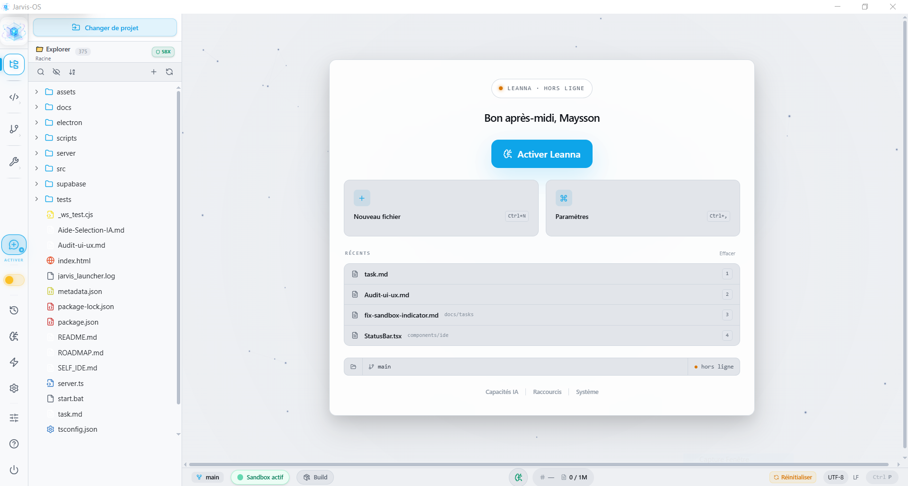
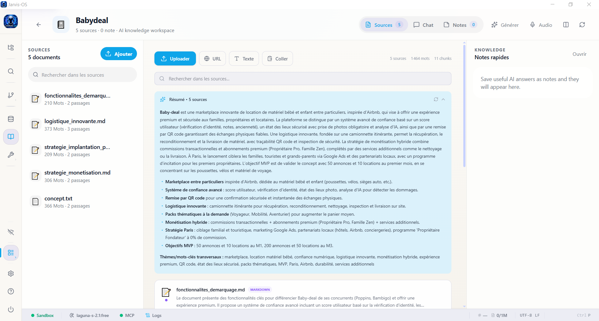
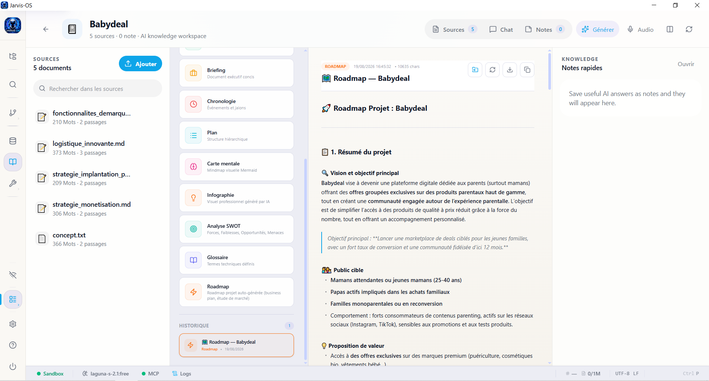

<p align="center">
  
</p>

<h1 align="center">🧠 Jarvis OS</h1>

<p align="center">
  <strong>Système d'exploitation IA multimodal — IDE intelligent, agents autonomes & notebooks RAG</strong>
</p>

<p align="center">
  
  
  
  
  
  
</p>

---

## 📋 Table des matières

- [Présentation](#-présentation)
- [Stack technique](#-stack-technique)
- [Fonctionnalités](#-fonctionnalités)
- [Screenshots](#-screenshots)
- [Installation](#-installation)
- [Configuration](#-configuration)
- [Lancement](#-lancement)
- [Architecture](#-architecture)
- [API Backend](#-api-backend)
- [Skills & Outils IA](#-skills--outils-ia)
- [Sécurité](#-sécurité)
- [Contribution](#-contribution)
- [Licence](#-licence)

---

## 🎯 Présentation

Jarvis OS est un **environnement de développement IA** tout-en-un, conçu comme un OS desktop intelligent. Il combine :

- Un **IDE complet** (Monaco Editor, explorateur, recherche, Git)
- Un **assistant IA multimodal** (voix en temps réel, webcam, partage d'écran via Gemini Live)
- Un **assistant code** capable de lire, écrire, modifier, patcher et valider du code de manière autonome
- Un **système multi-agents** spécialisé dans la rédaction, le code et le traitement documentaire
- Des **notebooks RAG** (concurrent de NotebookLM — ingestion de sources, chat avec citations, génération de contenu)
- Un **moteur de workflows** et d'automatisation avec planification de missions autonomes
- Une **passerelle MCP** (Model Context Protocol) pour connecter des outils externes

---

## 🔧 Stack technique

| Couche | Technologies |
|--------|-------------|
| **Frontend** | React 19, React Router 7, Tailwind CSS 4, Monaco Editor, Motion (animations), Lucide React, react-window |
| **Backend** | Node.js 22+, Express 4, WebSocket (ws), multer, compression |
| **IA** | Google Gemini 2.x (SDK `@google/genai`), OpenRouter (multi-modèles), embeddings `gemini-embedding-001`, Gemini Vision |
| **Desktop** | Electron 43, electron-builder (NSIS Windows) |
| **Bundling** | Vite 6, esbuild, tsx |
| **Persistance** | Système de fichiers JSON, Supabase (optionnel) |
| **Autres** | pdf-parse, puppeteer (scraping), marked (Markdown), mermaid (diagrammes), react-window (virtualisation) |

---

## ✨ Fonctionnalités

### 💻 IDE Intelligent

- Éditeur Monaco (syntaxe, autocomplétion, multi-fichiers, multi-onglets)
- Explorateur de fichiers avec arbre interactif
- Recherche globale dans le projet (Ctrl+Shift+F)
- Sandbox IA isolé pour les modifications assistées (validation avant merge)

### 🤖 Assistant Code (Leanna)

Leanna peut gérer, créer et modifier du code **directement dans le workspace** sans délégation obligatoire :

#### Lecture
- `read_project_file` — lecture partielle ou complète avec numéros de ligne, hash MD5, preview début+fin pour les gros fichiers
- `read_file_outline` — structure d'un fichier (fonctions, classes, exports) avec numéros de ligne
- `search_in_files` — recherche textuelle ou regex avec lignes de contexte, numéro de colonne et prévisualisation de remplacement
- `list_project_files` — exploration avec filtrage par extension et stats (dates, taille)

#### Écriture & Modification
- `write_project_file` — création ou écrasement complet + mode `append` pour ajouter en fin de fichier
- `modify_project_file` — remplacement de texte exact avec fuzzy match et suggestions de correction si le `searchText` n'est pas trouvé
- `patch_project_file` — patch par numéros de ligne (replace / insert / delete)
- `apply_patch` — application de diff unifié (format `git diff`) avec tolérance whitespace sur les lignes de contexte
- `rename_project_file` — renommage et déplacement
- `delete_project_file` / `delete_project_folder` — suppression avec garde-fous

#### Exécution & Validation
- `run_project_command` — exécute `npm`, `npx` ou `node` dans le workspace (`npm run build`, `npm install axios`, `npx tsc --noEmit`, etc.)
- `verify_file` — lint + typecheck TypeScript + analyse sécurité sur un fichier modifié
- `verify_typecheck` — vérification TypeScript complète du projet
- `verify_syntax` — validation syntaxique instantanée avant écriture

#### Workflow code intégré
1. `read_file_outline` → identifier la structure
2. `read_project_file` (startLine/endLine) → lire la section précise
3. `modify_project_file` ou `patch_project_file` → appliquer le changement
4. `verify_file` → valider avant de terminer

### 🎙️ Assistant Multimodal (Gemini Live)

- **Voix en temps réel** : Dictée, commandes vocales, réponses audio
- **Vision webcam** : Analyse de documents physiques ou schémas manuscrits
- **Partage d'écran** : Capture et interprétation du contenu affiché
- **Chat textuel** : Conversation avec historique, streaming SSE, contexte persistant

### 🤖 Système Multi-Agents

7 agents documentaires spécialisés avec orchestration automatique :

| Agent | Rôle | Capacité |
|-------|------|----------|
| ✍️ **Rédacteur** | Rédaction de documents complets | Lecture/Écriture |
| 🎨 **Mise en forme** | Formatage Markdown, tables, TOC | Lecture/Écriture |
| 🔍 **Recherche** | Collecte d'infos, vérification de faits | Lecture seule |
| ✅ **Correcteur** | Orthographe, grammaire, cohérence | Lecture/Écriture |
| 🌐 **Traducteur** | Traduction et localisation multilingue | Lecture/Écriture |
| 📋 **Synthèse** | Résumés exécutifs, abstracts | Lecture/Écriture |
| 📐 **Planificateur** | Plans, outlines, structures | Lecture seule |

**Patterns de collaboration :**
- `document-complet` : Planificateur → Rédacteur → Correcteur → Mise en Forme
- `traduction-verifiee` : Rédacteur → Traducteur → Correcteur
- `recherche-redaction` : Recherche → Planificateur → Rédacteur → Correcteur

**Flotte d'agents autonomes** et **missions planifiées** pour des tâches complexes multi-étapes.

### 📓 Notebooks RAG (style NotebookLM)

- **Sources multiples** : Upload fichiers (PDF, DOCX, MD, HTML, images PNG/JPG/WebP, CSV, JSON, YAML), ingestion d'URLs, texte collé, paste depuis le presse-papier
- **Support images** : Upload d'images avec analyse Vision IA (OCR, description visuelle), affichage inline dans le viewer
- **Rendu HTML visuel** : Les fichiers HTML uploadés sont rendus visuellement dans une iframe avec toggle Visuel/Texte
- **Recherche hybride** : Embeddings sémantiques (Gemini) + TF-IDF lexical + Reciprocal Rank Fusion + Re-ranking LLM (5 stratégies de parsing)
- **Chat groundé** : Questions/réponses avec citations précises et score de pertinence
- **Conversations multiples** : Threads de chat séparés par notebook, switch instantané, titrage automatique
- **Deep Dive** : Mode exploration approfondie multi-étapes
- **Comparaison de sources** : Analyse des similitudes, différences et contradictions entre 2+ sources
- **Extraction d'insights** : Détection automatique des tendances, connexions cachées et points de vigilance
- **Mode Focus Sources** : Sélectionner quelles sources utiliser pour une question spécifique
- **Personnalités IA** : 6 tons disponibles (Standard, Académique, Vulgarisateur, Concis, Détaillé, Créatif)
- **Commandes slash** : `/résume`, `/compare`, `/quiz`, `/insights`, `/glossaire`, `/plan`
- **Voice Input** : Dictée vocale via Web Speech API (français)
- **TTS** : Lecture audio des réponses avec contrôle play/stop
- **Retry / Regenerate** : Régénérer une réponse en un clic
- **Edit & Resend** : Modifier un message utilisateur et relancer la conversation
- **Copy to clipboard** : Copier n'importe quelle réponse
- **Feedback** : Thumbs up/down pour noter la qualité des réponses
- **Stop streaming** : Arrêter la génération en cours avec sauvegarde partielle
- **Token counter** : Estimation en temps réel des tokens utilisés par conversation
- **Sauvegarde en notes** : Enregistrer une réponse du chat directement dans les notes du notebook
- **Génération de contenu** :
  - Résumé synthétique
  - FAQ (15-20 Q&R)
  - Guide d'étude (concepts, quiz, auto-évaluation)
  - Briefing exécutif
  - Chronologie
  - Plan structuré
  - Carte mentale (rendu Mermaid visuel)
  - Analyse SWOT (forces, faiblesses, opportunités, menaces)
  - Glossaire (termes techniques, acronymes)
  - Infographies (génération d'images IA)
- **Génération en streaming** : Contenu affiché en temps réel avec design pro
- **Filtrage de sources** : Sélection des sources spécifiques pour la génération
- **Instructions personnalisées** : Prompt custom pour guider le style et le focus
- **Import au workspace** : Exporter un document généré directement dans le projet
- **Export Markdown** : Télécharger tout document en fichier .md
- **Régénérer** : Relancer la génération si le résultat ne convient pas
- **Audio Overview** : Script de podcast IA (deux hôtes discutent de vos sources)
  - Vitesse de lecture variable (1x → 2x)
  - Progression synchronisée (karaoké)
  - Download du script en Markdown
  - Personnalisation du ton et instructions custom
- **Notes avancées** :
  - Templates (Cornell, Résumé, To-do, Compte-rendu)
  - Recherche full-text et tri (récentes, anciennes, A→Z)
  - Export de toutes les notes en Markdown
  - Épinglage et organisation
  - **Vue Canvas** : Espace 2D pour organiser visuellement les notes (drag & drop, zoom, pan)
  - **Backlinks** : Détection automatique des mentions entre notes avec liens visuels
- **Sources** :
  - Preview du contenu inline
  - Rendu visuel HTML (iframe sandboxée)
  - Affichage d'images (PNG, JPG, WebP) avec description IA
  - Re-indexing (re-embed après mise à jour du modèle)
  - Tags custom (ajout/suppression inline)
  - Suppression individuelle (icône au hover)
  - Paste depuis le presse-papier
  - Résumé global automatique de toutes les sources
- **UX** :
  - Skeletons de loading cohérents
  - Breadcrumb navigation (Notebooks > Titre > Onglet)
  - Raccourcis clavier (Ctrl+1-5 onglets, Ctrl+N notes, Ctrl+F chat)
  - Formatage riche des réponses (bold, italic, code, tables, blockquotes, liens)

### 🧠 Moteur de Connaissances

- Indexation automatique du workspace (fichiers, code, dépendances)
- Graphe de relations entre fichiers et entités
- Recherche sémantique sans API externe
- Analyse d'impact avant modification
- Détection de contradictions entre documents
- Mémoire projet (conventions, préférences de style)

### ⚙️ Automatisation & Workflows

- Workflows documentaires orchestrés (pipelines de traitement)
- Tâches planifiées (cron-like) avec déclencheurs
- Missions autonomes avec planification IA
- Exécution parallèle ou séquentielle avec dépendances
- Navigation web automatisée (Puppeteer)

### 🌐 Navigateur Web Intégré (BrowserPanel)

Navigateur embarqué basé sur Electron `<webview>`, **pilotable en temps réel par l'IA via le protocole CustomEvents** (`useLiveAPI` → `jarvis-browser-*`).

#### Commandes disponibles pour l'IA

| Événement dispatché | Action |
|---|---|
| `jarvis-ide-action` `open-browser` / `close-browser` | Ouverture / fermeture du panneau navigateur |
| `jarvis-ide-action` `browser-navigate` | Navigation vers une URL donnée |
| `jarvis-browser-scroll` | Défilement (top/bottom/up/down) |
| `jarvis-browser-control` | **Recul** (`browser-back`), **Avance** (`browser-forward`), **Rechargement** (`browser-reload`) |
| `jarvis-browser-read-request` | **Lecture de contenu** — extraction du texte visible de la page (ou d'un sélecteur CSS cible) et retour via `/api/browser/content-result` |

#### Flux de lecture de page (`browser_read_content`)

1. Le skill émet `emitIdeAction({ type: "browser-read-request", requestId, selector })`
2. `useLiveAPI` dispatcher l'action via `jarvis-ide-action` **et** émet directement `jarvis-browser-read-request`
3. `BrowserPanel` capte l'événement, injecte un script d'extraction dans la webview, nettoie scripts/styles/nav/footer, tronque à 8000 caractères
4. Résultat renvoyé au backend via `POST /api/browser/content-result` avec `requestId`
5. L'IA reçoit le contenu et peut poursuivre sa tâche (analyse, synthèse, recherche d'infos…)

#### Fonctionnalités UI

- Barre d'adresse avec normalisation automatique (URL, domaine ou recherche Google)
- Badge visuel « Leanna » quand l'assistant pilote la navigation
- Indicateur HTTPS / erreurs de chargement
- Boutons Précédent / Suivant / Actualiser / Accueil
- Notifications d'événements : `jarvis-browser-navigated`, `jarvis-browser-title-updated`, `jarvis-browser-load-error`

### 🏗️ Infrastructure Backend

- **Rate limiting ciblé** : Limiteurs dédiés pour chat (30 req/min), embeddings (50/5min), polling (relaxé), auth (strict)
- **Gestion mémoire intelligente** : LRU éviction des embeddings par notebook, lazy loading depuis le disque, limite configurable (50K vecteurs/~50MB)
- **Backup automatique** : Sauvegarde incrémentale toutes les 30 min, rotation (10 backups max), restauration par notebook ou globale
- **Queue de processing** : File d'attente pour l'ingestion de sources (concurrence ×2, retry exponentiel, priorités, annulation)
- **Cache intelligent** : Cache LRU avec TTL + matching par similarité Jaccard pour les questions proches, invalidation auto quand les sources changent
- **Circuit breaker client** : Protection contre les cascades d'erreurs réseau (auto-recovery après 8s)

### 🔌 Passerelle MCP

- Connexion à chaud de serveurs MCP (stdio & SSE)
- Invocation d'outils externes depuis l'IA
- Interface de gestion intégrée

### 📄 Gestion Documentaire

- Création assistée de documents structurés
- Templates intelligents (MVP, rapport, cahier des charges, specs, roadmap)
- Export multi-format (Markdown, PDF, DOCX)
- Analyse croisée de documents
- Versionning avec rollback

### 🔗 Intégrations

- **Supabase** : Persistance, mémoire long terme
- **OpenRouter** : Modèles alternatifs (GPT-4o, Claude, Llama, etc.)

---

## 📸 Screenshots

<p align="center">
  
</p>
<p align="center">
  
</p>
<p align="center">
  
</p>

---

## 📦 Installation

### Prérequis

- **Node.js** ≥ 22.12.0
- **npm** ≥ 10.x
- **Clé API Gemini** (Google AI Studio)
- **Clé API OpenRooter**

### Étapes

```bash
# 1. Cloner le dépôt
git clone https://github.com/moonback/Jarvis-OS.git
cd Jarvis-OS

# 2. Installer les dépendances
npm install

# 3. Configurer l'environnement
cp .env.example .env
# Renseigner au minimum GEMINI_API_KEY dans .env
```

---

## ⚙️ Configuration

### Variables d'environnement (.env)

| Variable | Description | Obligatoire |
|----------|-------------|:-----------:|
| `GEMINI_API_KEY` | Clé API Google Gemini | ✅ |
| `JARVIS_API_TOKEN` | Token de sécurité des endpoints | Recommandé |
| `SUPABASE_URL` | URL de l'instance Supabase | Non |
| `SUPABASE_SERVICE_ROLE_KEY` | Clé service Supabase | Non |
| `OPENROUTER_API_KEY` | Clé OpenRouter (modèles alternatifs) | Non |
| `GITHUB_TOKEN` | Token GitHub (repos, issues, PRs) | Non |
| `ENABLE_CHAIN_OF_THOUGHT` | Afficher le raisonnement IA (true/false) | Non |
| `SANDBOX_EXIT_CODE` | Code de sécurité pour sortir du sandbox | Non |

### Pool de clés Gemini

Jarvis OS supporte un **pool de clés API** avec rotation automatique (round-robin + retry sur 429). Les clés sont stockées chiffrées dans `.gemini-keys.json`. Gestion via l'UI Paramètres.

---

## 🚀 Lancement

### Mode Web (développement)

```bash
npm run dev
```

Serveur accessible sur `http://localhost:5000`

### Mode Desktop (Electron)

```bash
# Avec DevTools
npm run desktop:debug

# Sans DevTools
npm run desktop
```

### Mode Production

```bash
npm run build
npm start
```

### Build installateur Windows

```bash
npm run dist:win
```

Génère un `.exe` (NSIS) dans le dossier `release/`.

## Build executeur Windows

```bash
npm run pack:win
```

Génère un `.exe` (NSIS) dans le dossier `win-unpacked/`.

---

## 🏗️ Architecture

```
Jarvis-OS/
├── assets/                    # Images, icônes, splash screen
├── electron/                  # Process principal Electron (main, preload, splash)
├── server/                    # Backend Express + WebSocket
│   ├── agents/                # Orchestrateur multi-agents, boucle autonome, persistence
│   ├── autonomy/              # Boucle autonome supervisée
│   ├── knowledge/             # Indexation, graphe, recherche sémantique
│   ├── mcp/                   # Bridge MCP (stdio/SSE)
│   ├── mission/               # Planificateur de missions autonomes
│   ├── notebooks/             # RAG Engine (11 modules)
│   │   ├── NotebookManager    # CRUD notebooks, sources, notes
│   │   ├── SourceIngester     # Extraction texte (PDF, HTML, images, URL)
│   │   ├── EmbeddingStore     # Vectorisation Gemini + stockage LRU
│   │   ├── RAGEngine          # Recherche hybride (embeddings + TF-IDF + RRF)
│   │   ├── GroundedChat       # Chat avec citations et re-ranking
│   │   ├── ContentGenerator   # Génération de contenu (résumés, FAQ, infographies...)
│   │   ├── BackupService      # Sauvegarde automatique incrémentale
│   │   ├── ProcessingQueue    # File d'attente async pour ingestion
│   │   └── ResponseCache      # Cache LRU intelligent avec invalidation
│   ├── prompts/               # Instructions système (SystemPromptBuilder)
│   ├── routes/                # 32 fichiers de routes REST
│   ├── runtime/               # ToolRegistry, AgentRuntime, StateMachine
│   ├── skills/                # 22 skills IA (codebase, git, memory, automation...)
│   ├── utils/                 # Logger, crypto, sandbox, validation, key pool, textGeneration
│   └── workflows/             # Moteur de workflows documentaires
├── src/                       # Frontend React 19
│   ├── components/            # 60+ composants
│   │   ├── notebooks/         # 11 composants notebook (Chat, Sources, Notes, Canvas, Audio...)
│   │   ├── ide/               # IDE (Editor, Explorer, Terminal, Git)
│   │   └── ui/                # Composants UI réutilisables (Toast, Skeleton...)
│   ├── config/                # Configuration sidebar, thèmes
│   ├── context/               # Providers (Theme, Profile, LiveAPI, ScreenShare)
│   ├── hooks/                 # Custom hooks
│   ├── services/              # Clients HTTP
│   ├── types/                 # Types centralisés
│   └── views/                 # 10 vues (IDE, Notebooks, Memories, Settings...)
├── server-bootstrap.ts        # Point d'entrée serveur (env, crypto, validation)
├── server.ts                  # Serveur Express + WebSocket + Gemini Live
├── index.html                 # Shell HTML Vite
├── package.json               # Scripts, dépendances
└── vite.config.ts             # Configuration Vite + plugins
```

---

## 🌐 API Backend

32 groupes de routes REST :

| Route | Description |
|-------|-------------|
| `/api/agents` | Orchestration multi-agents |
| `/api/automation` | Tâches planifiées & automatisation |
| `/api/browser` | Intégration navigateur (contenu lu depuis BrowserPanel : `content-result`) |
| `/api/conversations` | Sessions de chat |
| `/api/custom-agents` | Agents personnalisés (Agent Builder) |
| `/api/custom-skills` | Skills créées par l'utilisateur |
| `/api/documents` | Gestion et analyse documentaire |
| `/api/generate-agent` | Génération dynamique d'agents |
| `/api/git` | Opérations Git (status, commit, branches) |
| `/api/github` | Intégration GitHub (repos, issues, PRs) |
| `/api/health` | Monitoring & santé système |
| `/api/ide` | Opérations IDE (fichiers, terminal) |
| `/api/impact` | Analyse d'impact avant modification |
| `/api/knowledge` | Base de connaissances, indexation |
| `/api/lists` | Listes et to-do |
| `/api/mcp` | Gestion des serveurs MCP |
| `/api/memories` | Mémoire long terme |
| `/api/notebooks` | Notebooks RAG (sources, chat, génération, audio, threads, notes) |
| `/api/openrouter` | Configuration OpenRouter |
| `/api/profile` | Profil utilisateur, préférences IA |
| `/api/safeguards` | Garde-fous de sécurité |
| `/api/sandbox` | Environnement sandbox isolé |
| `/api/self-root` | Gestion du self-root |
| `/api/skills` | Registry des outils IA |
| `/api/summarize-context` | Optimisation contexte LLM |
| `/api/tokens-optimization` | Gestion des tokens |
| `/api/tts` | Synthèse vocale (Text-to-Speech) |
| `/api/understanding` | Moteur de compréhension |
| `/api/upload-document` | Upload et analyse de documents |
| `/api/workflows` | Moteur de workflows |
| `/api/workspace` | Gestion du workspace |

> Les skills `codebase`, `verify` et `system` sont chargées au démarrage (critical skills) et disponibles immédiatement sans `request_tools`.

---

## 🛠️ Skills & Outils IA

L'IA dispose de 22+ skills regroupées par domaine :

| Skill | Outils principaux |
|-------|------------------|
| **codebase** | `read_project_file`, `read_file_outline`, `search_in_files`, `list_project_files`, `write_project_file` (+ append), `modify_project_file` (+ fuzzy match), `patch_project_file`, `apply_patch` (+ tolérance whitespace), `rename_project_file`, `delete_project_file`, `delete_project_folder`, `create_project_directory` |
| **verify** | `verify_file` (lint + typecheck + sécurité), `verify_typecheck`, `verify_syntax`, `verify_lint`, `verify_security`, `verify_full` |
| **system** | `run_project_command` (npm/npx/node), `system_execute_command`, `system_info`, `system_notify`, `system_open` |
| **git** | Status, commit, push, branches, diff |
| **github** | Issues, PRs, repos, review |
| **automation** | Tâches planifiées, navigation web (Puppeteer) |
| **browser** | `browser_navigate`, `browser_search`, `browser_open`, `browser_read_content` (lecture page + sélecteur CSS) |
| **knowledge** | Indexation, recherche sémantique, graphe de dépendances, analyse d'impact |
| **documentKnowledge** | Connaissance documentaire spécialisée |
| **documentLinker** | Liaisons et analyse croisée entre documents |
| **memory** | Stockage/récupération de mémoires persistantes (Supabase + embeddings) |
| **mission** | Planification et exécution de missions autonomes |
| **agents** | Délégation à des agents spécialisés (coder, test, docs, refactor, security, review, architect) |
| **reasoning** | Chain-of-thought, décomposition de problèmes (`reasoning_think`) |
| **richDocument** | `create_rich_document` — tableaux, graphiques, KPI, listes interactifs |
| **workflow** | Exécution de pipelines documentaires |
| **time** | Heure, date, timestamps |
| **weather** | Informations météo |
| **guidelines** | Conventions de code, style guides |
| **history** | Historique des sessions et conversations |
| **list** | Gestion de listes et to-do |
| **project** | Scaffold de nouveaux projets (React, Next, Vite, etc.) |
| **aiStudioDirectives** | Directives techniques pour la génération IA Studio |
| **customSkills** | Skills définies par l'utilisateur |

---

## 🔐 Sécurité

- **Authentification** : Token `x-jarvis-token` sur tous les endpoints API
- **Chiffrement** : Clés API et secrets chiffrés au repos (AES)
- **Sandbox** : Modifications IA isolées, validation manuelle avant merge
- **Rate limiting** : Protection multi-couche (global strict, polling relaxé, auth brute-force, notebook chat/embedding dédié) + **30 écritures fichiers/min max**
- **Audit trail** : Journalisation de toutes les actions sensibles (write, modify, patch, delete) avec diff résumé
- **Fichiers critiques** : Confirmation utilisateur interactive obligatoire avant toute modification (`.env`, `package.json`, `server.ts`, etc.) — fail-closed en contexte autonome
- **Garde-fous écriture** : `isWriteForbidden` bloque les fichiers système (`.git`, `.env`) ; chemins validés contre le workspace, pas de path traversal
- **run_project_command** : Seuls `npm`, `npx`, `node` autorisés ; commandes modifiant `node_modules` nécessitent confirmation interactive ; caractères shell dangereux bloqués
- **Circuit breaker** : Protection côté client contre les cascades d'erreurs réseau
- **Injection guards** : Protection contre l'injection de prompts
- **Backup & Recovery** : Sauvegarde automatique incrémentale (checkpoint Git avant chaque écriture) avec restauration granulaire
- **Memory management** : Éviction LRU pour prévenir les fuites mémoire sur les embeddings
- **Iframe sandbox** : Rendu HTML isolé (sans scripts) pour les sources HTML

---

## 🤝 Contribution

Les contributions sont les bienvenues !

```bash
# Lancer les tests
npm test

# Lancer le linter
npm run lint

# Build complet
npm run build
```

### Guidelines

- TypeScript strict partout
- Commits conventionnels (feat:, fix:, refactor:, docs:)
- Tests unitaires pour les nouvelles skills
- Documentation des endpoints REST

---

## 📄 Licence

Distribué sous licence **MIT**. Voir [LICENSE](LICENSE) pour plus de détails.

---

<p align="center">
  <sub>Construit avec ❤️ et beaucoup de Gemini par l'équipe Jarvis OS</sub>
</p>
