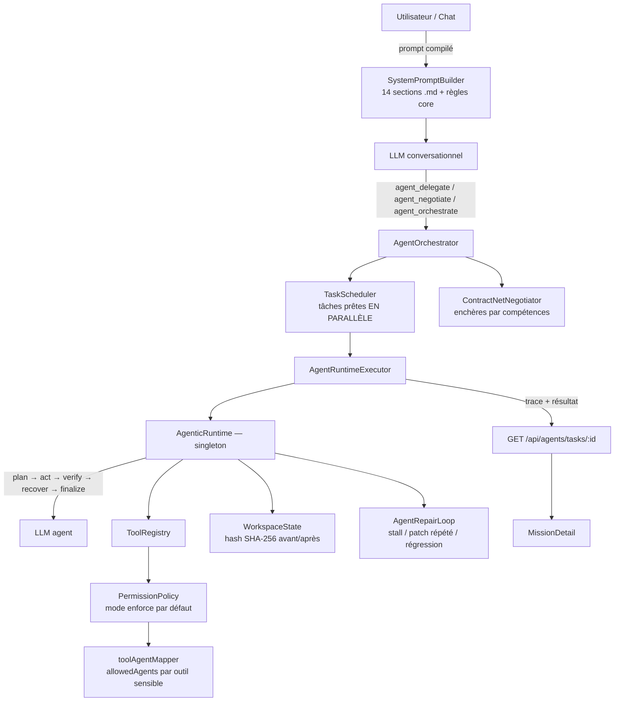

# Analyse de l'architecture des agents Leanna

> Périmètre : runtime agentique, orchestration multi-agents, prompts système (chat + agents), autorisations d'outils, et l'UI de suivi des missions.
> Ce document liste ce qui a été **corrigé** dans cette passe et ce qui reste **recommandé**, avec le fichier en cause à chaque fois.

---

## 1. Vue d'ensemble



### Les deux couches de prompts

| Couche | Source | Rôle | Taille |
|---|---|---|---|
| Prompt principal (chat) | `server/runtime/prompts/*.md` compilés par `SystemPromptBuilder` (ContextResolver → RuleRegistry → ConflictResolver → SectionRegistry → PromptCompiler) | Identité, sécurité, routage direct/délégation, efficacité, autonomie | ~65 Ko de Markdown source |
| Prompt d'agent | `server/agents/roles.ts` : `BASE_SYSTEM_PROMPT` + sections par rôle (identité, mission, processus, règles, interdictions, critères) | Comportement d'un spécialiste dans la boucle agentique | ~5,6 Ko par rôle (20 rôles) |
| Injections runtime | `ToolPromptBuilder` (outils, budget, historique), `phasePrompts` (guidage de phase), `AgenticRuntime.plan/execute` (plan, étape) | Contexte du tour courant | variable (historique ≤ 60 000 car.) |

### La boucle agentique (`server/runtime/agentic/AgenticRuntime.ts`)

1. **Plan** : un appel LLM produit un JSON `{intent, successCriteria, steps[]}`.
2. **Act** : chaque étape = **un** tour LLM qui renvoie des `tool_calls` JSON (texte), exécutés via le `ToolRegistry`.
3. **Verify** : tout fichier écrit est vérifié par `verify_file` (preuve hashée) ; un échec d'outil invalide l'étape.
4. **Recover** : `AgentRepairLoop` décide retry / replan / abort selon le progrès réel.
5. **Finalize** : synthèse de la mission.

Le tout est borné par un budget à réserves étanches (lecture 8, plan 3, écriture 9, vérification 6, récupération 4).

La conception est solide : preuve plutôt que narration, budgets étanches, réparation déterministe. Les problèmes trouvés sont surtout des **défauts d'intégration** entre ces briques, dont plusieurs annulaient en pratique la qualité du modèle.

---

## 2. Défauts critiques (corrigés)

### C1 — Sessions concurrentes écrasées
- **Où** : `AgenticRuntime` stockait la session dans `this.session`, alors que le runtime est un **singleton** et que `TaskScheduler` lance les tâches prêtes avec `Promise.allSettled`.
- **Effet** : pendant un `await` de la tâche A, la tâche B écrasait la session. A planifiait/agissait avec **l'agent, les outils et le budget de B**, puis plantait sur « aucune session active » quand B se terminait. Toute orchestration parallèle était donc corrompue.
- **Correctif** : la session vit dans un `AsyncLocalStorage` propre à chaque `run()`. Le test `agentPerformance.test.ts` reproduit le plantage sur l'ancien code.

### C2 — L'agent ne voyait que 500 caractères de ce qu'il lisait
- **Où** : `buildObservationHistory` → `previewResult` tronquait **chaque** résultat d'outil à 500 caractères. `clampResult` ne bornait que les chaînes, et les objets passaient tels quels jusqu'à cette troncature.
- **Effet** : un `read_project_file` n'exposait que le début du fichier, donc le `searchText` d'un `modify_project_file` devenait introuvable et l'agent bouclait. Les `parsedErrors` de `verify_typecheck` étaient coupés derrière `stdout` : l'agent réparait sans voir l'erreur.
- **Correctif** (`ToolPromptBuilder.renderResultForModel`) :
  - les 2 tours les plus récents sont rendus jusqu'à 8 000 caractères par résultat, les plus anciens en version compacte ;
  - le contenu de fichier est rendu en texte brut au lieu de JSON échappé (plus lisible, moins de jetons) ;
  - statut, erreur et diagnostics structurés passent en premier, et `stdout`/`stderr` sont omis quand un diagnostic structuré existe ;
  - les gros contenus écrits ne sont plus recopiés dans l'historique ;
  - quand le budget d'historique est dépassé, ce sont les tours **anciens** qui sont abandonnés. L'ancien code tronquait la fin de la chaîne, donc le tour le plus récent.

### C3 — Écritures de plus de 2 Ko perdues silencieusement
- **Où** : `ToolCallParser.extractJsonObject` arrêtait le scan à 2 000 caractères, et le format 1 n'acceptait qu'un JSON pur.
- **Effet** : dès que le modèle entourait son JSON de ```` ```json ```` (fréquent avec Gemini) ou d'une phrase, on passait au format 3, qui perdait tout appel dont le contenu dépassait ~2 Ko. Le `write_project_file` disparaissait, puis le runtime relançait l'agent avec « tu n'as rien écrit ». C'est très probablement la cause des cas « 8 itérations, 0 fichier » documentés dans le code.
- **Correctif** : l'enveloppe `{"tool_calls": …}` est retrouvée même préfixée ou dans un bloc de code, et la borne de scan passe à 500 Ko.

### C4 — 21 capacités déclarées mais refusées à l'exécution
- **Où** : les `capabilities` de `roles.ts` et les `allowedAgents` de `toolAgentMapper.ts` n'étaient pas alignés. La `PermissionPolicy` est en mode `enforce` par défaut.
- **Effet le plus grave** : `writer`, `formatter`, `documentation`, `planner`, `proofreader` et `performance` déclarent `verify_file`. Le runtime **appelle automatiquement** `verify_file` après chaque écriture, l'appel était refusé, donc **chaque livrable de ces agents échouait sa vérification** et partait en boucle de réparation. `refactor` ne pouvait lancer aucune de ses 5 vérifications.
- **Correctif** : les listes `allowedAgents` des outils `verify_*` couvrent désormais tous les rôles qui les déclarent (ces outils ne modifient pas le code). Deux capacités contradictoires ont été retirées : `run_project_command` pour `security` (agent en lecture seule) et `delete_project_file` pour `writer`. Un script de contrôle montre 0 désalignement restant.

### C5 — Cache de lecture jamais invalidé
- **Où** : `session.readCache` n'était vidé par aucune écriture.
- **Effet** : relire un fichier qu'on venait de modifier renvoyait l'**ancien** contenu, et l'agent re-patchait une version périmée.
- **Correctif** : `invalidateReadCache` après chaque écriture réussie retire les entrées du fichier ainsi que les recherches et listings. Un renommage ou une suppression vide tout le cache.

---

## 3. Défauts majeurs des prompts (corrigés)

### M1 — Trois contrats de sortie contradictoires, dont aucun n'était lu
- `BASE_SYSTEM_PROMPT` exigeait un rapport XML `<result>`.
- `SECTION_OUTPUT_FORMAT`, ajouté à **chaque** rôle, exigeait en parallèle des titres Markdown `## Résumé / ## Détails / ## Recommandations`.
- `ToolPromptBuilder` demandait « une réponse finale en texte ».
- `finalize()` relançait un **appel LLM supplémentaire** pour tout re-synthétiser en JSON, et `ResultParser` ne lisait que le Markdown.

**Correctif** : un seul contrat, le XML `<result status files_modified>` avec `summary`, `deliverable` et `notes`, lu par `FinalReportParser`.
- Le runtime l'exploite directement, ce qui économise un appel LLM par mission dès que l'agent termine proprement.
- Le parseur legacy le comprend aussi, y compris le statut `failed` / `needs_input`.
- Les prompts d'agent font 14 % de moins en moyenne (6,5 → 5,6 Ko par rôle) malgré un protocole plus explicite.

### M2 — Outil fantôme `run_tests`
`base.md`, `autonomy.md` et `phasePrompts.ts` exigeaient `run_tests`, qui **n'existe pas**. Ces références pointent maintenant vers `verify_run_script({ script: "test" })`, ajouté aux rôles `coder`, `refactor`, `debugger` et `tester`, ainsi qu'à la liste des outils exécutables et à la classification « verify » du runtime.

### M3 — Délégations ignorées en mode agentique
Le socle imposait « DÉLÉGATION OBLIGATOIRE … bloc ## DÉLÉGATION », mais `AgentRuntimeExecutor`, le moteur actif, ne lisait jamais ces blocs : elles étaient perdues. Elles sont désormais extraites en `proposedDelegations` structurées et **proposées** à l'utilisateur, conformément à la règle « pas de délégation automatique non sollicitée » d'`agents-system.md`.

### M4 — L'agent perdait le fil du plan
Chaque tour ne voyait que l'étape courante, sans le plan ni les critères de succès. Les plans n'étaient pas bornés, alors que chaque étape coûte au moins un tour.
- **Correctif** : le prompt de chaque tour inclut la liste d'étapes avec leur statut (`[x]`, `[▶]`, `[!]`), les critères de succès, les instructions et les fichiers de contexte.
- Le plan est limité à 6 étapes. La planification impose aussi une étape d'écriture suivie d'une étape de vérification pour les agents qui produisent un artefact, et des critères observables.

### M5 — Aucun raisonnement autorisé
`thinkingBudget: 0` combiné à « aucune verbalisation du raisonnement » empêchait l'agent de raisonner. Le protocole autorise maintenant une ligne `Pensée : …` (2 phrases au plus) avant le JSON. Elle est conservée dans l'historique, ce qui aide l'agent à garder le fil pour un coût minime.

### Réécriture du socle `BASE_SYSTEM_PROMPT`
Le socle est réorganisé en blocs nets : principes, protocole de travail par tour, CI/CD, mémoire, rapport final, délégation (proposition seulement). Il ajoute aussi des règles d'édition concrètes :
- lire avant de modifier ;
- copier le `searchText` depuis la dernière lecture et relire en cas d'échec ;
- préférer un patch ciblé ;
- ne jamais répéter un appel identique ;
- `ok:true` n'est pas une preuve.

---

## 4. Fonctionnalités ajoutées

| Fonctionnalité | Backend | UI |
|---|---|---|
| **Plan d'exécution en direct** | `AgentTask.onTrace` émet un `ExecutionTrace` (intention, étapes et statuts, budget, récupérations) après la planification puis à chaque étape. Il est stocké sur la tâche et exposé par `GET /api/agents/tasks/:id`. | Section « Plan d'exécution » de `MissionDetail` : frise d'étapes colorée (fait / en cours / échec / à faire), avec l'étape active qui pulse. |
| **Jauges de budget** | idem (`execution.budget`) | Section « Budget consommé » : itérations et appels d'outils (couleur selon le seuil), répartition lecture / écriture / vérification / récupération. |
| **Délégations en un clic** | `TaskResult.proposedDelegations` + `POST /api/agents/delegate`, qui délègue directement si un rôle est indiqué, sinon met la tâche aux enchères (contract-net) | Section « Délégations proposées » : rôle, raison, fichiers cliquables, bouton **Lancer** avec états chargement / lancée / erreur. |
| **Rapport Markdown enrichi** | — | « Copier le rapport » inclut le plan coché et les délégations proposées. |

Le design réutilise les primitives existantes (`lea-steps`, `lea-mission-*`) et ne s'appuie que sur les tokens de thème (vérifié visuellement en thème sombre). Les animations respectent `prefers-reduced-motion`.

---

## 5. Recommandations (non implémentées)

Classées par rapport impact / effort.

1. **Appel d'outils natif** (`functionDeclarations` Gemini / `tools` OpenRouter) au lieu du JSON en texte libre. Cela supprime toute la classe de bugs de C3, garantit le typage des paramètres et ouvre l'appel parallèle natif. C'est le plus gros gain de fiabilité restant. Fichiers : `server/utils/textGeneration.ts`, `AgenticRuntime.execute`.
2. **Thinking ciblé** : un budget de réflexion non nul **uniquement** pour `plan()` et `recover()`, configurable par variable d'environnement. Les tours d'action gardent 0 pour la latence.
3. **Conversation multi-tours + context caching** : aujourd'hui, chaque tour re-sérialise prompt système, plan et historique dans un unique message. Une vraie conversation (messages modèle / outil) avec cache de préfixe réduirait fortement coût et latence sur les missions longues.
4. **Dédupliquer le prompt principal (~65 Ko source)** :
   - la règle Zero-Filler est répétée dans `base`, `efficiency`, `autonomy` et `browser` ;
   - la boucle PLAN→ACT→VERIFY dans `base`, `autonomy` et le prompt d'agent ;
   - le profil « haut potentiel » dans `base`, `fundamentals` et `chat`.

   Mesurer avec `SystemPromptBuilder.explain()` et viser −30 %.
5. **Externaliser les prompts de rôle** (`roles.ts`, 1 700 lignes) en `.md` par rôle, éditables via `/api/prompts` comme le prompt principal, avec un test de non-régression de taille et de contenu.
6. **Un seul moteur d'exécution** : `AgentExecutor` (legacy, 1 240 lignes), `AgentRuntimeExecutor`, `AutonomousAgent`/`AutonomousLoop` et le `brain` coexistent. Le legacy ne sert plus qu'en repli ; le supprimer allège le code et ôte une source de divergence de comportement.
7. **Banc d'évaluation par rôle** : étendre `scripts/test-agent-missions.mjs` en benchmark (taux de succès, itérations, coût par rôle), joué avec un modèle scripté en CI et avec le vrai modèle de façon périodique. Sans métrique, impossible de savoir si une modification de prompt améliore ou dégrade.
8. **Mémoire d'échecs par rôle** : enregistrer les causes d'échec récurrentes (ex. « searchText introuvable sur fichiers > 500 lignes ») et les injecter dans le prompt de planification du rôle.
9. **Budget adaptatif** : dimensionner le budget selon la complexité estimée au plan (nombre d'étapes, de fichiers) au lieu d'un budget fixe pour tous.
10. **Verrou d'audit en CI** : faire échouer la CI si une capacité déclarée n'est pas autorisée (contrôle C4). Le script utilisé pour cette analyse peut devenir un test.

---

## 6. Validation

- `npm run typecheck` : propre.
- Nouveaux tests serveur `server/runtime/agentic/agentPerformance.test.ts` (11 tests). Exécutés sur l'ancien code, ils reproduisent C1 (« aucune session active ») et C5 (lecture servie par le cache).
- Nouveau test UI `src/components/panels/MissionDetail.test.tsx` : rendu du plan, lancement d'une délégation.
- Suites agents, runtime et prompts : vertes. Seuls restent des échecs préexistants sur `main` sans lien avec cette passe (`SkillWorker`, chargement de module en worker).
